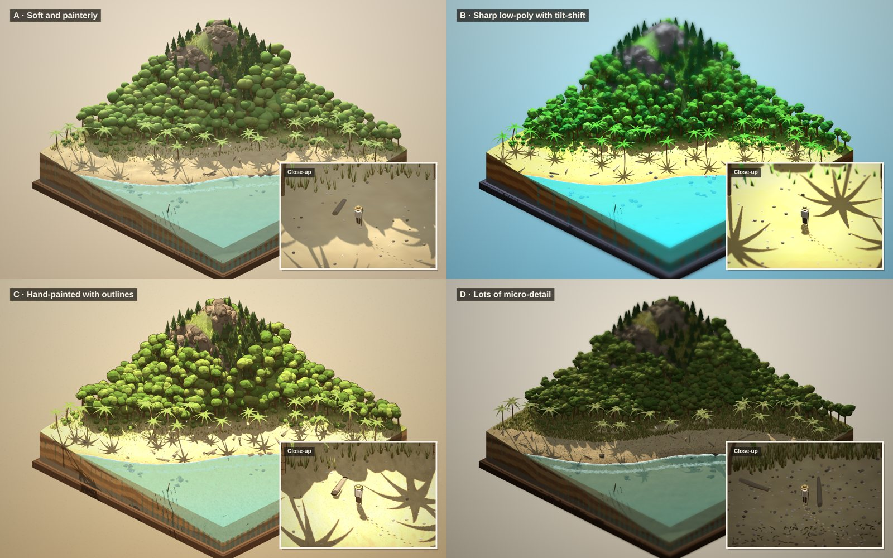
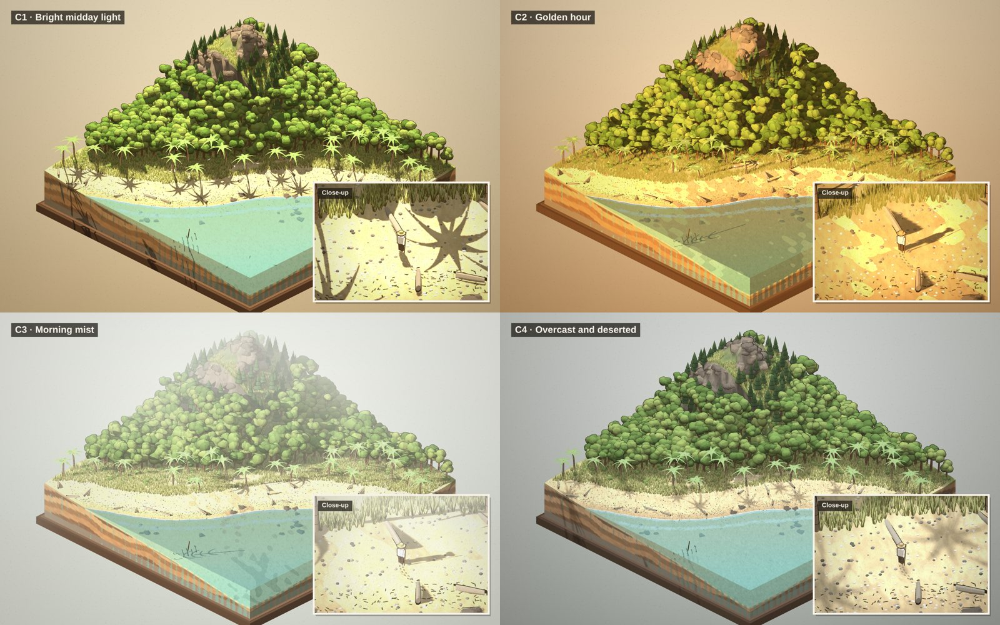
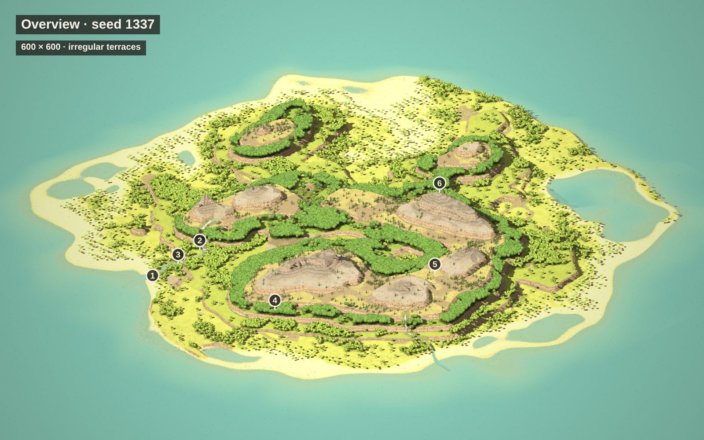
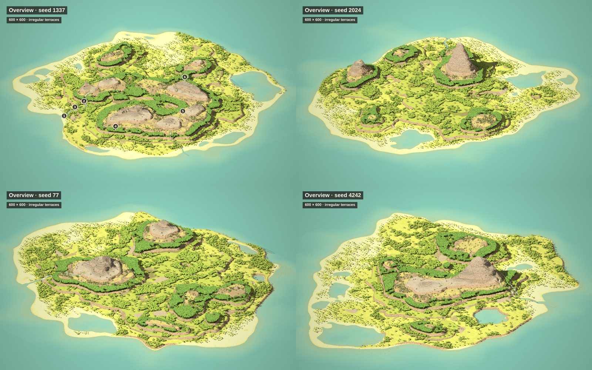
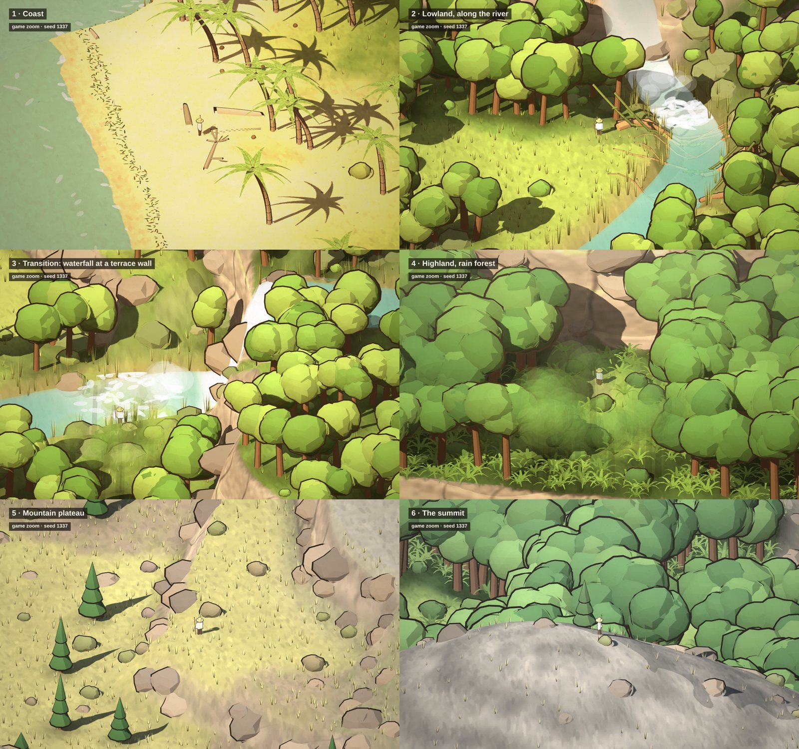
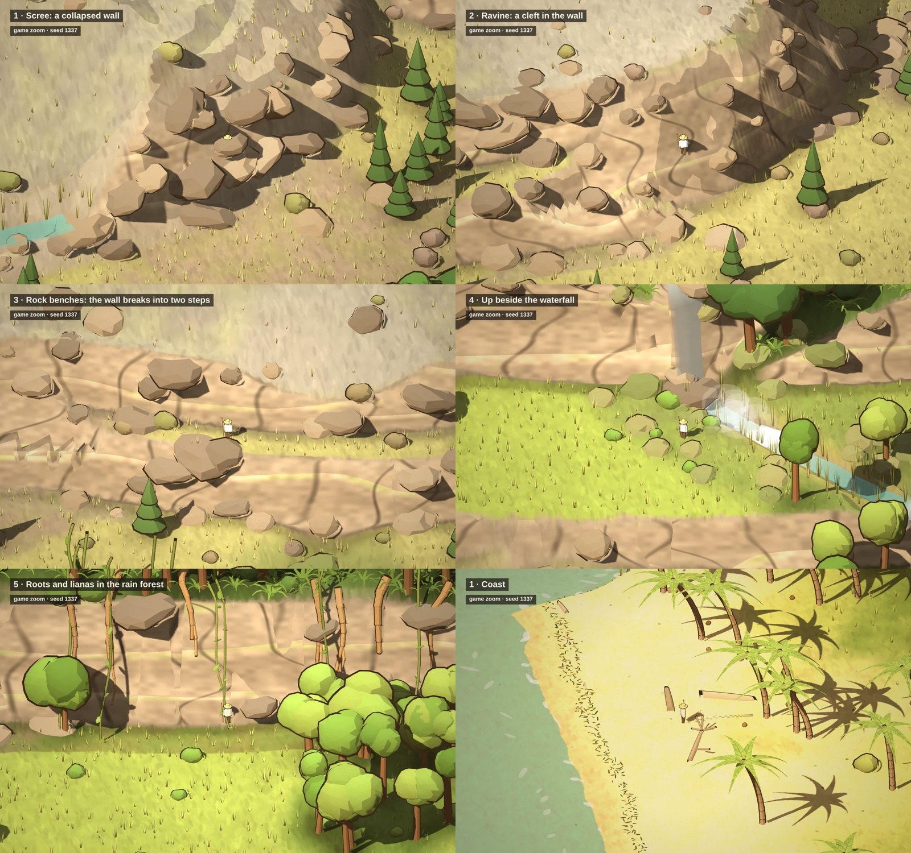

# Design of Driftwood

This document holds what has been **decided** about the game. Exploring happens in conversation; the results end up here. Keep it short and current: when a decision changes, change it here.

## Concept

A stylised, diorama-like survival game. You are completely alone on a large, wild island that you slowly get to know. The feeling of abandonment stays, but it is deliberately **not** a Robinson Crusoe story.

- **Feeling:** abandonment and loneliness. A small figure in a big landscape of beach, forest and mountain.
- **Tone:** realistic in what you do (no dungeons or fantasy), stylised in how it looks.
- **Core:** gathering, digging and building with driftwood and branches, and getting to know the island terrace by terrace. Since 0.28 you can also leave Dave alone: he looks after the ordinary things himself (water, food, a fire, sleep, a pile of wood) and you step in for the special ones. The direction (agreed 2026-11-04): lonely but not hostile, an honest hard life, he is not unhappy, cozy; the player watches Dave live and steps in for the special things (building, exploring).
- **Tension:** now and then strangers arrive by canoe. You do not know what they want. The threat works through hiding and avoiding, not fighting.
- **Scope:** small and lonely. The atmosphere matters most. New game elements are only added after discussion.

## Art style

Chosen: **style C, hand-painted with outlines.** Stylised and diorama-like, not realistic.

| Variant | Verdict |
|---|---|
| A · Soft and painterly | Nice, but too sweet |
| B · Sharp low-poly with tilt-shift | Far too harsh |
| C · Hand-painted with outlines | **Chosen** |
| D · Lots of micro-detail | Too dark |
| C1–C4 · C under other light (midday, golden hour, mist, overcast) | The original C stays the favourite |

Explored earlier and dropped: 2D pixel art, plain low-poly and voxels.

- **Colour:** warm, earthy tones. Sand, olive green, weathered wood. All colours live in `src/render/palette.js`.
- **Ground:** a painted texture with brush strokes.
- **Lighting:** toon shading in three light steps, bright midday light, soft warm colour grading. The sun follows its own path through the day (see *Day and night*); it stands still in the world when you turn the view, so shadows stay on the ground.
- **Outlines:** dark brown edges around trees, rocks, palm trunks and the castaway.
- **Detail:** leaf clusters, grass tufts, pebbles, shells and driftwood, at the level of the original style C.
- **Rock walls:** painted in the shader with strata, cracks and ledges, greyer higher up, so the texture never stretches on steep faces.
- **Water (0.14, built):** stylised and subtle, drawn only in the existing water shaders, with no extra objects. The river has light streaks and flecks drifting downstream, faster on steep stretches, fords and falls, and the white water at fords and falls moves. The sea has slow glints and long lines of swell; the surf breathes a little up and down the beach over a few seconds, on top of the tide. Lagoons are calmer. At night only faint moon glints, warm near a fire or torch. Moving water does not count as something happening for the idle frame rate (see *Quiet frames*). As built: river streaks and flecks move at 0.5 m/s in calm water, up to about 3 m/s down falls; the sea's swell tilts the surface slowly (periods of 7 to 15 s) with fine ripples on the crests, so sun, moon and fire glint by themselves (the lights do it: faint and silvery at night, warm by fire and torch), plus faint pale lines by day; lagoons and sheltered bays get a fifth of the motion; the water level breathes up to 4.5 cm every 6 to 11 s, so the surf edge slides a little up and down the beach.

Each terrace has its own colour and vegetation within the same style:

- **Coast:** warm sand, palms with coconuts underneath, bleached driftwood (logs with a branch or a root plate) and a ragged tide line of seaweed with shells and twigs. Graded a little warmer and darker than the rest.
- **Lowland:** open forest, grassland and the river, the green of the original style C.
- **Highland:** dark, mossy rain forest with ferns and a light mist.
- **Mountain plateau:** dry grass, heath, pines and rocks, cooler light.
- **Summit:** grey rock with lichen, less saturated and cool.

No two trees look alike, but all stay within the style and the calm palette (no flowering trees):

- **Heights:** most trees are middling, about one in ten is young and small and about one in ten an old giant: broadleaf trees 1.1–4.4 m, rain forest trees 2–7 m (a few emergent giants stand above the canopy), pines 1–4.4 m, palms 1.7–5 m (the castaway is about 0.75 m). A tall tree gets a thicker trunk and a fuller crown of more leaf clumps, not bigger balls. The height is fixed by the tree's place, so the simple far-away trees have the same height.

- **Palms:** most lean towards the sea, at widely different angles; some stand nearly straight, some bend out and up again, a few lean low. Palms close together often lean apart. Fronds range from fresh green to yellow-green and olive, trunks from grey-brown to sandy. About a quarter carry one or two withered, straw-coloured fronds hanging down; never more.
- **Broadleaf and rain forest trees:** round crowns, wide flat umbrella crowns, tall narrow ones and now and then a forked trunk with two crowns. Crown greens from yellow-green to dark; some trees have grey bark.
- **Bushes:** never one green ball, but a loose clump of smaller leaf clumps in the style of the tier: low, wide dune scrub with stiff blades on the coast, leafy shrubs in the lowland, big leaf fans over a dark core in the rain forest, flat olive heath cushions with wiry sprigs on the plateau, small grey-green tufts on the summit.
- **Pines:** two to four tiers, slim or wide, some leaning a little, in greens from warm to grey-blue.

### Quality that adapts (0.16.2, built)

The look is the same on every device, but the game lowers its own quality when it runs slowly (a laptop with an integrated graphics chip drew 10 to 12 frames a second with the finest shadows). There is no menu and no setting; the only trace is `qN` in the developer panel. Levels, from best, one step at a time:

0. As designed: shadow map 4096 px (2048 on touch-only devices), bilinear shadow filter, drawing at up to 1.5 times the screen's pixel ratio, the ground casts shadows.
1. Shadow map 2048 px.
2. A lighter shadow filter (16 plain taps, the soft edge of 0.13.1 to 0.14.1).
3. Pixel ratio 1.
4. The ground no longer casts shadows (trees, props and the castaway still do).

After the island has faded in, the game measures the time between frames over 3 seconds of normal play (not while idling); below 27 frames a second (30 with a tolerance) it steps down one level, waits 2 seconds for things to settle, and measures again, until it is fine or at level 4. The first 4 seconds are ignored (tiles are still being built). It never steps back up within a session. The level is remembered per device and the next start begins there (and may step further down). A step that changes nothing on this device is skipped (touch devices start at 2048 anyway). The numbers are in `render/quality`.

### Wind (0.19, built)

The plants move, a little, atmosphere only: nothing in the rules depends on it, and nothing in the picture is added. It is done in the existing tree and plant shaders (a small shift per vertex, no extra objects), only on the detailed tiles near him; the far tiles stand still.

- **What moves:** palm fronds most (tips up and down and a little sideways, the top of a tall palm bends slightly with them, the trunk below it stands still); broadleaf and rain forest crowns rock slowly as a whole, with the leaf clumps a little apart; pines sway slightly from the cones' tips; bushes, ferns and leaf fans move a little; grass and reeds bend at their tips. Trunks, branches, rocks, driftwood and the lean-to stand still (the lean-to's palm fronds too: it is something he built; since 0.22.2 they lie flat on the sloping roof branches instead of floating above them). Outlines move with the plant they belong to.
- **Wind:** a calm base that is never quite still, plus gusts that roll over the island as a wave, one about every 30 s, some weak or nothing, crossing at 12 m/s about 40 m wide, so you see a gust coming: first the trees further off, then the ones near him. The direction is fixed per island by the seed and turns slowly (26 degrees to each side, once round a day). Neighbouring plants are out of step (the phase follows the place), but the clumps of one crown move together.
- **Strength by height:** moderate on the coast, a little less in the lowland, hardly any in the rain forest (sheltered, an eighth of the coast), strongest on the plateau and the summit (one and a half and one and eight tenths times the coast); calmer at night (0.4 of the day strength). The largest movements are a few decimetres: a frond tip 20 cm in a gust on the coast, a crown 11 cm, a blade of grass 9 cm.
- **Shadows move with it:** the shadow map gets the same displacement (the shadows of fronds, crowns and bushes sway), and so does the place a plant looks up its own shadow, so there is no acne. The shadow filter is unchanged; the shadow light itself still turns in the same small steps.
- **Quality:** on at every level (it costs a fraction of a millisecond; measured at the start view, before and after the same within the noise), so no level turns it off.
- **Idle:** wind does not count as something happening, as moving water does not (see *Quiet frames*): an idle game draws 15 frames a second and the wind then moves at that rate. The wind keeps its own clock, advancing with the drawn frames, so a fast-forwarded sleep does not make gusts race.
- **Sound (0.20 "Sound"):** the wind layer there follows these gusts and the strength per height (see *Sound*).

### Sound (0.20 "Sound", built)

Everything is made in the browser (Web Audio: filtered noise, a few simple tones, envelopes); there are no sound files. It is quiet and soft, a few layers under the picture that depend on where he is; nothing is louder than the surf at the water's edge, and nothing is added that has no place on the island.

- **Surf:** swells and falls back in the rhythm of the breathing surf of 0.14 (the same `breath` clock as the water level, so the sound and the water's edge move together). Loud at the water's edge, fading with the distance to the nearest sea (a fifth of the volume at 40 m, a few per cent far inland), duller and darker the further away.
- **Rivers:** a murmur near running water, fading over about 10 m from the water's edge; louder and brighter at fords and clearly louder, with a deeper rush, near waterfalls. Heard only within 12 m of a river, as the world knows rivers (`riverAt`).
- **Wind:** a soft breath that follows the gusts at his place and the strength per height of 0.19 (calm in the rain forest and at night, more on the plateau); a rustle of leaves and fronds when palms and trees stand near, in step with the wind; and on the summit a thin, wavering howl.
- **Fire and torch:** a low flutter of flames and small crackles, more and louder with bigger flames; embers hush. A fire or planted torch close by is heard, further than about 15 m it is gone; the torch in his hand always.
- **Footsteps:** one for each step (twice per walk cycle of the figure), by what is underfoot: dry sand (soft, grainy), wet sand (damp, lower, a small squelch), water (a splash) and grass or forest floor (a light swish). A run is louder; being tired, thirsty, hungry or loaded makes the steps heavier (lower, longer, a bit louder), the same needs that shorten his steps since 0.16.1. **Panting (0.23):** while he is out of breath (from empty until he may run again, 2 to 3 s) a soft in-and-out breath of band-passed noise about every 0.8 s, very quiet (`LEVELS.pant` 0.05).
- **Work:** husking (dry tearing and a thump now and then), drilling fire (a quick rubbing, rising as the glow nears), building (soft knocks of wood on wood). Drinking, filling a shell and sipping from one have no sound of their own.
- **Gulls:** the cries of seabirds when birds are near, more of them and louder for a landed flock close by; the high circling birds are heard rarely and faintly; none at night (there are none then).
- **Crickets:** in the forest at night, a soft pulsing of a few voices; not on the open beach, not by day.
- **Rain (0.21, built):** a steady soft hiss of filtered noise that follows the intensity of the shower (see *Weather*); a little muffled (the high end rolled off, quieter) when he stands under a finished lean-to; and when a fire goes out in the rain a single hiss (a short burst of noise falling away), louder the closer the fire is. It sits in the `rain` layer that 0.20 prepared (`LEVELS.rain` in `audio/mix`).
- **Switching:** **M** turns sound on or off. There is a small ink sound mark (a speaker, crossed out when off) above the moon, and a tap or click on it does the same (on every device since 0.22.3; before that only on touch-only devices). The choice is remembered per device (`localStorage`, `driftwood-sound`); the default is on. Browsers allow sound only after a key or tap, so sound starts with the first key press or tap (answering the name question counts); until then it is silent. When the tab is hidden the sound fades out and stops, and comes back when he returns.
- **Levels:** a master gain of 0.5 and a soft limiter after it so that nothing clips; the sum of the layers stays well below it. The levels were set by the maker's reasoning, not by ear: the user listens and judges the mix, and the numbers are in `audio/mix` (one table, `LEVELS`).
- **Pure and presentation apart:** `audio/mix` decides what should be heard from the state (testable in Node); `audio/sound` builds the Web Audio graph and applies it every frame with smoothing. Sound is presentation, so it sits beside `render` and reads the world and the game like it does.

## Weather: rain (0.21 "Rain", built)

The first weather, and the only one: a shower now and then. It is atmosphere first and a small test for the fire: wood and flames need a roof. Nothing is added to the interface: no icon, no forecast, no number.

- **When:** about once a week. The first shower starts 5 to 9 days after the start of the game, and each next one 5 to 9 days after the start of the last. The gaps are fixed per island by the seed (the same island has the same showers, whatever he does), so there is never a shower in the first two days. A shower can come at any time of day or night. Nothing is saved for the schedule: it follows from the seed and the clock alone (`game/weather`).
- **How long:** a shower lasts one to two hours of game time (one to two minutes of play), including a soft start and a soft end of about ten game minutes each. The rain is "falling" (it counts for wood and fire) from a quarter of its full strength on. Each shower has its own strength (three quarters to full), also fixed by the seed.
- **Look:** the light turns greyer and softer (the sun weaker and colder, the sky fill flatter and greyer, colours less saturated, a grey veil over the picture), thin streaks of rain fall across the picture (a light layer drawn over the scene, fewer streaks on the lower quality levels; at night they stay light and nearly as strong as by day so they still read in the dark, 0.27.6), rings spread on the sea and the rivers (in the water shaders), and the ground is a little darker with a slight sheen. It animates like the water and the wind: it does not count as "something happening" for the idle frame rate (15 fps when nothing else moves). Rain does not change how far he sees.
- **Sound:** see *Sound*.
- **Wood in the open gets wet:** while it rains, loose pieces lying anywhere in the open (what is far from him is caught up when he comes near, also after a sleep through a shower), piles, and what he carries become wet again: as dark and shiny as fresh driftwood, and a fire does not catch on them (see *Wet wood*). A piece lying, piled or carried within **1.5 m of the centre of a finished lean-to** (2.5 m with side walls, 0.27) stays dry; a half-built one does not shelter. While it rains the wood keeps getting wet, and once the rain stops it dries again from that moment (the same clock as fresh driftwood). A branch dries faster than driftwood: dry again after half a day instead of a day (and wet until three quarters of that, as driftwood). Wood that got wet is saved (an optional field of the save).
- **A fire in the open:** burns down three times as fast while it rains, and goes out after fifteen minutes of game time of rain (about fifteen seconds of play), with a hiss. It leaves its burnt place as usual, but as **wet ash**: the same place, darker without the char, and it fades as every burnt place does. A shower that ends before that lets it live. A fire within **2 m of a finished lean-to** (3 m with side walls, 0.27), or in a stone ring (0.27), burns on as normal.
- **Torches** burn twice as fast in the rain, in his hand and stuck in the ground. A torch stuck within 2 m of a finished lean-to burns as usual; so does the one in his hand while he stands within 2 m of it.
- **Left out on purpose:** wind does not change with the rain, there is no thunder, no puddles, nothing floods. Rain does not wake him, and animals do not react.

## The castaway

A small blocky figure with outlines, dressed for a tropical island after a long time alone: a straw hat, shaggy dark hair and a long, unkempt beard, a yellowed shirt with ripped short sleeves, holes and a ragged hem, frayed short trousers, bare sun-tanned legs and bare feet, and a staff. Because the figure is small on screen, the detail lives in the silhouette and in flat colour areas (skin against cloth), not in small parts.

The castaway walks unhurried (2.9 per second) and with Shift (on a touch screen: a double tap) breaks into a run (5.5, almost twice walking), but not for long. **Breath (0.23, no meter):** rested and unloaded he can run about 12 s in a row. Load, tiredness, thirst and hunger make it run out sooner (the drain is divided by the same combined speed factor that slows him, but not below 0.4, so at the worst about 5 s). Breath out, he drops to walking by himself, whatever is asked (Shift, a double tap, the rim of the thumb stick), and cannot run until it is back to 40 %, so it does not flicker. It comes back while he walks (a full breath in 8 s) and faster standing still (5 s). Signs: in the last 30 % of the breath his running stride gets shorter (down to 75 %, the stride scaling of load and needs), and while he is winded he pants softly (see *Sound*). Not saved: he starts with a full breath. Walking, kneeling work and sleep are unaffected.

Tree trunks (broadleaf, rain forest, pine and palm), boulders of 0.35 m and larger and the crags in the walls are solid: the castaway bumps into the trunk, not the crown, and slides round it. Grass, roots, small stones and beach finds are walked through or stepped over, and so are stones lying on a climbing route: there you scramble over them. Bushes are pushed through: they slow you to 55 % in the middle and hardly at all when you brush the edge (not on a climbing route).

## Gathering driftwood

The first game element. Driftwood lies on the dry beach above the tide line at the start, a few pieces per stretch of beach, and the sea leaves new pieces in the strip between low and high water, each with its own look (bleached colour, sometimes a side branch or a root plate).

- **Picking up (0.13):** click or tap a piece and the castaway walks to beside it and stands there; the action button (*The action button*) bends him down briefly to pick it up. A finger may tap a little less precisely than a mouse. Clicking, tapping and steering never pick anything up.
- **Carrying:** at most **3 pieces**, under the left arm at their real length (low enough that the head and hat stay readable). Every piece slows walking and running by 12 % (three pieces: 64 %), with shorter steps (each piece takes about 7 % off the stride) and a slight stoop, a forward lean that grows with the load (0.10, built).
- **Laying down (0.13):** the action button, when nothing else can be done: everything carried goes down at the feet, on a pile close by or as a new pile. Not in water. Standing beside a pile with wood in his arm, the button lays the wood on it rather than taking more from it; to take from it again, put the wood down first or walk off.
- **A pile never goes in the water (0.14.1):** a first pile goes a step in front of him; if that spot is wet, a dry spot round him is used (first in the direction he faces, then alternating left and right, clear of other piles); if there is none, he keeps the wood in his arms, as with a full pile that has no room beside it.
- **Piles** stay where they are, and can be picked up again with the action button when his arms are empty (the top pieces first, as many as fit).
- **Pile limit (0.12, built):** a pile holds at most **12 pieces**. Driftwood and branches never share a pile (every pile carries a kind, `driftwood` or `branch`, see *Basic needs*; carried together, each kind is laid on its own piles). Laying wood on a full pile, or on a pile of the other kind, starts a new pile right next to it: about a step away (0.95 m), first in the direction he faces, then round the pile, not in water and clear of other piles. When the pieces do not all fit, as many as fit go on the pile and the rest start the new pile (3 pieces on a pile of 11: 1 goes on it, 2 start a new one). A pile that holds more than 12 in an older save is left as it is: it takes no more wood and can be picked up as usual.
- **Tally marks (0.12, built):** while the castaway stands beside a pile (within about 1.8 m of its middle, a little further than `F` reaches), tally marks in ink show how many pieces it holds, drawn above it in the journal style: five-bar gates (four upright strokes, the fifth across them), with a double line under when the pile is full. They fade in over a third of a second, fade out when he walks away, and are pale ink at night (the shared ink colour). A pile within 2.6 m of a lean-to's middle shows them 1.5 m further out, away from the lean-to, so they never float over the roof (0.27.6). The pile itself visibly grows and shrinks with its count (two pieces to a layer). A fire gets the same marks (see *Fire*).
- No counter for what he carries: what you carry in your hands is what you see; piles and fires get tally marks. Wood is never solid; you walk over it. (Small things carried loose go into the inventory, see *Carrying and the inventory*; wood does not.)
- **Low water finds (0.18, built):** each high water washes up one or two new pieces per stretch of beach, no longer on the dry sand but in the strip between the low-water and the high-water line (wet sand and shallow water, never in a river). They are placed at high water, while the spot is under water, so you never see one appear. At low water the sea falls back and they lie there; they can be picked up as usual, also standing on wet sand or in shallow water. While the sea covers a piece completely it cannot be picked up; as soon as part of it sticks out of the water (the sea is below the top of the log, about 0.2 m over the ground for the thickest) it can be found and picked up, standing beside it in the shallows (that is never deeper than a wade allows). Wood washed up at high water always lies wholly under water, so it still never appears in sight. (Covered, it shows faintly through the shallow water, the water is drawn over it). Wood that is left lying stays there: the next high water does not take it, it only adds new wood. A stretch of beach never gets more loose wood than it had at the start, so the beach never fills up (a stretch without such a strip gets none); your piles do not count. What you gather slowly grows back. The wood that lies on the dry beach at the start stays where it is. Piles laid in the strip are still taken by the flood.
- **The flood takes back** a pile laid on the wet sand of low water, below the high-water line. Wood cannot be laid down in the sea.
- **Wet wood:** what a high water brings is wet and salty: dark when it washes up. It stays clearly wet, darker and cooler grey-brown with a slight wet sheen, until it is dry enough to burn, then bleaches quickly to its own colour, wherever it lies, in a pile or is carried under his arm (0.10, built: wet until three quarters of the day, the dryness at which a torch lights a pile, then bleaching over the next tenth of a day; colour in steps of about half a minute of play). Rain (0.21) wets wood again: see *Weather*. A dark damp patch in the sand, a soft-edged disc somewhat larger than the log, lies under every wet log on the beach, shrinks and fades as the wood dries and is gone once it is dry enough to burn (0.10, built). Piles get no patch: the sea left the sand wet where it left the wood, and a pile has been carried and laid down. The wood that lies on the beach at the start is dry. Only dry wood makes a fire catch, so gathering ahead pays. **Wood in the strip stays wet (0.18, built):** every time the sea covers a piece, its drying starts over, so wood left in the strip never dries; carry it up above the high-water line (or lay it in a pile there) and it dries as above. No damp patch is drawn under wood in the strip (the sea covers it).

## Coconut fibre

A fire needs something that catches first: the dry fibre of a coconut husk.

- **Coconuts** lie under the palms, but few (0.24 "Lean times"): one nut under about 1 in 10 palms, never more than one per palm, so finding food takes a little searching every day. Which palms keep their nut is fixed by the seed (`game/fibre` thins the 1 to 3 nuts that `world/vegetation` still puts under about half of the palms, so the world and its fixture stay the same). Seed 1337: 1680 palms, 339 nuts (was 1961).
- **Husking (0.13):** click or tap a coconut and he walks to beside it; the action button makes him kneel and tear the husk off with his hands (about 4 seconds since 0.15, when he also eats the nut; before that 2½). That gives a meal (see *Basic needs*, Food) and **one tuft of fibre** when he has room for it. Since 0.27.1 "Husk" husking is always what the button does at a nut on the ground, hungry or not, so fibre never depends on hunger: when the husk is off he eats the nut if he is hungry (more than half a day since he ate) or already carries two nuts, otherwise he carries the husked nut (see *Carrying a coconut*). Husking is offered also with three tufts: then he still husks the nut (and it grows back as usual) but gets no fourth tuft. Walking off, clicking elsewhere or pushing the thumb stick stops him, and the nut stays where it was.
- **Carrying:** at most **3 tufts**, kept loose in his shorts and not drawn on him; they show in the inventory row (see *Carrying and the inventory*). Fibre weighs nothing.
- **Carrying a coconut (0.25 "Shell", built):** at a coconut the short press always husks it first (4 s, a tuft of fibre when there is room; 0.27.1 "Husk", before that a not hungry player could only pick the nut up whole, and without a tuft). When the husk is off he eats the nut if he is hungry (hunger above half a day, `EAT_AT` 0.5, with the meal and the shell below); otherwise he **carries the husked nut**, at most **2 nuts** (a small coconut in the row; no meal, no shell yet; the palm grows a new one after 10 to 14 days). With two carried already he eats the nut anyway. A carried nut is already husked, so eating it later is a short kneel of about 2 s (`EAT_TIME`) with a short press anywhere, only when he is hungry (see the order of the action button): the same meal (one day of hunger, a quarter day of thirst) and the shell, no tuft. Nuts carried in saves from before 0.27.1 were unhusked; they are simply treated as husked. Carried nuts do not spoil, weigh nothing and are not wood. **Shells:** after husking and eating a nut he keeps the empty half shell, at most **2** (with two, no third is kept). Shells are in the row too (below).
- **New nuts:** a palm drops a new coconut where an old one lay, six to ten days after it was taken (was three to six).

## Fire

Making fire is deliberately hard: it takes preparation and effort, so a fire that burns is precious.

- **Laying a fire:** a pile of at least **4 pieces** of driftwood on dry ground, laid down as any pile.
- **Lighting it (0.13, since 0.27.4 an icon of the arc):** click or tap the flame icon above the action button standing beside the pile (within about 1.2 m of its edge), or press `F` there (or the key 1 to 3 the icon has). With fibre on him, the castaway walks to the pile's side, kneels and twirls his staff upright between his palms as a fire drill, for about **14 seconds**. It is hard work: a whole attempt costs some rest (the moon wanes visibly). Walking off, clicking elsewhere or pushing the thumb stick stops him; the fibre is kept. The ring beside the pile picks it up; only the flame icon (or `F`) lights it.
- **Whether it catches:** at the end the tuft is used up, and the fire catches or it does not. At best (dry wood, rested) a little more than half the attempts catch. Wet wood makes it much harder (the chance falls with the square of the pile's dryness), fresh wood never catches, and a tired castaway does worse (half the chance at the limit). A failed attempt leaves only a puff of smoke; the pile stays. Whether an attempt catches is fixed by the seed and the number of attempts, so it cannot be retried for luck.
- **Burning:** the pile becomes a little tepee of charred wood with flames and rising smoke. Each piece burns about **2½ hours** of game time, so four pieces last most of a night; a fire holds at most eight pieces' worth. A branch burns half as long (1¼ hours), so it counts as half a piece, as a short stroke in the tally. When the wood is gone it sinks to **embers** that glow for about 1½ hours, then it goes out and you start again. No number: the size of the flames tells how much is left, but tally marks show the count when you stand beside it (below).
- **Keeping it going:** the action button beside a fire while carrying wood lays one piece on it. That also works on the embers. Wet wood cannot be laid on a fire (0.12, built): the button lays one piece that is dry enough to burn; from a mixed load he picks a dry piece and keeps the wet; with only wet wood the button just lays the wood down on the ground. A full fire (8 pieces) takes no more wood (0.13, built): the button offers nothing to lay on it, the piece is not wasted, and with wood in his arm it lays the wood down beside the fire like anywhere else.
- **Tally marks by a fire (0.12, built):** while the castaway stands beside a fire, tally marks in ink above it count the pieces still on it, up to 8, in the same gates as for a pile (double line under when full). A half-burnt piece counts as a short stroke; embers get none. As for piles, they fade when he walks away and are pale ink at night, and the fire's tepee visibly grows and shrinks with the count (one charred piece in the tepee for each piece still on the fire, taller with more).
- **Light:** a fire throws a warm, flickering light round it; at night a soft glow lies round it over the darkness. The light reaches about 14 m for a fire and 9 m for a torch, and sits exactly at the flame (also on the torch in his hand). Every fire and torch near him lights the ground round it (0.17.2): up to four at once on a good device (two when the game has lowered its quality), the nearest ones, plus the torch in his hand which always has its own. When the lights are given to other fires as he walks they fade over about 0.3 s, so nothing pops, and the soft glow over the picture follows every light that is on. By day a thin column of grey smoke rises.
- **The flood** puts out a fire laid on the wet sand of low water.
- **Rain (0.21, built):** a fire in the open burns down faster in the rain and goes out hissing after fifteen game minutes of rain, leaving wet ash; a fire within 2 m of a finished lean-to is not touched; torches burn twice as fast in the rain. Wet wood in the rain stays wet (see *Weather*), so a fire in the rain has to be built under a roof. Details in *Weather*.
- **Warmth:** a fire close by lets the castaway sleep the night through (see *Sleep*).
- **A torch:** the action button beside a burning fire with empty hands and the castaway takes a burning brand out of it (it costs the fire half a piece's worth; not from embers). He holds it up in his left hand; it lights a small warm circle round him at night and burns about **two hours** of game time. With a torch he has no hand free for wood. The action button sticks it in the ground in front of him when nothing else can be done, where it burns on as a light; beside it, with empty hands, the button takes it up again. Lying down to sleep, he sticks it in the ground first. Wading in deeper than about 30 cm puts it out, and the flood puts out a torch stuck in the wet sand.
- **Lighting with a torch:** the flame icon (or `F`) beside a pile of at least 4 pieces while holding a torch: the castaway kneels and pushes the torch into it. No fibre and no drilling: dry wood (dry for at least three quarters of the day it takes) always catches, and the torch goes into the fire. Wetter wood only smokes, and he keeps the torch. So a fire, once made, can be carried to a new place.
- Fire is not solid, like wood (see *Known weak spots*). It burns on while the castaway sleeps.

## Ebb and flow

- **Two high waters a day,** as on a real coast: the tide comes round every 12 h 25 min of game time (about 10⅓ minutes of play), so high water falls a little later each day. A game starts on a falling tide, mid-morning.
- At high water the sea stands where it always stood, at the tide line of seaweed. At low water it is **0.4 m lower**: a strip of wet sand falls dry, and you can walk further out, onto the sandbanks of the lagoons. The surf follows the water's edge.
- When the flood comes in round you, you can always wade back to shore; you cannot go further out. Footprints the water covers are wiped out.

## Sleep

- The castaway has to sleep **at least every two days** (40 minutes of play). **Restless (0.17.3):** he can only choose to sleep after at least **half a day awake** (the moon still three quarters full, `sleep.awake >= 0.5`); before that the arc offers no moon and `Z` does nothing. Collapsing (exhaustion at the limit, thirst) puts him to sleep regardless. After a day and a half he is tired: his head and shoulders hang, his arms swing less and he walks slower, down to 60 % at the limit. At two days he falls asleep where he stands.
- **Going to sleep (0.13, since 0.27.4 an icon of the arc):** the moon icon above the action button (see *The action button*), or press `Z`. You can sleep anywhere on dry land, not in the water and not on a climbing route, and at any time of day. Only after he has been awake half a day (0.17.3). He first lays down what he carries, then lies on his back with the straw hat over his face.
- **Sleeping by a fire:** with a burning fire (or its embers) within about 3 m, the castaway sleeps the whole night through and wakes fully rested. Without one the sleep is cold: he wakes after **three hours** (0.17.3, was four), about **40 % rested** (was half). If the fire goes out while he sleeps, the cold wakes him once he has slept three hours. So a fire that lasts the night is worth the work. Under a lean-to (0.16, see *Basic needs*) the cold sleep lasts six hours and he wakes three quarters rested, and by a fire he also rests 1.25 times as fast; since 0.27 side walls make that seven hours and a bed makes him rest 25 % faster.
- **A sleep lasts eight hours** of game time (by a fire); meanwhile time runs **20 times as fast** (about 20 seconds), easing in and out. The sun or moon, the tide and the wood all go on: wood that washes up meanwhile lies there when you wake. A full sleep rests you completely. A left click, a tap, the action button or a walking key (WASD, arrows) wakes you early, only partly rested; turning, tilting or zooming the view does not. The flood wakes you too: you can lie down on the wet sand of low water, but when the rising water reaches you, you wake and get up, only partly rested. Worn out in the water, you wade on and only fall asleep once on dry ground.
- **How long still:** a small moon in the bottom left corner, in the dark brown of the loading screen. Full when rested, it wanes to a thin sickle and to nothing as the two days run out, and waxes again while you sleep. It is faint most of the time and grows clearer in the last half day. No numbers.

## Day and night

- **One day lasts 20 minutes of play.** A game starts in the middle of the morning.
- **The sun** rises in the east, climbs over the south to about 62° and sets in the west. It is up for about 13 minutes. Low sun gives warm golden light and long shadows; at noon the light is plain style C.
- **Dusk and dawn** last about a minute each around the horizon: the light turns lilac and mauve, the warm coast grading fades and colours lose some saturation.
- **Night lasts about 5 minutes and is moonlit:** dark blue and dim, with soft moon shadows, about a third darker than before. Only the moon, a fire and a torch give light, so their circles stand out; the island and the castaway stay readable. Dusk and dawn stay smooth, golden hour is unchanged.
- The shadow light never comes from lower than 15° (0.12.1, built; before 0.12.1 about 11.5°), so shadows stay readable and less extreme at sunrise and sunset. Only the shadow light is lifted: the sun disc and the sky colours follow the true sun.
- **Shadows as built (0.13.1, settings chosen 0.13.2):** the shadow map was 2048 px (see 0.14.2 below), but the shadow camera is fitted tightly round what is seen (`render/shadowFit`): the view box, cut off between 3 m below the castaway and a zoom-dependent height above him (0.8 x zoom, 5..20 m), measured across the light, so with a low sun a texel covers about 3 cm of sand instead of about 9 cm. Shadows of things outside that box (tall palms, hills towards the sun) still fall into the view, because a shadow keeps its place across the light. The size changes in steps of 5 % so turning and zooming do not make edges shift, and the centre snaps to whole texels so walking does not shimmer. The hard three.js PCF is replaced by an own soft filter: 16 taps on a disc of 1.5 texels (3 since 0.14.2), turned per pixel, which makes the stair steps of the map into a soft band while the toon look stays crisp. The light's direction turns in steps of 1/32° (0.11.1 had ¼°, which jerked about a metre with a low sun), so a step moves the tip of a tall palm's shadow only a few centimetres. **Chosen (0.13.2):** the user compared the variants by eye on a phone and chose steps of 1/32°, a minimum shadow-light height of 15°, the soft filter at 1.5 texels and the tight fit. These are now fixed; the comparison parameter and the alternatives are gone. **Soft edges without jaggies (0.14.2):** the shadows still flickered, because each tiny step of the light re-rasterised the map and its jagged texel edges fell slightly differently every time. The fix is to leave no jaggies: the shadow map is 4096 px on desktop and 2048 px on phones (touch-only devices), the filter radius is 3 texels and each tap is a bilinear comparison. The light keeps its 1/32° steps. A cross-fade between two shadow lights was tried and rejected (doubled shadows).
- No clock on screen (only the day number in the day line, see *Decisions*), no stars, moon disc or weather yet. The day drives the tide (see *Ebb and flow*) and sleeping speeds it up (see *Sleep*); what else it should mean for playing is still to be discussed.

## World

Every game gets a new island from a **seed**. **Seed 1337** is the fixed demo. The island is about **600 × 600**: crossing it takes a few minutes of walking, a walk around the coast about a quarter of an hour. You never see it all at once; the camera follows the castaway, but from far enough away that the figure stays small in the landscape.

- **Irregular terraces:** several highlands spread over the island, with rock walls of about 6 m between the terraces.
- **Difficulty rises with height:** coast → lowland → highland with rain forest → mountain plateau → summit. Higher means less food, colder, more wind and mist.
- **Passages:** all natural, because the island is uninhabited: no steps, ropes or posts. You have to find your own way. There are five kinds:
  - a **scree slope** where part of the wall has collapsed
  - a **ravine**, a cleft up through the wall
  - **rock benches**, where the wall breaks into two lower steps
  - a **route beside a waterfall**, over wet, mossy rocks
  - in the rain forest, **roots and lianas** over a lower wall

  You recognise a passage only by nature itself: loose stones, less vegetation, moss. The higher the terrace, the scarcer the passages.
- **Rivers:** run from a highland to the sea. Where they leave a terrace, a waterfall forms. Sometimes a tributary joins. At the mouth the bed flattens out into the sea floor (the carve fades out over 8 m past the mouth, 0.17.1), so the shallows run on smoothly and there is no dark trough offshore.
- **Wading (built):** the castaway wades at most up to his waist, about **0.35 m**; deeper water stops him as the sea does, and he never sinks further than his waist. Upstream, where a river is still a narrow brook, it is shallow and can be waded anywhere. Along the middle reach each river gets **2 to 4 fords**: shallow stretches where the bed rises, recognisable only by nature (stones sticking out of the water, gravel, white rippling water; no markers). The wide, deep stretch towards the sea cannot be waded. So a river is a real border you have to learn. The fords are carved into the bed by the world generation (a deliberate change of seed 1337); the stones and gravel on them are drawn only and never block.
- **Coast:** beaches with palms, rocky shores and lagoons with sandbanks.

## The action button (0.13, built)

Too many things happened at a stray click: a torch taken from a fire, a drink at a river he only meant to wade through. So clicking and tapping only walk, and everything he does goes through one action button.

- **Clicking or tapping** the ground or a thing only walks: on a thing (wood, a pile, a coconut, a fire, a torch in the ground) he walks to beside it and stands there, doing nothing. River water and its bank are just ground: he walks to the spot, wading if it lies in the river, so wading through a river just works. The castaway himself is no longer a thing to tap, and pressing on the ground, a pile or him does nothing.
- **One action button:** **Space** on a keyboard, and an ink ring drawn like the thumb stick (thin dark brown ink, turning pale at night). On touch-only screens it sits bottom right, just above the thumb stick, inside the safe area; on a desktop in the bottom right corner, where it can also be clicked. Faint (0.45) and empty when there is no small thing to do; clear (0.95) with an ink icon inside when there is, fully opaque under a finger (1). Since 0.13.3 (built) the ring holds a faint paper disc (about 0.29 opacity, pale paper by day and dark brown at night), has a soft glow behind it and the icons (strokes 2.2 px, the icon 1.8 times the drawing box). The button has its own pointer handling: a finger or the mouse on it is never a walk tap or steering, and does not count towards the thumb stick or the two-finger turn and pinch.
- **The ring only does the small things (0.27.4 "Choices", built):** a press (on release; there is no long press, however long it is held) does the obvious small thing for what he stands beside: pick up driftwood or from a pile, husk a coconut, lay wood on a fire (dry wood only), take a torch from a fire or take up a planted torch, drink at river water or its bank, fill a shell, sip, eat something carried, dig, roast, pick berries or bananas, and otherwise lay down what he carries or stick the torch in the ground. What is in his hands decides first, then what is nearest: with dry wood beside a fire he feeds the fire, even with a pile next to it; with wood in his arm a pile is laid on, not taken from; laying down (or sticking the torch in the ground) comes last, when nothing else can be done. Reaches: wood, a coconut and a planted torch within about half a metre of his feet (0.55); a pile or a fire within 1.2 m of its edge (as for `F`); fresh river water within 0.8 m, so standing on the bank counts. Drinking with wood in his arm or a torch in his hand first lays the wood down (or sticks the torch in the dry ground beside him) and then kneels; in the water, where wood cannot be laid down, there is nothing to drink with wood in his arm. Pressing while he bends down or kneels does nothing. **The big things are never the ring's press, so none starts by accident:** light a pile, build a lean-to, build an upgrade and sleep are icons of the arc (below), one click or tap each.
- **The arc of choices (0.27.4 "Choices", built; agreed after the playtest found that a pile or a coconut nearer than the water took the drink press):** when something besides the ring's main action can be done, up to **three smaller ink icons** appear in a small arc above the ring: the same ink, stroke and glow as the ring's icons, no frames, no text, no boxes; faint (0.75) like the ring, clear (1) under the pointer. A click or tap on one (on release), or the key **1**, **2** or **3** (left to right), does that action at once. Nothing appears when only one thing is possible. They are, in this order (so the keys are numbered the same): the other small actions, nearest first, one icon of each kind (a pile and a log nearby are one pick-up icon); then the big actions, which are never dropped for a small one (at most 3 in all). So drinking at the water is always an icon when the water is within reach, even when a pile or a coconut nearer than the water takes the ring. The big actions: **light** a pile (with the fire drill and fibre, or with a torch in his hand; the pile has at least 4 pieces and he stands on dry ground), **build** a lean-to (0.16: beside a pile of at least 6 driftwood or 6 branches with the other kind close by, or beside a half-built lean-to; this wins over lighting), **upgrade** a lean-to (0.27: the icon shows what will be built) and **sleep** (on dry, walkable ground, after half a day awake). A big action alone leaves the ring empty and faint and shows its icon in the arc. In the water or on a climbing route there is no sleep icon. **F** (light, build, upgrade) and **Z** (sleep) stay as keyboard shortcuts. Each icon has an invisible English `aria-label`. The hit area of each is 44 px; on a desktop the fan leans left (the ring sits in the corner), on touch it is centred above the ring, clear of the thumb stick below and of the screen edge. A click or tap on an icon never reaches the world (no walk, no steering, nothing for the two-finger gestures).
- **The row (0.27.2):** the drawings of a coconut, a full shell, berries, a banana bunch and a crab in the inventory row can be clicked to use them at once (see *Carrying and the inventory*); the button itself is unchanged.
- **Storing water and coconuts (0.25 "Shell", built):** the full order of the short press, top to bottom, the first that applies wins (the nearest wins among the things at his feet): (1) dry wood in his arm beside a fire that is not full: feed it; (2) the nearest of: pick up a piece or a pile, a nut within reach (husked), digging a crab, roasting a crab, taking a torch, and river water within 0.8 m; (3) with a torch in his hand: stick it in the ground; (4) with wood in his arm: lay it down; (5) with empty hands and standing out of the water: drink a **full shell** if he is thirsty (more than a quarter day since he drank, `SIP_AT` 0.25), else eat a **carried nut** if he is hungry (more than half a day, `EAT_AT`); a full shell is drunk first when both apply, so a press to lay down wood or pick something up is never taken by a drink. At river water (2) the press **drinks** when he has been thirsty for more than a tenth of a day (`DRINK_AT` 0.1) or has no empty shell (as before: drinking always works, also when not thirsty); only when he is hardly thirsty and carries an empty shell it **fills** one shell instead: a short kneel of 2 s (`FILL_TIME`), wood is laid down and a torch stuck in the ground first as for drinking. A **full shell drunk** anywhere else takes half a day of thirst off (`SIP_DRINK` 0.5, never below 0) in 1.5 s (`SIP_TIME`) and leaves an empty shell. Water in a shell does not spoil. Walking off stops filling and sipping early, and nothing happens. Icons: a half shell with a drop over it (fill), a tilted half shell with water in it (sip); husking a nut and eating a carried one show the half coconut. Shells and nuts are saved (optional field, older saves have none). **Since 0.26 "Inland"** two more candidates join (2): a bearing berry bush or banana plant within reach (picked and eaten when hungry, else carried while there is room), and in (5) the carried food is eaten, in the order berries, banana bunch, nut, when he is hungry (more than `EAT_AT`); see *Basic needs*, "Inland".
- **Icons** in the same thin ink as the moon and the drop: wood with an arrow up (pick up) or down (lay down), the half coconut (husk, as in the hunger mark since 0.16; before it was the fibre tuft), a flame over a piece of wood (feed the fire), a torch (take a torch, also take one up), a torch with a stroke of ground (stick it in the ground), the drop (drink), a flame (light, an icon of the arc), a small lean-to (build, an icon of the arc, 0.16: two posts, a ridge and a sloping roof) and the crescent moon (sleep, an icon of the arc); since 0.26 a cluster of berries with an arrow up (berries), a bunch of bananas with an arrow up (bananas) and the plain cluster or bunch (eat a carried one). The ring shows its main icon large; the arc shows the same drawings smaller.
- **A full fire** (8 pieces) takes no more wood: the button offers nothing to lay on it, and the piece is not wasted (see *Fire*).
- A press of the button, like a walking key, wakes a sleeping castaway; that press then does nothing more.

## Carrying and the inventory (built)

- **What he holds in his hands is visible in his hands:** driftwood under the arm, the torch, later a bow or a fishing rod in hand.
- **What he carries loose is drawn in the inventory:** a quiet row of small drawings next to the moon mark, in the same dark brown ink, drawn as in a journal: no boxes, frames or numbers. Three tufts of fibre are three little drawings; each piece of driftwood carried is a small weathered log (wet or dry it looks the same), drawn before the branches; each branch is a twig; since 0.22 each crab carried (at most two) is a small crab; since 0.26 each handful of berries carried (at most two) is a small cluster of berries with a leaf and a banana bunch (at most one) a bunch of three bananas, both drawn before the coconut; since 0.25 each coconut carried (at most two) is a small whole coconut with its three eyes, and each half shell kept (at most two) a small bowl with an oval rim, with a wavy line of water in it when it is full, after the crabs. Later: nails, a knife, and so on.
- The row is faint most of the time (the moon's quiet level) and grows clearer for about 3 seconds when something is added or used up, then eases back over 2 seconds. With nothing carried it is empty.
- **Using a drawing (0.27.2 "Row", agreed):** a click or tap on a drawing in the row uses it at once, the same as the action button would but the player chooses (so also when not hungry or thirsty; hunger and thirst never go below zero). A **coconut** is eaten (about 2 s kneeling, the half shell is kept), a **full shell** is drunk (half a day of thirst less, 1.5 s), **berries** and a **banana bunch** are eaten at once (the oldest, the one that spoils first, goes first), a **crab** is roasted and eaten (8 s) but only beside a fire with flames; without one nothing happens and that drawing gives a small shake. Wood, branches, fronds, stones, fibre and empty shells are not clickable (default pointer, no hover change). It does nothing in water, with a torch in hand, while asleep or lying down, or while he is already kneeling or bending; the drawing shakes then too. Wood under his arm stays there: eating and drinking need no free hands (unlike the action button's sip, which waits for empty hands). Any drawing of a kind uses the oldest of that kind. On a mouse a usable drawing grows clearer on hover and the pointer becomes a hand; on touch the tap area is larger than the drawing. A click or tap on the row never walks him and never counts for the action button; it also makes the row grow clear for a moment. Nothing new is drawn: the existing row is only made clickable.
- Wood and the torch are **not** in the row; they show only in the world. Branches are the exception (0.16): each branch carried is a small drawing of a twig with a leaf in the row, next to the fibre tufts, and it also shows under his arm.
- Limits stay physical (what fits in the hands, at the waist, on the back), not a number of slots.

## Camera and view

- Orthographic: isometric without perspective. It starts rotated 45° and tilted 30° down.
- **Turning and tilting:** the player turns the view freely around (hold `Q` / `E`, or drag with the right mouse button) and tilts it between 25° and 45° (right mouse button up/down). Turning starts and stops softly. No snapping to fixed angles. Not flatter than 25° (without perspective the ground would run on endlessly) and not steeper than 45° (the rock walls and terraces would stop reading). Walking with the keys stays relative to the screen: W always walks away from you. The view angles are saved per island with the game (0.10, built); a new start or an old save starts in the default view, turned 45° and tilted 30°.
- Turning also lets you look behind walls and trees; worth keeping in mind once hiding from the strangers is designed.
- **Never lose the castaway:** vegetation between the camera and the castaway (crowns, pines, palms, bushes, ferns) is thinned out round the figure into a stippled veil (about 1.5 m in radius; the middle keeps some 40% of the leaves, filling in gradually to the edge), so the castaway shows through while the trees stay visible; never a clean hole. It moves smoothly with the castaway; whole trees never switch on or off. Where something solid hides the figure (a rock wall, a boulder, a trunk, a fern right in front), a dark ink silhouette of the castaway (dark brown, 80% opaque, one flat shape) shows through, so he stays findable in forest and behind rocks and drawn like the other ink marks, not as a pale ghost (0.27.6).
- **Footprints** in the sand: at most about 80 (some 17 m of trail); the oldest fade out, so the trail thins behind you.
- No plinth while playing.
- The camera stays far enough away that the castaway is small in a big landscape (about 6% of the screen height): zooming in too close shrinks the loneliness.
- **Zooming:** the player can zoom with the mouse wheel or `+` / `-`, between 5 and 10 (it starts at 7). Never closer than that, so the figure always stays small. As a developer aid (0.10), while the dev panel is visible the furthest zoom is 25 and the panel line adds `zoom N` beyond 10; hiding the panel (backtick) brings the normal limit back and a zoom beyond 10 eases back to 10, and a saved zoom beyond 10 is clamped to 10 when the panel is hidden at load. No buttons on screen. The zoom is saved per island with the game too (0.10, built); the view opens straight in the saved pose, without easing in from the default, and is saved shortly (1.5 s) after it stops changing; a new start or an old save starts at 7.
- **Touch screens:** tap to walk to a spot, drag to steer, double tap to run there (hold and drag after the double tap to steer while running). Everything else goes through the action button and the icons above it (see *The action button*), each icon with room for a finger (44 px). Two fingers: pinch to zoom (same limits), twist to turn the view; the island turns with the fingers, and the castaway stops while two fingers are down. No tilting on a touch screen. **Thumb stick (0.5):** on touch-only devices (a coarse primary pointer and no fine pointer anywhere, so never on a desktop nor on a laptop with a touch screen and a mouse) a thumb stick sits fixed bottom right, inside the safe area, to walk with one finger. It is drawn like the moon mark: a thin dark brown ink ring (about 110 px across) with a dot, no fills, arrows or labels; faint (0.55) most of the time, clearer (0.95) under a thumb (ring 2.2 px with the glow of 0.13.3); the dot follows the thumb inside the ring and springs back on release. Its touch area is a little larger than the ring. Dragging from the centre walks that way relative to the screen, like the walking keys (up is away from the camera, whatever the view angle); a small dead zone (12 %) near the centre does nothing, pushing past 85 % of the radius runs, letting go stops. It wakes a sleeping castaway like a walking key. A finger on the stick is never a tap or steering for the world and does not count towards the two-finger turn and pinch; a second finger elsewhere can still turn or zoom the view, and the stick keeps walking meanwhile. The browser's own page zoom is switched off.
- On a summit the camera zooms out a further 1.6× on top of the player's zoom (at most 14), as a reward for the climb.
- **Almost no interface:** no HUD, map or menu. What you see is the island (the wood you carry, the torch in his hand, how big the flames are). The exceptions are the touch-only thumb stick (see *Touch screens*), the action button (see *The action button*), the faint moon that shows how long you can still go without sleep (see *Sleep*), the inventory row next to it (see *Carrying and the inventory*), the castaway's name (see *Name*), the developer panel (see below), and the loading screen: the word *Driftwood* in a dark brown serif (Georgia) on the sand background, with a thin bar below it that fills as the island is made, and fades out as the island fades in. No percentage, no step names.
- **Name (0.9, built):** the first time an island is started, the loading screen asks one thing under the title: *What is your name?*, in a handwritten-feel italic, with a bare input below it (no frame, only an ink underline and the caret, the loading screen's dark brown) and a small → to tap. Enter or → confirms; an empty answer is fine and means *the castaway*. Loading goes on meanwhile and the island only fades in once the question is answered (if loading is done first, it waits quietly). Up to 20 characters, trimmed. On phones the keyboard comes up. The name is saved with the island and not asked again; starting over (Shift + backtick, `#new`) asks again. The test parameters (`?spawn`, `?time`, `?awake`) skip the question and use *the castaway*.
- **The day line (0.9, built):** one small line in ink top left, inside the safe area, always there: `Dave, day 3` (`The castaway, day 3` without a name). Faint like the moon most of the time, clearer for a few seconds when it first shows and when a new day begins, then easing back (the same curve as the inventory row). Day 1 is the day the game started; the day turns at midnight on the game clock, also while he sleeps.
- **The waking line (0.9, built):** whenever a sleep ends, however it ends (rested, the cold, the flood, a tap), a short line in the middle of the screen fades in and out over about 4 seconds: `Dave wakes. Day 3.` (`The castaway wakes. Day 3.`). Same ink, no box.
- **Readability of the day and waking lines (0.12, built):** the day line grows to about 15 px and the waking line to about 22 px. The day line rests at opacity 0.55 (instead of faint) and goes to 0.9 when a day turns. The waking line peaks at 0.95 and stays for 5 seconds (instead of the 4 seconds above). Both get a soft glow behind the letters in the opposite colour of the ink (pale paper by day, dark at night), with no frame (a text shadow that follows the same day and night blending as the ink).
- **Pale ink at night (0.9, built):** all ink marks (the moon, the inventory row, the thumb stick, the action button, the developer panel, the day line and the waking line) share one colour that follows the light of the day: dark brown by day, a pale warm paper colour at night, blending smoothly through dusk and dawn. The developer panel's light backing turns dark at night so its text stays readable. The loading screen keeps its dark brown.
- **Interface on any ground (0.13.3, built):** every interface element is drawn so that it stays readable on light and on dark ground (sand, green, water, shadow), by day and at night: ink with a soft glow in the opposite colour behind its strokes, strokes thick enough to read, and a faint backing where an element needs one (the action button gets a faint paper disc). Built as: one glow, `--halo` (two soft drop-shadows of `--ink-glow`, 1.5 px and 4 px; `--ink-glow` is pale paper by day and dark brown at night, 0.85) on the action button, thumb stick, moon, drop and fibre tufts; the tally marks get a wider stroke of the glow colour under the ink instead. Strokes: action ring and icons 2.2 px (icons keep their width at any scale; the arc's icons 2.2 px too), thumb stick ring 2.2, moon rim 1.8, drop 2, fibre 2, tally 1.7 units (about 3.6 px) over a glow stroke of 3.8 units. Resting opacity of the moon, drop and fibre row is 0.5 (was 0.3), peak 0.95. No frames or hard boxes anywhere. This holds for every element added later too.
- **Dev panel:** a developer aid, not part of the game: one faint line top right in the same dark brown ink (`v0.4 · Dev panel · 60 fps`: version, name, frames per second). Visible for now; later it is hidden by default (`DEV_PANEL_VISIBLE`) and the backtick key (`` ` ``) shows and hides it, as it already does now. Since 0.7 it also shows the work time per frame in ms and the word `idle` while the game rests (`v0.7 · Quiet frames · 30 fps · 9 ms · idle`). Not remembered between sessions. The versions are listed in `docs/versions.md`.
- **Quiet frames (0.7):** the game is easy on the battery. On touch-only devices it draws at most 30 frames a second (a desktop is not capped), and on every device at most 15 a second when nothing has happened for about 3 seconds (the castaway standing still, the view settled, no touch, key or wheel). Any input brings the full rate back at once. Fire flicker and the slow sun and tide do not count as something happening, and neither does moving water (0.14, built: the water just moves as fast as frames are drawn).

## Decisions

- **Language:** everything is in English: the game, the code and the documentation.
- **Name:** Driftwood.
- **Engine:** Three.js in the browser for now. A large tiled world works well there. Godot may come later, for example for Steam or a console.
- **Scope of the base:** the island and walking, then atmosphere. The first game elements are gathering driftwood, ebb and flow, sleep, coconut fibre and fire (see above); more only after discussion.
- **Saving (0.6, built):** automatic and silent, no menu and no message. One save **per island** (per seed), kept in the browser's local storage, so it belongs to this browser on this device; another browser or device starts fresh. The game is laid over the generated island at start-up: where he stands, the time, how long he has been awake or asleep, the wood carried, in piles and washed up, the coconuts taken, the fibre, fires, torches. Not saved: footprints, kneeling work in progress. The view (turn, tilt, zoom) is saved per island too (0.10, built) and restored silently at start-up. **Start over** with Shift + backtick (`` Shift+` ``), or by opening the island with `#new` in the address (it starts fresh and `new` is removed from the address again). A save that cannot be read is ignored. A local save is all there is for now; a backend could come later behind the same interface (see `architecture.md`).
- **Working method:** see `CLAUDE.md`.

## Basic needs (water 0.11, food 0.15 and shelter 0.16, all built)

- **General:** the castaway never dies. Needs make him slower and wear him out; at worst he collapses and sleeps, like exhaustion. Each need has a small ink mark in the row next to the moon, always shown (faint like the moon, clearer when it matters), no bars or numbers.
- **Water (0.11 "Water", built):** thirsty after about one day (20 minutes of play), very thirsty after a day and a half. Drinking (0.13): the action button standing at river water or on its bank (within 0.8 m) (wood or a torch is laid down or stuck in the ground first, as before sleep); he kneels and drinks a few seconds and is no longer thirsty. Sea and lagoon water don't help (he doesn't kneel). Since 0.25 water can be carried in half shells (see *The action button*).
- **Water effects (built):** thirst is counted in game days and keeps running while he sleeps (a night is a third of a day); thirsty: clearly slower (65 % at the point of collapse, 0.16.1; combined with load, tiredness and hunger); very thirsty: rest runs out twice as fast; after two days he collapses and sleeps, and wakes still thirsty. Mark: a drop that empties (full just after a drink, empty at the collapse), placed between the moon and the row of what he carries, with room for the half coconut right after it; his head hangs a little. After a collapse he wakes at a day and three quarters, so he does not collapse again at once. Drinking needs fresh water: river water above the sea at high water, not the last stretch at the mouth; a tap on the bank counts (a little further than for a piece of wood). There is no key for it, only the button.
- **Food (0.15 "Coconut", built):** hunger is counted in game days since he last ate and keeps running while he sleeps (a night is a third of a day). Hungry after two days, starving after four, where it simply stops (no collapse of its own; he never dies). Husking a coconut now takes 4 seconds (the same kneeling work, no new animation: first the husk, then he eats). When the work is done he has one tuft of fibre and has eaten the nut (the nut is eaten on the spot when he is hungry, more than half a day since he ate, or has no fibre; otherwise since 0.25 he can pick it up and eat it later; nothing goes below 0): one nut takes away 1 day of hunger (a quarter of the way to starving, never below 0) and a quarter day of thirst. Stopped early (walking off, the thumb stick, a click), nothing happens and the nut stays. Coconuts grow back after some days, so you move along the palms.
- **Food effects (0.15, built):** hungry: drilling fire costs 1.5 times as much rest, and he walks slower (down to 75 % at four days, 0.16.1, multiplied with load, thirst and tiredness); starving: rest runs out 1.5 times as fast (multiplied with thirst's double: both together make 3 times), so he falls asleep exhausted sooner. Mark: a half coconut next to the drop, seen from the side, whose white flesh empties from the top down (full just after eating, empty when starving), faint most of the time, clearer as hunger grows and for a moment after eating, like the drop. **Heavy legs (0.16.1, built):** needs slow him clearly (tired 60 %, thirsty 65 %, hungry 75 % at the worst, each easing in from its own threshold; multiplied together, at the worst about 29 %, and with the load). His steps get shorter with the slowing, as when carrying: stride = 1 - 0.4 x (1 - the combined needs factor), about 72 % at the worst, so he does not shuffle. Crabs are food from 0.22 (see *Crab catch*). Later, not decided in detail: fishing.
- **Crab catch (0.22 "Crab catch", built):** crabs can be caught and eaten, the second food after the coconut. Digging: at a hole a crab has just fled into (he walks up, the crabs within 3 m scuttle into holes; the crab stays hiding in its hole while he stays within 5 m, as always) a short press of the action button makes him kneel and dig for 5 seconds (icon: a hand with claws over a hole; the same kneeling as husking; walking off, the thumb stick or a click stops it and nothing happens). About half the time he gets the crab: the chance is fixed by the seed and the number of digs so far (like lighting a fire), so a dig cannot be repeated for luck, and a failed dig still counts. A dig that fails is visible: the crab pops out of the sand 0.5 to 1 m from the hole on the far side from him, scuttles sideways straight away from him for 2 to 4 m and dives into another hole of its colony (or digs in where it ends if none is there). It then stays hidden three times as long as usual (30 to 60 s) and cannot be dug for; he must scare another crab into a hole to dig again. The chance stays one half. A crab shows only in holes it fled into, so at low water, when all crabs are out, there are many more chances than at high water. He carries at most 2 crabs, a small crab in the row of what he carries (ink like the other drawings), separate from the wood limit of three and from the fibre (carrying crabs does not slow him). No eating raw: beside a fire that has flames (not embers) a short press makes him roast and eat one crab: he kneels 8 seconds (icon: a crab over a flame), eats the crab that has been carried longest, and it takes away 2/3 day of hunger (two thirds of a coconut, never below 0). Priority at a fire: feeding with dry wood in his arm comes first, then roasting (when he carries a crab and nothing blocks his hands), then taking a torch; when a coconut or a crab hole is nearer, the nearer wins. A raw crab not roasted within one game day (20 minutes of play) goes bad: the drawing disappears from the row. A caught crab is gone from its colony and comes back 5 to 8 days after it was caught (0.24: was 3 to 5) (fixed by the seed and the dig), so a colony caught empty grows back, one crab at a time. Sound: a short scrape while digging and a sizzle while roasting. Saved: the crabs he carries (with the moment each was caught), the caught crabs with their return time and the number of digs (optional, older saves load). No new meter, no interface beyond the row and the two button icons.
- **Inland (0.26 "Inland", built):** food away from the coast, two new foods that are picked, not husked or caught. Nothing is added to the generated island: like the branches under the trees, the plants are chosen in the game layer (`game/forage`) from the bushes the world already has (`tile.bushes`, by a hash of the bush's place), so seed 1337 and its fixture are unchanged. **Berries:** about 1 in 8 of the lowland bushes (tier 1, the dense shrubs of the forest edges and clearings, never the dune scrub of the beach; on seed 1337 472 bushes, 78 within 100 m and 211 within 200 m of the start beach, the nearest 36 m inland) bear red and dark purple berries: four to eight small clusters of four or five berries on the outer leaves (toon lit and outlined like the coconuts; the berries sit still while the bush sways a few centimetres). A short press beside a bearing bush (within the usual half metre of its edge) picks a handful: when he is hungry (more than half a day, `EAT_AT`) he eats it at once, a third of a day of hunger less (`BERRY_FOOD`); otherwise he carries it, at most two handfuls, drawn in the row as a small cluster of berries with a leaf. With full hands and not hungry the bush offers nothing. A picked bush is bare and bears again 2 to 4 days later (fixed per bush and per time it was picked). A carried handful spoils after one game day, like a raw crab: the drawing disappears. **Wild bananas:** rare, a plant beside about 1 in 180 of the rain forest bushes (tier 2; on dry, gentle ground; seed 1337: 10 on the whole island, 2 within 100 m of the start as the crow flies, the rest far inland): a sturdy green-brown false trunk (1.8 to 2.2 m) with six or seven long paddle-shaped leaves (folded along a midrib, arching up and drooping, one or two older ones hanging, browner and notched; outlined by a dark sheet beneath, since a hull would cover a sheet) and, while it bears, a bunch of four tiers of green-yellow bananas, about 0.45 m tall, on a curved stalk 0.6 m out to a side that differs per plant with no leaf over it, and a dark purple flower bud below it (picked: bunch and stalk gone, a small bud stays; it stands still, no wind). A press picks the bunch: hungry he eats it at once, a whole day of hunger less (`BANANA_FOOD`); otherwise he carries it, at most one bunch, drawn in the row as a bunch of three bananas. The bunch grows back 7 to 8 days after it was picked and keeps 3 days when carried. **Eating what he carries:** with empty hands, nothing near to do and hunger above half a day, a press eats the carried food that spoils first: berries, then the banana bunch, then a carried coconut (after the full-shell sip, as before). Eating is instant (the short stoop), no kneeling. Not hungry, he keeps it. Button icons: a cluster of berries with an arrow up (pick them, or eat them on the spot), a bunch with an arrow up (bananas), and the plain cluster or bunch (eat a carried one). Clicking a bush or plant only walks, as always. Saved as `berries` and `bananas` (`carried` with the moment each was picked, `picked` with the plant ids and days), optional in old saves.
- **Branches (0.16 "Lean-to", built):** new material, lying under about half of the broadleaf and rain forest trees (none on the coast, the plateau or the summit): 0 to 2 under a tree, fixed per island by the seed, like the coconuts under the palms (derived from the tree list, so the generated island itself does not change). A branch is thinner and shorter than driftwood (0.8 to 1.2 m, dark bark, one or two side twigs and a few dry leaves) and always dry: never wet, no damp patch. After he takes one it grows back at the same spot 4 to 8 days later (coconuts: 10 to 14). Picked up and carried under the arm like driftwood: the same slowing per piece, and wood and branches together at most three (`CARRY_MAX`). Branches have their own piles (kind `branch`, at most 12, never mixed with driftwood, tally marks as for driftwood) and an own small icon in the inventory row next to the fibre tufts (one per branch carried). They burn too, but half as long as a piece of driftwood (1¼ hours): branches can feed a fire, and a pile of at least 4 branches can be lit like a driftwood pile.
- **Building a lean-to (0.16, built):** the condition is a pile with at least 6 driftwood and a pile with at least 6 branches whose centres are within 2 m of each other. Click the lean-to icon of the arc (or press `F`) beside either of them and he builds instead of lighting (building wins over lighting; the arc shows a small lean-to instead of the flame). It takes 6 driftwood and 6 branches out of those piles (the rest stays) and the lean-to stands midway between the two piles. He kneels and works for about an hour of game time (about a minute of play) and it costs as much rest as two attempts to drill a fire. Walking off, the thumb stick or a click stops him: the half-built lean-to stays where it is, and the lean-to icon beside it builds on from where it was (no more wood is needed). It rises in steps: first two forked driftwood posts, then a ridge pole, then branches leaning on it as a sloping roof, about 2 m wide and 1.5 m deep (0.17.5 "Palm roof": the roof branches are fewer, thinner and uneven, and as a last step, in the last part of the progress, five big palm fronds are laid over them one by one, in the green and style of the palms, so from the camera it reads as a roof and no longer as a gate or fence; look only, no new material). The open side faces the camera at the moment building starts (the heading is stored and stays fixed). A lean-to is not solid: he walks through it, like piles. More than one may be built.
- **Lean-to effect (0.16, built):** it counts when he goes to sleep within about 1 m of the centre of a finished lean-to. Without a fire the cold sleep lasts 6 hours instead of 3 and he wakes about three quarters rested (instead of 40 %). With a fire within 3 m he sleeps the whole night, and he recovers 1.25 times as fast as by a fire alone. The flood takes a lean-to (also a half-built one) that stands on the wet sand of low water, as it takes piles and torches. It is shown only in the world, not in the row.
- **Fallen palm fronds (0.27 "Home", built):** new material, a dead, partly brown palm frond lying flat on the ground (the palms' own frond shape, drier: the tan of the dry frond texture, one in three the green one gone brown) under about one palm in three, one each, fixed per island by the seed (derived from the palm list by a hash, like the coconuts and branches, so the generated island itself does not change). Picked up like a branch: under the arm, wood, branches and fronds together at most three, the same slowing per piece. Always dry, and it does not burn (it is never fed to a fire). Its own piles (kind `frond`, at most 12, never mixed, tally marks as for driftwood; a stack of folded fronds) and its own drawing in the row (a frond with leaflets). After he takes one it lies there again 4 to 6 days later.
- **Stones (0.27 "Home", built):** new material, small rounded grey stones with the dark outline, half sunk in the ground, along the river banks (a small group of one to three here and there beside the water) and at the foot of loose boulders and crags, on dry gentle ground, fixed by the seed (derived from the river and rock data). Carried in the hands, at most two, apart from the wood limit; each stone slows him as one piece of wood does (so three pieces of wood and two stones walk at 40 %). Their own piles (kind `stone`, at most 12, a small heap) and their own drawing in the row (a stone). They do not grow back: there are plenty (on seed 1337 93 within 50 m of the start and 309 within 100 m).
- **Shelter upgrades (0.27 "Home", built):** three upgrades of a finished lean-to, in any order, each built once per lean-to. They are built like the lean-to itself: he stands beside the finished lean-to (within about 2 m of its middle) with the materials in piles within 3 m of it, clicks the upgrade icon of the arc (or presses **F**) and kneels for about half a minute of play in steps; each step takes one of each material out of the piles as it begins, so walking off keeps the progress and what was used, and the icon again builds on (only the rest of the materials is needed). It costs half as much rest as the lean-to itself. The icon shows what will be built (a roof with fronds hanging down its side, a low frame with a frond on it, a ring of stones round a small flame); when several can be built the first of walls, bed, ring comes first; building a new lean-to wins, and an upgrade wins over lighting a pile.
  - **Side walls (6 fronds):** live palm fronds hang from the roof's edge to the ground along both open sides. Wood stays dry within **2.5 m** of the lean-to's middle (was 1.5), fires and torches within **3 m** (was 2), and a cold sleep under it lasts **7 hours** and he wakes **87 % rested** (a bare lean-to: 6 hours, three quarters; none: 3 hours, 40 %).
  - **Bed (4 branches and 4 fronds):** a low raised frame of branches under the roof with fronds laid on it. He rests **25 % faster** when he sleeps under that lean-to (warm or cold; with a fire as well that is 1.25 x 1.25 times as fast as by a fire alone).
  - **Stone fire ring (8 stones):** a ring of stones in front of the open side (2.2 m from the middle). A fire inside it (within 1 m of its middle) burns **1.5 times as long** and does not burn faster in the rain or go out in it. Torches are not helped.
- **Fire place (with 0.11, built):** after a fire goes out, the burnt place (ash and charred ends) stays visible for about two days, fading slowly, then is gone; the flood washes it away sooner (a fire the flood puts out leaves none), and a new fire lit on it replaces it. It gives no light or warmth and does not block walking.

## Wildlife (0.17 "Wildlife", built)

Atmosphere only (0.17): the animals move and react to the castaway (flee, hide, dart, fly up), but nothing could be done with them. Since 0.22 the crabs can be caught and roasted (see *Crab catch* under *Basic needs*); fish and birds stay atmosphere. What the animals do is not saved (only the crabs caught, 0.22).

- Where they live is fixed per island by the seed, like the trees (`game/habitats`, derived from the world without changing the generated island). They are alive only within about 30 m of the castaway (nothing further away is updated or drawn), instanced, small and simple, in the same toon style with outlines. Moving animals do not count as "something happening" for the 15 fps idle rate (they just animate at whatever rate frames are drawn).
- **Crabs:** about 12 cm (14 cm across with the legs), orange-red body, two claws, little legs, two black eyes. Small groups on the beach with a few holes each, more out on the wet sand at low water: about 45 % of a colony is out at high water, all of it at low water, and a crab whose hole the sea covers is in it. They make short sideways runs near their hole. Within about 3 m they scuttle sideways to the nearest hole and vanish; they come out again 10 to 20 s after he has been more than 5 m away. Also at night. The holes are dark dots in the sand (7 cm across), shut while the sea covers them.
- **Fish (0.17.6 "More fish", built; look changed in 0.22.2):** since 0.22.2 the fish are a soft blue-green shadow in the water's own hue (`WILD.fish.shadow` 0x3f8189 at opacity 0.58), measured on screen about 28 % darker than the water beside them by day (about 17 % at dusk), where before they were black blobs (mean luminance 40 against 223 for the water). The cause was a bug, not the colour: the per-fish colour was never applied (the instance colour buffer was allocated empty), so every fish was drawn black whatever the palette said, and on a phone, small and black on a light sea, they were hard to see; a coarse depth buffer can also hide a shallow fish, so the camera's depth range was tightened (see `render/camera`: near 30 and far 760 metres instead of 1 and 4000). The pale colour they fade to now actually shows. The darker colour and opacity mentioned below are the 0.17.3 and 0.17.6 values on paper (they were never seen: see above). river groups now run right up to the mouth, including the wide, slow stretch (92 % of the points kept, was 80 %; depth up to 1.5 m allowed, fish spread over up to 1.5 m across, 2 to 4 fish per river group), and in the river mouth, from where the bed runs out into the sea up to 18 river points further, groups of 2 to 4 lie in the channel (kind sea, same bed range as the sea groups; the random sea rules hardly ever hit this narrow channel), so that at most about 8 to 12 fish show in one view of the river near the start. Sizes: a first try with fish 1.5 times bigger (68 cm and up) was too big, they read as sharks next to the 75 cm castaway; now river and lagoon fish are 35 to 50 cm and sea fish 40 to 60 cm (darker colour and opacity of 0.17.3 kept; the visibility problem was mainly placement). Seed 1337: 340 groups, 16 river; 21 groups with a fish within 40 m of the start beach. The pool holds 192 fish. Earlier text for 0.17.3 follows. Dark elongated shadows in groups of 2 to 5 in shallow river water (not at falls) and in the shallow lagoons inside the island, and (0.17.3) groups of 3 to 6 in the open sea along the coast, over a bed 0.55 to 3 m below high water, beyond the surf (they lie on the water like the others, so they show wherever the water is clear); in rivers they face upstream with a little wiggle, in lagoons and the sea they drift about slowly. Since 0.17.3 they are 45 to 65 cm (sea fish 50 to 75 cm, was 30 to 45 cm), darker and more opaque, and there are many more groups (about every 9th river point, up to 4 per lagoon tile, up to 5 sea groups per 40 m tile). Why none were seen in 0.17: seed 1337 had only 23 groups on the whole island, 2 within 30 m of the start beach (the nearest 19 m away, outside the view) and none in the sea, and the shadows were small and light. Sea fish dart off like the river fish when he wades within about 2 m. When he wades within about 2 m they dart off and fade (not for someone on the bank), stay away 8 to 16 s while he keeps 2.5 m off, and come back slowly (4 s). Over a sandbank at low water there is no fish. Now and then (every half to one and a half minutes, when the sea is in view) a fish jumps just beyond the surf: a small silver fish on an arc of about a second, with a splash where it goes in and where it comes out, in the white-water style (flat white flecks spreading and fading, a few drops thrown up).
- **Birds:** white seabirds with grey wing tips, grey-white tail, orange beak and legs, about 30 cm long and half a metre across the wings (0.17.3: half the size they were), flapping and gliding. By day 2 to 4 circle high over each stretch of coast (6 to 9 m up: the camera looks from a low angle, so higher would leave the screen; no shadows); they arrive at dawn (0.20 to 0.27 of the day) and in the evening (0.69 to 0.76) fly off towards the nearest rocky shore and are gone; no birds at night. Every few minutes of play (the first after 90 to 180 s, then every 150 to 300 s, by day, not while he sleeps) a flock of 5 to 8 glides down to flat dry sand 10 to 20 m from him (the birds spread out over a few metres) and pecks about (heads down, little walks). When one is within about 4 m they all fly up, circle and leave towards the rocky shore. Unbothered, a landed flock leaves after 60 to 120 s, and in the evening at once.
- **Shadows:** nothing casts one (crabs and landed birds are too small to be worth the cost, and circling birds must have none); they do receive the light and shade of the scene.
- **Fireflies (0.17.4 "Fireflies", built):** small warm yellow lights that drift in the dark, atmosphere only (no interaction beyond keeping out of his way, nothing to catch, no sound, not saved). Where: groups of 10 to 30 at forest edges (where the forest thins out, with trees close by) and along the banks of rivers, in the lowland and the rain forest only (tiers 1 and 2; never on the open beach, never on the plateau or summit), fixed per island by the seed (`game/habitats`, derived from existing world data, so the island and its fixture do not change). When: from dusk to an hour before sunrise (they fade in over about 40 s of play after sunset and out in the last stretch before that hour), none by day. Behaviour: each drifts slowly in its own loop (0.3 to 2 m above the ground, up to about 1 m sideways), blinks slowly in its own rhythm (about a second of light every 3 to 6 s, a faint glow in between), and now and then a few of a group flash together. When he comes within 3 m they drift aside and drift back once he has gone. Alive only within 30 m of him, like the animals. Look: a tiny warm yellow centre with a soft halo, over the picture like the night glow round fires and torches (a layer above the night grading; no real light on the ground, the light count stays constant), invisible by day. They do not count as "something happening" for the 15 fps idle rate. Cost: one small 2D layer, at most 300 sprites per frame.
- **Cost:** a pool of instanced meshes refilled every frame, at most 96 crabs, 40 birds and 128 fish shadows, each with its outline mesh; the animals do not follow the quality levels of 0.16.2 (they are cheap).

## Habit (0.28, built)

Agreed on 2026-11-04 (option B: he does the ordinary, the player the special). When the player leaves him alone the castaway ("Dave") takes care of ordinary life by himself, and the player can take over at any moment. Nothing new is shown in the game: no message, no icon, no sound. The developer panel adds the word `habit` while the habit is in charge. Built in `game/mind` (his head), `game/known` (what he knows of the island), `game/path` (finding a way) and `game/input` `createTakeover` (the timer); the habit adds no game rule, it only does what the player could do (it fills an input object like the player's).

**Takeover**
- After **30 s** (`QUIET`) without any input at all (a key, a click or tap, the thumb stick, the action button, an icon of the arc, a drawing of the row, and the camera: turn, tilt, zoom, pinch, twist; a held key and a walk target he is still following count; a mouse that only moves does not) he starts by himself. Any input gives him back to the player at once: the habit drops its goal, a kneeling job already begun is left to finish (the player's own walking key or click stops it as usual), and after 30 s of quiet it takes over again. A tab that comes back to the front starts the 30 s over.
- Not while the name question is open (the game does not run then), and never while he sleeps or lies down: the habit never wakes him and never starts a sleep before he may choose to (half a day awake). The test parameters (`?spawn`, `?time`) do not switch it off.

**What he does, in this order** (numbers are `game/mind` constants)
1. **Drink** at thirst 0.8 days: a full shell is drunk, else he walks to the nearest river water he knows, kneels, and fills any empty shells while he is there; with empty shells and the river within 40 m he also goes at thirst 0.4.
2. **Eat** at hunger 1 day: what he carries first (berries, a banana bunch, a nut), a carried crab roasted at a fire, a crab dug for when he stands at a hole; else the nearest food he knows by walking cost: a nut on the ground (husked, eaten), a bearing berry bush (3 times dearer) or a banana plant.
3. **Sleep** once he may lie down and it is night (from 0.87 to 0.17 of the day) or he is tired (1.5 days awake): he walks home and lies down (Z). He collapses as usual when he must.
4. **Fire**, in the evening (0.6 to 0.87): dry driftwood (else branches) to one pile at the fire spot at home, enough for 6 pieces of burning (a branch counts half), the pile lit from 0.74 when it holds at least 4 pieces and 3 pieces' worth and he carries fibre (or has a torch in his hand), and the fire fed from the piles when it holds less than 0.6 of the most it can. By day a fire that still burns is not fed; the wood waits for the evening.
5. **Stores**, by day (0.2 to 0.6): a nut husked for fibre and to carry (two nuts, one tuft: the game's limits), and wood for the evening as above.
6. **Doing nothing:** after each task he stands still for 5 to 20 s (drawn from a PRNG seeded by the island, so a run can be repeated), walks back to within 8 m of home, and once a day around sunset (0.76 to 0.83) walks to the shore (or the fire) and stands a while looking out. No new pose or animation.
A higher need breaks into a lower goal (checked every 1.5 s); a goal that fails is left alone for a while (60 to 300 s). He walks; only very thirsty (1.3 days) and 20 m or more from the water does he run.

**What he does not do (stays the player's):** he never builds (no lean-to, no upgrade: those kinds are never chosen, and the fire and branch piles are kept so that the arc offers to light and not to build), never gathers fronds or stones, never takes a torch himself, never explores, writes no lines and sits in no new pose. **Home:** his nearest finished lean-to; else his last fire (burning, or the last lit); else the place where he last slept; else the place where he was when the habit took over.

**Only known ground.** The game remembers which part of the island he knows: a coarse grid of cells of 10 m, a cell becoming known when its middle lies within 20 m of a spot he walked past (`game/known`). Only the player's own walking teaches him ground; when the habit walks him only his own cell is marked (it is known already), so the habit can never creep out into unknown land by walking at the edge of what he knows. His targets and paths lie in known cells and 1.5 m inside their edge (so sliding past a tree cannot carry him into a cell he has not been to). The memory is saved (optional field `known`; older saves have none and the ground round him counts as known).

**Measured** (headless, `tests/mindLife*.test.js`, `scripts/playtest.js --mind`; ten game days, from a new game, no player input). With the ground a first day would have shown him (the start, the nearest water, 4 nuts, 4 pieces of driftwood, 4 branches, a berry bush, walked by the shortest way): seed 1337: highest thirst 0.89 days, hunger 2.79 (of 4), 10 of 10 nights lain down by himself (2 by a fire, 8 cold: few dry driftwood pieces and few nuts, and a fire costs a tuft of fibre whether it catches or not), no collapse, no stuck; seed 2024: thirst 0.96, hunger 1.07, 10 of 10 nights, 7 by a fire, no collapse; seed 7: thirst 1.54, hunger 1.73, 9 of 10 nights, 4 by a fire, no collapse, and 386 times he stood still for 4 s on the way to the water, which lies up a steep scramble (the same steep passages the playtest bot gets stuck at, see the handover); seed 11: thirst 1.35, hunger 1.17, 9 of 10 nights, 1 collapse, 368 such stand-stills. He never built, never stood on a cell he did not know, never woke himself. He stands still for a third (seed 7) to most (86 % on seed 1337, where there is little to do) of the time. With only the 20 m round the start known the picture is bleak: seed 1337 has no water inside the margin (the brook is at the very edge) and is starving most of the ten days; on seeds 2024, 7 and 11 there is no water and almost no food in reach and he collapses of thirst again and again.

**Design questions** (for the user, not decided): with so little known at the start, should a new game start with a larger known area (say 40 m), or should the habit only begin once he has been to water once? What should he do when he is thirsty and knows no water: wait (as built), go back to the nearest water he has seen, or only the player moves? The 4 s stand-still on steep scrambles (seeds 7 and 11) is a movement problem of the game, not of the habit.

## Game ideas (not built, not decided)

An early atmosphere prototype tried most of these. They are ideas until we decide otherwise.

| Part | Idea |
|---|---|
| Gathering, later | A barrel of nails at the wreck |
| Digging | The ground really sinks; salt water on the beach, nails at the wreck |
| Building | Lean-to (built in 0.16, see *Basic needs*); fire is built (of driftwood or branches, see *Fire*) |
| Building, later | Rope from lianas or palm fibre, lashing, palisade, storage pit, raft |
| Day and night | At night only the light of your fire; a fire can be seen from far away (also by the strangers) |
| Strangers | A canoe lands on a distant beach and lights a fire; within 10 m they see you and flee; they leave footprints |
| Journal | Messages as journal lines in an 18th-century hand |
| Food, later | Fishing (crabs are built, 0.22; storing coconuts, 0.25) |
| Animals, later | Sea turtle laying eggs at night, parrots in the rain forest, lizards on warm rocks, wild goats on the plateau, wild pigs (tension), bats at dusk, fireflies at night, dolphins or whale spouts far out at sea, coconut crab |
| Weather | A storm wrecks your lean-to but washes up new driftwood |
| Map | Filled in by yourself, journal style; only what you have seen |
| Ending | Build a raft and sail away, or stay |

## Open questions

- Who are the strangers (mutineers, slave traders, other castaways)?
- Saving: local only for now (0.6); a backend later?
- Mood per terrace: more weather over time (mist in the rain forest, wind on the summit). Rain is built (0.21).
- What else should the day/night cycle mean for playing (food, strangers)?
- Should a fire mean anything for the strangers?
- Loneliness: the castaway growing lonelier without a fire, shown without a meter (an idea, to be thought through).

## Known weak spots

- The ravine still reads more like a gully than a cleft; its shape needs to be steeper and narrower.
- Some roots stand slightly off the wall, so their shadow falls loose on the wall.
- Driftwood looks flat from above (more like planks than round logs); a bark texture would help.
- The colour transition between terraces could be softer.
- You can walk straight through a fire, as through wood.
