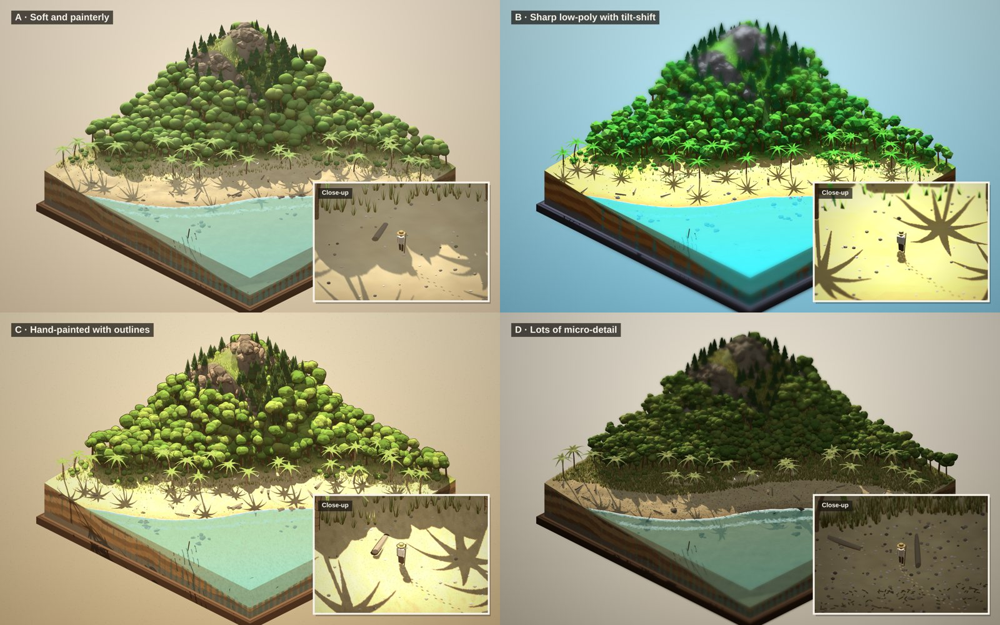
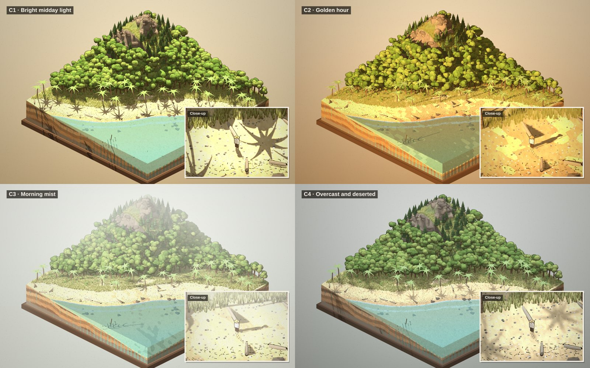
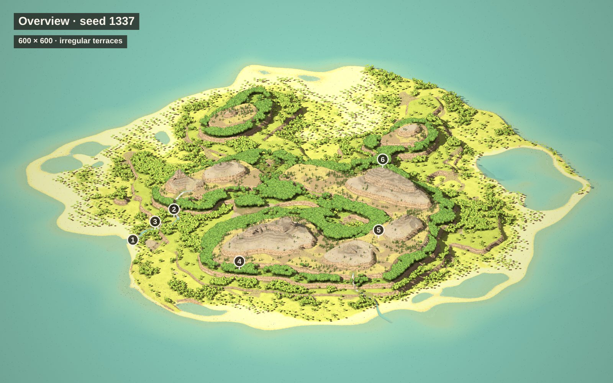
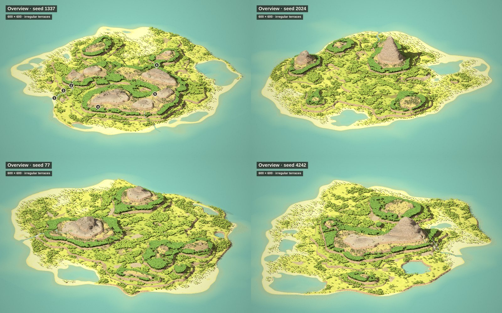
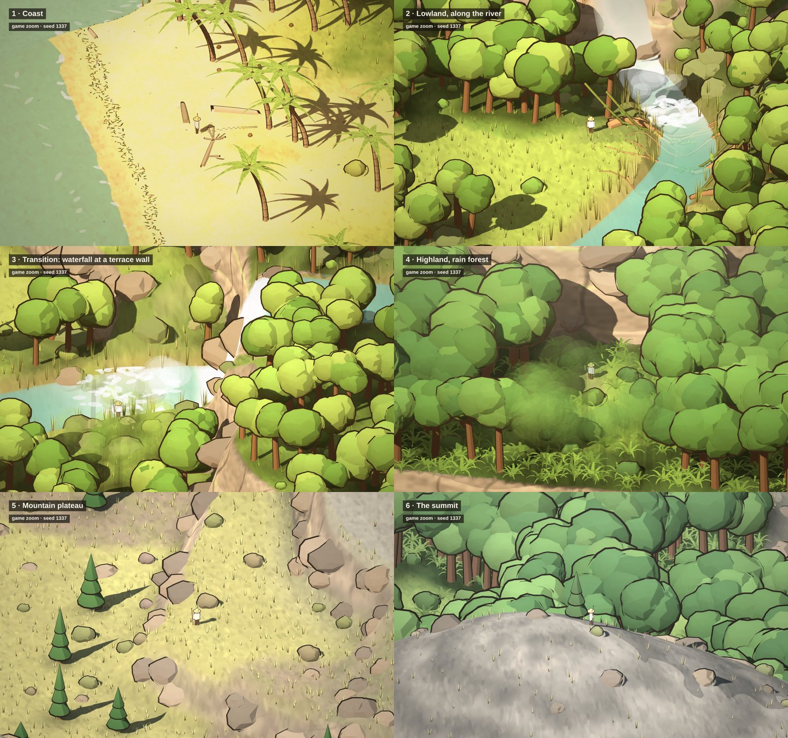
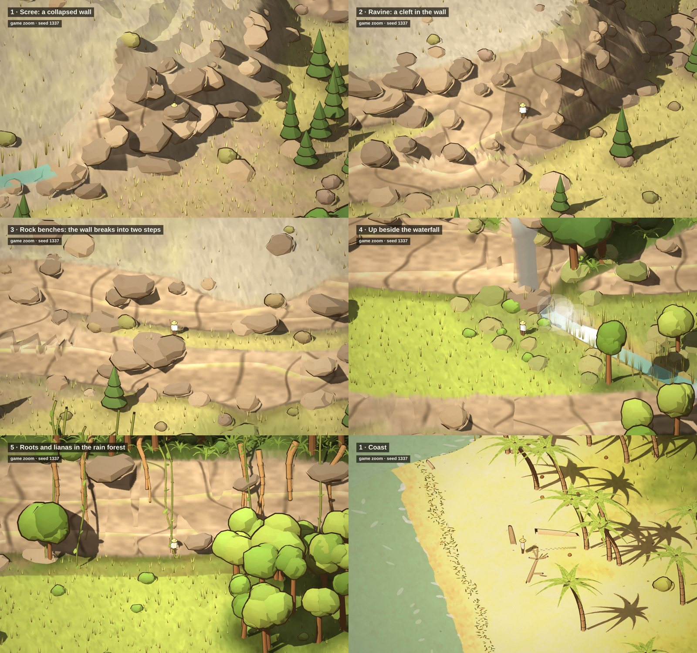

# Design of Driftwood

This document holds what has been **decided** about the game. Exploring happens in conversation; the results end up here. Keep it short and current: when a decision changes, change it here.

**How to read the older sections (0.39.0 "Landfall"):** since 0.38.0 "Only him" the player only watches, turns and zooms, and a language model decides everything Dave does (see *Full AI play*). The sections written before that still describe the player's controls (clicking or tapping a thing, the action button and its arc, the walking keys, Shift to run, F, Z) and the old mind (his habits, goals, pastimes, journeys, the voice's fixed phrases). Read those parts as history: the rules of the island they describe hold as before, but now the model asks for them with the actions of game/actions (`go` to a place of the menu, `do` an action such as `pickup`, `lay`, `husk`, `light`, `buildHere`, `use` a carried thing, `wait`, `wander`), and nothing of the old mind is left. Where a section and *Full AI play* disagree, *Full AI play* and the release log (`docs/versions.md`) win.

## Concept

A stylised, diorama-like survival game. A castaway is completely alone on a large, wild island that he slowly gets to know; the player watches him. The feeling of abandonment stays, but it is deliberately **not** a Robinson Crusoe story.

- **Feeling:** abandonment and loneliness. A small figure in a big landscape of beach, forest and mountain.
- **Tone:** realistic in what you do (no dungeons or fantasy), stylised in how it looks.
- **Core:** gathering, digging and building with driftwood and branches, and getting to know the island terrace by terrace. Since 0.38.0 "Only him" the player only watches: a language model is Dave's mind (with the player's own key) and decides everything he does, one action at a time, within the rules of the island (see *Full AI play*). The direction (agreed 2026-11-04): lonely but not hostile, an honest hard life, he is not unhappy, cozy; the player watches Dave live.
- **Tension:** now and then strangers arrive by canoe. You do not know what they want. The threat works through hiding and avoiding, not fighting.
- **Scope:** small and lonely. The atmosphere matters most. New game elements are only added after discussion.

## Art style

Chosen: **style C, hand-painted with outlines.** Stylised and diorama-like, not realistic.

| Variant | Verdict |
|---|---|
| A · Soft and painterly | Nice, but too sweet |
| B · Sharp low-poly with tilt-shift | Far too harsh |
| C · Hand-painted with outlines | **Chosen** |
| D · Lots of micro-detail | Too dark |
| C1–C4 · C under other light (midday, golden hour, mist, overcast) | The original C stays the favourite |

Explored earlier and dropped: 2D pixel art, plain low-poly and voxels.

- **Colour:** warm, earthy tones. Sand, olive green, weathered wood. All colours live in `src/render/palette.js`.
- **Ground:** a painted texture with brush strokes.
- **Lighting:** toon shading in three light steps, bright midday light, soft warm colour grading. The sun follows its own path through the day (see *Day and night*); it stands still in the world when you turn the view, so shadows stay on the ground.
- **Outlines:** dark brown edges around trees, rocks, palm trunks and the castaway.
- **Detail:** leaf clusters, grass tufts, pebbles, shells and driftwood, at the level of the original style C.
- **Rock walls:** painted in the shader with strata, cracks and ledges, greyer higher up, so the texture never stretches on steep faces.
- **Water (0.14, built):** stylised and subtle, drawn only in the existing water shaders, with no extra objects. The river has light streaks and flecks drifting downstream, faster on steep stretches, fords and falls, and the white water at fords and falls moves. The sea has slow glints and long lines of swell; the surf breathes a little up and down the beach over a few seconds, on top of the tide. Lagoons are calmer. At night only faint moon glints, warm near a fire or torch. Moving water does not count as something happening for the idle frame rate (see *Quiet frames*). As built: river streaks and flecks move at 0.5 m/s in calm water, up to about 3 m/s down falls; the sea's swell tilts the surface slowly (periods of 7 to 15 s) with fine ripples on the crests, so sun, moon and fire glint by themselves (the lights do it: faint and silvery at night, warm by fire and torch), plus faint pale lines by day; lagoons and sheltered bays get a fifth of the motion; the water level breathes up to 4.5 cm every 6 to 11 s, so the surf edge slides a little up and down the beach.

Each terrace has its own colour and vegetation within the same style:

- **Coast:** warm sand, palms with coconuts underneath, bleached driftwood (logs with a branch or a root plate) and a ragged tide line of seaweed with shells and twigs. Graded a little warmer and darker than the rest.
- **Lowland:** open forest, grassland and the river, the green of the original style C.
- **Highland:** dark, mossy rain forest with ferns and a light mist.
- **Mountain plateau:** dry grass, heath, pines and rocks, cooler light.
- **Summit:** grey rock with lichen, less saturated and cool.

No two trees look alike, but all stay within the style and the calm palette (no flowering trees):

- **Heights:** most trees are middling, about one in ten is young and small and about one in ten an old giant: broadleaf trees 1.1–4.4 m, rain forest trees 2–7 m (a few emergent giants stand above the canopy), pines 1–4.4 m, palms 1.7–5 m (the castaway is about 0.75 m). A tall tree gets a thicker trunk and a fuller crown of more leaf clumps, not bigger balls. The height is fixed by the tree's place, so the simple far-away trees have the same height.

- **Palms:** most lean towards the sea, at widely different angles; some stand nearly straight, some bend out and up again, a few lean low. Palms close together often lean apart. Fronds range from fresh green to yellow-green and olive, trunks from grey-brown to sandy. About a quarter carry one or two withered, straw-coloured fronds hanging down; never more.
- **Broadleaf and rain forest trees:** round crowns, wide flat umbrella crowns, tall narrow ones and now and then a forked trunk with two crowns. Crown greens from yellow-green to dark; some trees have grey bark.
- **Bushes:** never one green ball, but a loose clump of smaller leaf clumps in the style of the tier: low, wide dune scrub with stiff blades on the coast, leafy shrubs in the lowland, big leaf fans over a dark core in the rain forest, flat olive heath cushions with wiry sprigs on the plateau, small grey-green tufts on the summit.
- **Pines:** two to four tiers, slim or wide, some leaning a little, in greens from warm to grey-blue.

### Quality that adapts (0.16.2, built)

The look is the same on every device, but the game lowers its own quality when it runs slowly (a laptop with an integrated graphics chip drew 10 to 12 frames a second with the finest shadows). There is no menu and no setting; the only trace is `qN` in the developer panel. Levels, from best, one step at a time:

0. As designed: shadow map 4096 px (2048 on touch-only devices), bilinear shadow filter, drawing at up to 1.5 times the screen's pixel ratio, the ground casts shadows.
1. Shadow map 2048 px.
2. A lighter shadow filter (16 plain taps, the soft edge of 0.13.1 to 0.14.1).
3. Pixel ratio 1.
4. The ground no longer casts shadows (trees, props and the castaway still do).

After the island has faded in, the game measures the time between frames over 3 seconds of normal play (not while idling); below 27 frames a second (30 with a tolerance) it steps down one level, waits 2 seconds for things to settle, and measures again, until it is fine or at level 4. The first 4 seconds are ignored (tiles are still being built). It never steps back up within a session. The automatic level is remembered per device and the next start begins there (and may step further down). On a desktop (a fine pointer is present), **G** cycles **Auto → 0 → 1 → 2 → 3 → 4 → Auto**. A numbered choice is fixed and stops adapting; returning to Auto restores the remembered automatic level. Both choices are remembered per device. There is still no menu or new mark; the developer line says `q2 auto` or `q2 fixed`. Touch-only devices have no new control and stay automatic. A step that changes nothing on this device is skipped (touch devices start at 2048 anyway). The numbers are in `render/quality`.

### Wind (0.19, built)

The plants move, a little, atmosphere only: nothing in the rules depends on it, and nothing in the picture is added. It is done in the existing tree and plant shaders (a small shift per vertex, no extra objects), only on the detailed tiles near him; the far tiles stand still.

- **What moves:** palm fronds most (tips up and down and a little sideways, the top of a tall palm bends slightly with them, the trunk below it stands still); broadleaf and rain forest crowns rock slowly as a whole, with the leaf clumps a little apart; pines sway slightly from the cones' tips; bushes, ferns and leaf fans move a little; grass and reeds bend at their tips. Trunks, branches, rocks, driftwood and the lean-to stand still (the lean-to's palm fronds too: it is something he built; since 0.22.2 they lie flat on the sloping roof branches instead of floating above them). Outlines move with the plant they belong to.
- **Wind:** a calm base that is never quite still, plus gusts that roll over the island as a wave, one about every 30 s, some weak or nothing, crossing at 12 m/s about 40 m wide, so you see a gust coming: first the trees further off, then the ones near him. The direction is fixed per island by the seed and turns slowly (26 degrees to each side, once round a day). Neighbouring plants are out of step (the phase follows the place), but the clumps of one crown move together.
- **Strength by height:** moderate on the coast, a little less in the lowland, hardly any in the rain forest (sheltered, an eighth of the coast), strongest on the plateau and the summit (one and a half and one and eight tenths times the coast); calmer at night (0.4 of the day strength). The largest movements are a few decimetres: a frond tip 20 cm in a gust on the coast, a crown 11 cm, a blade of grass 9 cm.
- **Shadows move with it:** the shadow map gets the same displacement (the shadows of fronds, crowns and bushes sway), and so does the place a plant looks up its own shadow, so there is no acne. The shadow filter is unchanged; the shadow light itself still turns in the same small steps.
- **Quality:** on at every level (it costs a fraction of a millisecond; measured at the start view, before and after the same within the noise), so no level turns it off.
- **Idle:** wind does not count as something happening, as moving water does not (see *Quiet frames*): an idle game draws 15 frames a second and the wind then moves at that rate. The wind keeps its own clock, advancing with the drawn frames, so a fast-forwarded sleep does not make gusts race.
- **Sound (0.20 "Sound"):** the wind layer there follows these gusts and the strength per height (see *Sound*).

### Sound (0.20 "Sound", built)

Everything is made in the browser (Web Audio: filtered noise, a few simple tones, envelopes); there are no sound files. It is quiet and soft, a few layers under the picture that depend on where he is; nothing is louder than the surf at the water's edge, and nothing is added that has no place on the island.

- **Surf:** swells and falls back in the rhythm of the breathing surf of 0.14 (the same `breath` clock as the water level, so the sound and the water's edge move together). Loud at the water's edge, fading with the distance to the nearest sea (a fifth of the volume at 40 m, a few per cent far inland), duller and darker the further away.
- **Rivers:** a murmur near running water, fading over about 10 m from the water's edge; louder and brighter at fords and clearly louder, with a deeper rush, near waterfalls. Heard only within 12 m of a river, as the world knows rivers (`riverAt`).
- **Wind:** a soft breath that follows the gusts at his place and the strength per height of 0.19 (calm in the rain forest and at night, more on the plateau); a rustle of leaves and fronds when palms and trees stand near, in step with the wind; and on the summit a thin, wavering howl.
- **Fire and torch:** a low flutter of flames and small crackles, more and louder with bigger flames; embers hush. A fire or planted torch close by is heard, further than about 15 m it is gone; the torch in his hand always.
- **Footsteps:** one for each step (twice per walk cycle of the figure), by what is underfoot: dry sand (soft, grainy), wet sand (damp, lower, a small squelch), water (a splash) and grass or forest floor (a light swish). A run is louder; being tired, thirsty, hungry or loaded makes the steps heavier (lower, longer, a bit louder), the same needs that shorten his steps since 0.16.1. **Panting (0.23):** while he is out of breath (from empty until he may run again, 2 to 3 s) a soft in-and-out breath of band-passed noise about every 0.8 s, very quiet (`LEVELS.pant` 0.05).
- **Work:** husking (dry tearing and a thump now and then), drilling fire (a quick rubbing, rising as the glow nears), building (soft knocks of wood on wood). Drinking, filling a shell and sipping from one have no sound of their own.
- **Gulls:** the cries of seabirds when birds are near, more of them and louder for a landed flock close by; the high circling birds are heard rarely and faintly; none at night (there are none then).
- **Crickets:** in the forest at night, a soft pulsing of a few voices; not on the open beach, not by day.
- **Rain (0.21, built):** a steady soft hiss of filtered noise that follows the intensity of the shower (see *Weather*); a little muffled (the high end rolled off, quieter) when he stands under a finished lean-to; and when a fire goes out in the rain a single hiss (a short burst of noise falling away), louder the closer the fire is. It sits in the `rain` layer that 0.20 prepared (`LEVELS.rain` in `audio/mix`).
- **Switching:** **M** turns sound on or off. There is a small ink sound mark (a speaker, crossed out when off) above the moon, and a tap or click on it does the same (on every device since 0.22.3; before that only on touch-only devices). The choice is remembered per device (`localStorage`, `driftwood-sound`); the default is on. Browsers allow sound only after a key or tap, so sound starts with the first key press or tap (answering the name question counts); until then it is silent. When the tab is hidden the sound fades out and stops, and comes back when he returns.
- **Levels:** a master gain of 0.5 and a soft limiter after it so that nothing clips; the sum of the layers stays well below it. The levels were set by the maker's reasoning, not by ear: the user listens and judges the mix, and the numbers are in `audio/mix` (one table, `LEVELS`).
- **Pure and presentation apart:** `audio/mix` decides what should be heard from the state (testable in Node); `audio/sound` builds the Web Audio graph and applies it every frame with smoothing. Sound is presentation, so it sits beside `render` and reads the world and the game like it does.

## Weather: rain (0.21 "Rain", built)

The first weather, and the only one: a shower now and then. It is atmosphere first and a small test for the fire: wood and flames need a roof. Nothing is added to the interface: no icon, no forecast, no number.

- **When:** about once a week. The first shower starts 5 to 9 days after the start of the game, and each next one 5 to 9 days after the start of the last. The gaps are fixed per island by the seed (the same island has the same showers, whatever he does), so there is never a shower in the first two days. A shower can come at any time of day or night. Nothing is saved for the schedule: it follows from the seed and the clock alone (`game/weather`).
- **How long:** a shower lasts one to two hours of game time (one to two minutes of play), including a soft start and a soft end of about ten game minutes each. The rain is "falling" (it counts for wood and fire) from a quarter of its full strength on. Each shower has its own strength (three quarters to full), also fixed by the seed.
- **Look:** the light turns greyer and softer (the sun weaker and colder, the sky fill flatter and greyer, colours less saturated, a grey veil over the picture), thin streaks of rain fall across the picture (a light layer drawn over the scene, fewer streaks on the lower quality levels; at night they stay light and nearly as strong as by day so they still read in the dark, 0.27.6), rings spread on the sea and the rivers (in the water shaders), and the ground is a little darker with a slight sheen. It animates like the water and the wind: it does not count as "something happening" for the idle frame rate (15 fps when nothing else moves). Rain does not change how far he sees.
- **Sound:** see *Sound*.
- **Wood in the open gets wet:** while it rains, loose pieces lying anywhere in the open (what is far from him is caught up when he comes near, also after a sleep through a shower), piles, and what he carries become wet again: as dark and shiny as fresh driftwood, and a fire does not catch on them (see *Wet wood*). A piece lying, piled or carried within **1.5 m of the centre of a finished lean-to** (2.5 m with side walls, 0.27) stays dry; a half-built one does not shelter. While it rains the wood keeps getting wet, and once the rain stops it dries again from that moment (the same clock as fresh driftwood). A branch dries faster than driftwood: dry again after half a day instead of a day (and wet until three quarters of that, as driftwood). Wood that got wet is saved (an optional field of the save).
- **A fire in the open:** burns down three times as fast while it rains, and goes out after fifteen minutes of game time of rain (about fifteen seconds of play), with a hiss. It leaves its burnt place as usual, but as **wet ash**: the same place, darker without the char, and it fades as every burnt place does. A shower that ends before that lets it live. A fire within **2 m of a finished lean-to** (3 m with side walls, 0.27), or in a stone ring (0.27), burns on as normal.
- **Torches** burn twice as fast in the rain, in his hand and stuck in the ground. A torch stuck within 2 m of a finished lean-to burns as usual; so does the one in his hand while he stands within 2 m of it.
- **Left out on purpose:** wind does not change with the rain, there is no thunder, no puddles, nothing floods. Rain does not wake him, and animals do not react.

## The castaway

### Voice (0.30; situation-led thoughts in 0.30.1; reasons only in 0.30.20 "Words")

**Now (0.38.0 and later):** the line above him carries only the model's thought when a plan starts (`say`, up to 140 characters on at most two lines, shown about 4 s plus reading time). The fixed phrases described below belonged to the old mind and are gone with it.

**With the AI on (0.36.9 "Voice"):** the line above him carries the model's own reason for a step, up to 140 characters on at most two lines, shown 4 s plus reading time; the fixed phrases above are then nearly all silent (only a short phrase in an emergency: very thirsty, very hungry, nearly falling asleep); what he lacks is told to the model instead. With the AI off all of the above is as it was.

Before Dave acts on a need, one short written English thought appears near him in the island's ink hand and fades after a few seconds. The thought gives the reason, not a running commentary: "I need some wood." before collecting, "I'm hungry." before eating or searching for food, "I need a drink." before seeking water, and "The fire's getting low." before fetching fuel for a low fire. An unlit pile instead gets "I need a fire." Wood and supply thoughts begin only once he has found the material; pickup, delivery and retry steps of an autonomous errand stay silent. **The rule (0.30.20): actions never speak; only reasons do.** Taking, laying, feeding, husking, drinking, digging, roasting and the other things he does are silent, whoever does them; what speaks is an intention (why he sets off) or, for the player, what is missing. Every reason has three or four plain first-person lines that rotate per kind, so the same line never comes twice in a row (a plain rotation, presentation only, never the world's or the mind's chance). New reasons, each said once at the start of the errand: "I need a spear to fish." (making the spear), "There may be fish in the shallows." (fishing as an afternoon pastime; for a meal the hunger line already said it), "Something warm to eat." (roasting a catch), "I need wood for a shelter." (material for the home), "I need a little shelter." (starting to build), "This could be a little cosier." (an upgrade), "I need a little light." (taking a torch for a walk in the dark), and on a journey one line at the start ("I want to see what lies further off."), one at the night camp ("I'll sleep out here tonight.") and one on the way home ("Time to go home."). **Need thoughts for the player (0.30.20):** when the mind is not driving and the player has stood still for about a second and a half where something is almost possible but one thing is missing, Dave says what is missing, once for that stillness: in the shallows without the spear ("I need a spear to fish.", or "My spear is back at camp." when it lies elsewhere), beside a pile of four or more pieces with no fibre ("I need some fibre for the fire."), beside a smaller pile with fibre ("This needs more wood to burn."). It adds no rule, only says why the button offers nothing. There is at least eight seconds between displayed thoughts, and the same kind waits at least a minute; suppressed thoughts are never queued for later. While the waking line shows (5 seconds) a thought waits and appears above Dave only once that line has faded (0.30.8 "Morning"); the L log gets it at once, with its own time. This changes no decisions or need thresholds. It is fixed computer text, never speech or audio, an AI service, a bubble, a menu or a claim that work has already succeeded.

(0.36.6 "One menu": the log that **L** once opened, a scrollable record of the shown lines with their island time, is gone; most of what it showed is in the AI panel. The fading line above Dave is unchanged.)

A small blocky figure with outlines, dressed for a tropical island after a long time alone: a straw hat, shaggy dark hair and a long, unkempt beard, a yellowed shirt with ripped short sleeves, holes and a ragged hem, frayed short trousers, bare sun-tanned legs and bare feet, and a staff. Because the figure is small on screen, the detail lives in the silhouette and in flat colour areas (skin against cloth), not in small parts.

The castaway walks unhurried (2.9 per second) and with Shift (on a touch screen: a double tap) breaks into a run (5.5, almost twice walking), but not for long. **Breath (0.23, no meter):** rested and unloaded he can run about 12 s in a row. Load, tiredness, thirst and hunger make it run out sooner (the drain is divided by the same combined speed factor that slows him, but not below 0.4, so at the worst about 5 s). Breath out, he drops to walking by himself, whatever is asked (Shift, a double tap, the rim of the thumb stick), and cannot run until it is back to 40 %, so it does not flicker. It comes back while he walks (a full breath in 8 s) and faster standing still (5 s). Signs: in the last 30 % of the breath his running stride gets shorter (down to 75 %, the stride scaling of load and needs), and while he is winded he pants softly (see *Sound*). Not saved: he starts with a full breath. Walking, kneeling work and sleep are unaffected.

**Sitting (0.29.2 "Amble", agreed 2026-11-05):** the castaway has a sitting pose, used only by his habit (see *Habit*; the player cannot make him sit). He sits on the ground (no logs or piles as seats), knees drawn up with the bare feet flat, the body leaning forward a little over them, his arms resting forward on his knees, his head up to look out, the straw hat on and the staff laid down on the ground on his right; he faces what he looks at (the sea or the fire). Sitting down and getting up each take half a second, eased at both ends (no popping), the staff travelling between his hand and the ground. Any input of the player takes over at once: he gets up (the get-up takes a quarter of a second when a walk starts) and the walk starts in the same moment. He never sits in water, on steep ground (a slope of 0.45 or more) or a climbing route, with a torch in his hand or with wood, a frond or a stone with him. Sitting is only a way of resting: no rule changes, nothing recovers faster. It is not saved (a reloaded game starts with him standing). The silhouette through trees and rocks and the outline work as for the standing figure.

Tree trunks (broadleaf, rain forest, pine and palm), boulders of 0.35 m and larger and the crags in the walls are solid: the castaway bumps into the trunk, not the crown, and slides round it. A fire place, whether it burns, glows or is burnt out, and the whole back and both sides of a lean-to, even while it is unfinished, are solid. The lean-to's front stays open so he enters through it to sleep and, when left alone inside, walks out through it before going round the shelter. Piles are small round obstacles too; driftwood and branch piles block their compact stack, so a protruding long log can be stepped over and a full fire pile cannot close off a shelter or the fire's rim. Frond and stone piles remain solid to their visible edge. Grass, roots, small stones and beach finds are walked through or stepped over, and so are stones lying on a climbing route: there you scramble over them. Bushes are pushed through: they slow you to 55 % in the middle and hardly at all when you brush the edge (not on a climbing route).

## Gathering driftwood

(Since 0.41.0 "Hands" the model picks wood up with a `take` of that piece or pile, and lays it down with a `lay` of one kind on a pile, beside a place or here; from 0.38.0 to 0.40.5 it was `go` to a piece or pile and `do: pickup`, and `do: lay` for everything; the clicks, taps and the action button below are history. Since 0.38.1 the request says what each pick-up took and lay-down laid.)

The first game element. Driftwood lies on the dry beach above the tide line at the start, a few pieces per stretch of beach, and the sea leaves new pieces in the strip between low and high water, each with its own look (bleached colour, sometimes a side branch or a root plate).

- **Picking up (0.13):** click or tap a piece and the castaway walks to beside it and stands there; the action button (*The action button*) bends him down briefly to pick it up. A finger may tap a little less precisely than a mouse. Clicking, tapping and steering never pick anything up.
- **Carrying:** at most **3 pieces**, under the left arm at their real length (low enough that the head and hat stay readable). Every piece slows walking and running by 12 % (three pieces: 64 %), with shorter steps (each piece takes about 7 % off the stride) and a slight stoop, a forward lean that grows with the load (0.10, built).
- **Laying down (0.13):** the action button, when nothing else can be done: everything carried goes down at the feet, on a pile close by or as a new pile. Not in water. Standing beside a pile with wood in his arm, the ring lays the wood on it; since 0.37.6 "Free hands" taking more from it (while there is room) is an icon of the arc, and laying down is always offered on dry ground, kept in the arc whatever else is near.
- **A pile never goes in the water (0.14.1):** a first pile goes a step in front of him; if that spot is wet, a dry spot round him is used (first in the direction he faces, then alternating left and right, clear of other piles); if there is none, he keeps the wood in his arms, as with a full pile that has no room beside it.
- **Piles** stay where they are, and can be picked up again with the action button when his arms are empty (the top pieces first, as many as fit). A pile is a small round obstacle: walk round its rim to pick it up or lay wood on it.
- **Pile limit (0.12, built):** a pile holds at most **12 pieces**. Driftwood and branches never share a pile (every pile carries a kind, `driftwood` or `branch`, see *Basic needs*; carried together, each kind is laid on its own piles). Laying wood on a full pile, or on a pile of the other kind, starts a new pile right next to it: about a step away (0.95 m), first in the direction he faces, then round the pile, not in water and clear of other piles. When the pieces do not all fit, as many as fit go on the pile and the rest start the new pile (3 pieces on a pile of 11: 1 goes on it, 2 start a new one). A pile that holds more than 12 in an older save is left as it is: it takes no more wood and can be picked up as usual.
- **Tally marks (0.12, built):** while the castaway stands beside a pile (within about 1.8 m of its middle, a little further than `F` reaches), tally marks in ink show how many pieces it holds, drawn above it in the journal style: five-bar gates (four upright strokes, the fifth across them), with a double line under when the pile is full. They fade in over a third of a second, fade out when he walks away, and are pale ink at night (the shared ink colour). A pile within 2.6 m of a lean-to's middle shows them 1.5 m further out, away from the lean-to, so they never float over the roof (0.27.6). The pile itself visibly grows and shrinks with its count (two pieces to a layer). A fire gets the same marks (see *Fire*).
- No counter for what he carries: what you carry in your hands is what you see; piles and fires get tally marks. Loose wood is never solid; you walk over it. (Small things carried loose go into the inventory, see *Carrying and the inventory*; wood does not.)
- **Low water finds (0.18, built):** each high water washes up one or two new pieces per stretch of beach, no longer on the dry sand but in the strip between the low-water and the high-water line (wet sand and shallow water, never in a river). They are placed at high water, while the spot is under water, so you never see one appear. At low water the sea falls back and they lie there; they can be picked up as usual, also standing on wet sand or in shallow water. While the sea covers a piece completely it cannot be picked up; as soon as part of it sticks out of the water (the sea is below the top of the log, about 0.2 m over the ground for the thickest) it can be found and picked up, standing beside it in the shallows (that is never deeper than a wade allows). Wood washed up at high water always lies wholly under water, so it still never appears in sight. (Covered, it shows faintly through the shallow water, the water is drawn over it). Wood that is left lying stays there: the next high water does not take it, it only adds new wood. A stretch of beach never gets more loose wood than it had at the start, so the beach never fills up (a stretch without such a strip gets none); your piles do not count. What you gather slowly grows back. The wood that lies on the dry beach at the start stays where it is. Piles laid in the strip are still taken by the flood.
- **The flood takes back** a pile laid on the wet sand of low water, below the high-water line. Wood cannot be laid down in the sea.
- **Wet wood:** what a high water brings is wet and salty: dark when it washes up. It stays clearly wet, darker and cooler grey-brown with a slight wet sheen, until it is dry enough to burn, then bleaches quickly to its own colour, wherever it lies, in a pile or is carried under his arm (0.10, built: wet until three quarters of the day, the dryness at which a torch lights a pile, then bleaching over the next tenth of a day; colour in steps of about half a minute of play). Rain (0.21) wets wood again: see *Weather*. A dark damp patch in the sand, a soft-edged disc somewhat larger than the log, lies under every wet log on the beach, shrinks and fades as the wood dries and is gone once it is dry enough to burn (0.10, built). Piles get no patch: the sea left the sand wet where it left the wood, and a pile has been carried and laid down. The wood that lies on the beach at the start is dry. Only dry wood makes a fire catch, so gathering ahead pays. **Wood in the strip stays wet (0.18, built):** every time the sea covers a piece, its drying starts over, so wood left in the strip never dries; carry it up above the high-water line (or lay it in a pile there) and it dries as above. No damp patch is drawn under wood in the strip (the sea covers it). **Wood in the strip stays wet (0.18, built):** wood the sea covers again and again at every high water never gets the day it needs to dry while it lies in the strip between the tide lines (its drying starts over each time the sea covers it); carried above the high-water line it dries as usual. Since 0.29.5 Dave takes such wood up the beach himself (see *Habit*, "Drying wood").

## Coconut fibre

A fire needs something that catches first: the dry fibre of a coconut husk.

- **Coconuts** lie under the palms, but few (0.24 "Lean times"): one nut under about 1 in 8 palms (0.29 "Daily bread": a fifth of the palms that have nuts keep one, it was a sixth, about 1 in 10), never more than one per palm, so finding food takes a little searching every day. Which palms keep their nut is fixed by the seed (`game/fibre` thins the 1 to 3 nuts that `world/vegetation` still puts under about half of the palms, so the world and its fixture stay the same). Seed 1337: 1680 palms, 204 nuts (`NUT_SHARE` 1/5; 170 with 1/6; 1961 before 0.24).
- **Husking (0.13):** click or tap a coconut and he walks to beside it; the action button makes him kneel and tear the husk off with his hands (about 4 seconds since 0.15, when he also eats the nut; before that 2½). That gives a meal (see *Basic needs*, Food) and **one tuft of fibre** when he has room for it. Since 0.27.1 "Husk" husking is always what the button does at a nut on the ground, hungry or not, so fibre never depends on hunger: when the husk is off he eats the nut if he is hungry (more than half a day since he ate) or already carries two nuts, otherwise he carries the husked nut (see *Carrying a coconut*). Husking is offered also with three tufts: then he still husks the nut (and it grows back as usual) but gets no fourth tuft. Walking off, clicking elsewhere or pushing the thumb stick stops him, and the nut stays where it was.
- **Carrying:** at most **3 tufts**, kept loose in his shorts and not drawn on him; they show in the inventory row (see *Carrying and the inventory*). Fibre weighs nothing.
- **Carrying a coconut (0.25 "Shell", built):** at a coconut the short press always husks it first (4 s, a tuft of fibre when there is room; 0.27.1 "Husk", before that a not hungry player could only pick the nut up whole, and without a tuft). When the husk is off he eats the nut if he is hungry (hunger above a third of a day, `EAT_AT` 1/3, with the meal and the shell below); otherwise he **carries the husked nut**, at most **2 nuts** (a small coconut in the row; no meal, no shell yet; the palm grows a new one after 8 to 12 days). With two carried already he eats the nut anyway. A carried nut is already husked, so eating it later is a short kneel of about 3 s (`EAT_TIME`, 2 s before 0.34) with a short press anywhere, only when he is hungry (see the order of the action button): the same meal (half a day of hunger, 0.15 day of thirst) and the shell, no tuft. Nuts carried in saves from before 0.27.1 were unhusked; they are simply treated as husked. Carried nuts do not spoil, weigh nothing and are not wood. **Shells:** after husking and eating a nut he keeps the empty half shell, at most **2** (with two, no third is kept). Shells are in the row too (below).
- **New nuts:** a palm drops a new coconut where an old one lay, 8 to 12 days after it was taken (0.29 "Daily bread"; 10 to 14 from 0.24, six to ten and three to six before).

## Fire

Making fire is deliberately hard: it takes preparation and effort, so a fire that burns is precious.

- **Laying a fire:** a pile of at least **4 pieces** of driftwood on dry ground, laid down as any pile.
- **Lighting it (0.13, since 0.27.4 an icon of the arc):** click or tap the flame icon above the action button standing beside the pile (within about 1.2 m of its edge), or press `F` there (or the key 1 to 3 the icon has). With fibre on him, the castaway walks to the pile's side, kneels and twirls his staff upright between his palms as a fire drill, for about **14 seconds**. It is hard work: a whole attempt costs some rest (the moon wanes visibly). Walking off, clicking elsewhere or pushing the thumb stick stops him; the fibre is kept. The ring beside the pile picks it up; only the flame icon (or `F`) lights it.
- **Whether it catches:** at the end the tuft is used up, and the fire catches or it does not. At best (dry wood, rested) a little more than half the attempts catch at first (`CATCH` 0.6), and more with practice (0.30.21 "Practice": see *Practice*; up to `CATCH_TOP` 0.9). Wet wood makes it much harder (the chance falls with the square of the pile's dryness), fresh wood never catches, and a tired castaway does worse (half the chance at the limit). A failed attempt leaves only a puff of smoke; the pile stays. Whether an attempt catches is fixed by the seed and the number of attempts, so it cannot be retried for luck.
- **Burning:** the pile becomes a little tepee of charred wood with flames and rising smoke. Each piece burns about **2½ hours** of game time, so four pieces last most of a night; a fire holds at most eight pieces' worth. A branch burns half as long (1¼ hours), so it counts as half a piece, as a short stroke in the tally. When the wood is gone it sinks to **embers** that can be woken for about **12 hours**: warm glow at first, then fewer red points until they die. A stone ring makes that stage one and a half times as long, as it does the burning wood. Wood laid on embers returns them to flames without drilling; the fresh ember stage begins only after those flames burn down. Rain in the open still puts them out after fifteen game minutes. Only the **first 1½ hours** of embers warm a sleeper, so an old glowing fire cannot buy a warm night. No number: the size of the flames tells how much is left, but tally marks show the count when you stand beside it (below).
- **Keeping it going:** the action button beside a fire while carrying wood lays one piece on it. That also works on the embers. Wet wood cannot be laid on a fire (0.12, built): the button lays one piece that is dry enough to burn; from a mixed load he picks a dry piece and keeps the wet; with only wet wood the button just lays the wood down on the ground. A full fire (8 pieces) takes no more wood (0.13, built): the button offers nothing to lay on it, the piece is not wasted, and with wood in his arm it lays the wood down beside the fire like anywhere else.
- **Tally marks by a fire (0.12, built):** while the castaway stands beside a fire, tally marks in ink above it count the pieces still on it, up to 8, in the same gates as for a pile (double line under when full). A half-burnt piece counts as a short stroke; embers get none. As for piles, they fade when he walks away and are pale ink at night, and the fire's tepee visibly grows and shrinks with the count (one charred piece in the tepee for each piece still on the fire, taller with more).
- **Light:** a fire throws a warm, flickering light round it; at night a soft glow lies round it over the darkness. The light reaches about 14 m for a fire and 9 m for a torch, and sits exactly at the flame (also on the torch in his hand). Every fire and torch near him lights the ground round it (0.17.2): up to four at once on a good device (two when the game has lowered its quality), the nearest ones, plus the torch in his hand which always has its own. When the lights are given to other fires as he walks they fade over about 0.3 s, so nothing pops, and the soft glow over the picture follows every light that is on. By day a thin column of grey smoke rises.
- **The flood** puts out a fire laid on the wet sand of low water.
- **Rain (0.21, built):** a fire in the open burns down faster in the rain and goes out hissing after fifteen game minutes of rain, leaving wet ash; a fire within 2 m of a finished lean-to is not touched; torches burn twice as fast in the rain. Wet wood in the rain stays wet (see *Weather*), so a fire in the rain has to be built under a roof. Details in *Weather*.
- **Warmth:** a fire close by lets the castaway sleep the night through (see *Sleep*).
- **A torch:** the action button beside a burning fire with empty hands and the castaway takes a burning brand out of it (it costs the fire half a piece's worth; not from embers). He holds it up in his left hand; it lights a small warm circle round him at night and burns about **two hours** of game time. With a torch in one hand the other arm carries wood (0.37.3 "Branches": branches; since 0.37.6 "Free hands", agreed with the user 2026-11-18, any wood: driftwood, branches, fronds): he picks it up (loose or from a pile), carries it, lays it down and puts it on a fire; with wood under his arm, or with the spear in his hand, he can still take a torch (from a fire or out of the ground). Stones, logs, digging and the axe still need the torch out of his hand; see *Hands*. Carrying branches, he holds the torch up in his right hand in place of his staff, the bundle under his left arm. The action button sticks it in the ground in front of him when nothing else can be done, where it burns on as a light; beside it, with empty hands, the button takes it up again. Lying down to sleep, he sticks it in the ground first. Wading in deeper than about 30 cm puts it out, and the flood puts out a torch stuck in the wet sand.
- **Lighting with a torch:** the flame icon (or `F`) beside a pile of at least 4 pieces while holding a torch: the castaway kneels and pushes the torch into it. No fibre and no drilling: dry wood (dry for at least three quarters of the day it takes) always catches, and the torch goes into the fire. Wetter wood only smokes, and he keeps the torch. So a fire, once made, can be carried to a new place.
- A fire place is solid, whether it has flames, embers or only a burnt place; the castaway feeds, lights and sleeps beside its rim. It burns on while he sleeps.

## Practice (0.30.21 "Practice", built; agreed with the user on 2026-11-11)

Everything with a chance of failure gets easier with practice: Dave gets better at it. There are exactly three such actions: **lighting a fire with the drill** (best chance `CATCH` 0.6 -> `CATCH_TOP` 0.9; the dryness squared and the tiredness factors still apply on top; wet wood never catches; the torch rule is unchanged), **digging a crab** (`DIG_CHANCE` 0.5 -> `DIG_TOP` 0.8) and **fishing with the spear** (`FISH_CHANCE` 0.45 -> `FISH_TOP` 0.75).
- **The rule:** `chance(n) = start + (top - start) * (1 - exp(-n / PRACTICE))` with `PRACTICE` 10 (`practised` in `core/math`): halfway after about 7 attempts, nearly at the ceiling after 20 to 25. `n` is the number of earlier attempts (the first ever attempt has the beginner's chance); every attempt counts as practice, the failed ones too. The counters are the ones that already exist and are saved (`fire.attempts`, `crabs.digs`, `fish.tries`): the save format does not change, and old saves simply start with the skill their counters give.
- **Skill never fades.** Nothing is shown to the player: no number, no meter, no new thought or line. Dave's decisions (`game/mind`, e.g. `FISH_TRIES`) are unchanged; he just fails less. The rolls stay fixed by the seed and the count as before; only the threshold changes.

## Ebb and flow

- **Two high waters a day,** as on a real coast: the tide comes round every 12 h 25 min of game time (about 10⅓ minutes of play), so high water falls a little later each day. A game starts on a falling tide, mid-morning.
- At high water the sea stands where it always stood, at the tide line of seaweed. At low water it is **0.4 m lower**: a strip of wet sand falls dry, and you can walk further out, onto the sandbanks. The surf follows the water's edge.
- When the flood comes in round you, you can always wade back to shore; you cannot go further out. Footprints the water covers are wiped out.

## Sleep

- The castaway sleeps **every night** (0.29 "Daily bread", a human daily rhythm) and has to sleep at the latest after **a day and a half** awake (30 minutes of play; it was two days). **Restless (0.17.3, 0.29):** by day he can only choose to sleep after at least **half a day awake** (the moon still two thirds full, `sleep.awake >= 0.5`); from **dusk** (0.83, just after the sun is down) to dawn (0.17) he can lie down once he has been awake **about 3½ hours** (`NIGHT_AFTER` 0.15), so after a short day he can still go to bed early, but a rested man does not lie down again in the dark before dawn. Before that the arc offers no moon and `Z` does nothing. Collapsing (exhaustion at the limit, thirst) puts him to sleep regardless, always for the full sleep. After about **16 hours awake** (two thirds of a day; a day from dawn to dusk is just short of it) he is tired: his head and shoulders hang, his arms swing less and he walks slower, easing in from there down to 60 % at the limit. At a day and a half he falls asleep where he stands.
- **Going to sleep (0.13, since 0.27.4 an icon of the arc):** the moon icon above the action button (see *The action button*), or press `Z`. You can sleep anywhere on dry land, not in the water and not on a climbing route. By day only after he has been awake half a day (0.17.3), and then it is a nap (below); at night after about 3½ hours awake, and then it is a full sleep (0.29). He first lays down what he carries, then lies on his back with the straw hat over his face.
- **A journey's bed (0.30.21):** on a journey he lies down on flat ground beside the camp's fire (a spot of ordinary ground, never on a climbing route, where sleep is refused), not wherever the fire's edge happens to be; if he is refused anyway, the spots he tries next are also on ordinary ground when there is any.
- **Sleeping by a fire:** with a burning fire (or its embers) within about 3 m, the castaway sleeps the whole night through and wakes fully rested. Without one the sleep is cold: he wakes after **three hours** (0.17.3, was four) and has rested only **half a day** of being awake (0.29; from empty about a third rested; after a 16-hour day he still has 4 hours of tiredness on him where a night by a fire leaves none), and he can lie down again at night (a cold night is two sleeps of three hours). If the fire goes out while he sleeps, the cold wakes him once he has slept three hours. So a fire that lasts the night is worth the work. Under a lean-to (0.16, see *Basic needs*) the cold sleep lasts four hours (0.40.0 "Belt", was six) and he wakes about half rested, and by a fire he also rests 1.25 times as fast; side walls make that five hours (0.40.0, was seven) and a bed makes him rest 25 % faster. **0.40.0 "Belt" (agreed with the user 2026-11-19):** the lean-to keeps the fire's warmth, it does not replace it: until the hut, a whole night needs a fire.
- **A nap (0.29):** a sleep by choice between dawn and dusk (before 0.83 and from 0.17 on) is only a nap: he wakes by himself after **two hours** (`NAP_DAYS`) and rests only half as fast (`NAP_REST` 0.5), so a nap takes about 4½ hours off the time awake; naps need the usual half day awake, so there is hardly one in an ordinary day. - **A night’s sleep lasts eight hours** of game time (by a fire); meanwhile time runs **20 times as fast** (about 20 seconds), easing in and out. The sun or moon, the tide and the wood all go on: wood that washes up meanwhile lies there when you wake. A full sleep rests you completely. A left click, a tap, the action button or a walking key (WASD, arrows) wakes you early, only partly rested; turning, tilting or zooming the view does not. The flood wakes you too: you can lie down on the wet sand of low water, but when the rising water reaches you, you wake and get up, only partly rested. Worn out in the water, you wade on and only fall asleep once on dry ground.
- **How long still:** a small moon in the bottom left corner, in the dark brown of the loading screen. Full when rested, it wanes to a thin sickle and to nothing as the day and a half runs out (about half full at dusk after an ordinary day), and waxes again while you sleep. It is faint most of the time and grows clearer in the last half day. No numbers.

## Day and night

- **One day lasts 20 minutes of play.** A game starts in the middle of the morning.
- **The sun** rises in the east, climbs over the south to about 62° and sets in the west. It is up for about 13 minutes. Low sun gives warm golden light and long shadows; at noon the light is plain style C.
- **Dusk and dawn** last about a minute each around the horizon: the light turns lilac and mauve, the warm coast grading fades and colours lose some saturation.
- **Night lasts about 5 minutes and is moonlit:** dark blue and dim. The moon and sky fill are half their former night strength, so the island and the castaway are only just readable and a fire or torch stands out. Fish, river streaks and flecks, foam and the pale sea swell darken with the light; the water near a fire or torch remains visible. Dusk and dawn stay smooth, golden hour is unchanged.
- **Night shadows:** daylight shadows fade continuously away through dusk and back through dawn. The shadowed sun light trades strength with an identical non-shadowing light, so the scene's total direct light does not jump; in full night the shadow map is not drawn. Fire and torch light remain shadowless.
- **Night shadows:** daylight shadows are softer and less prominent at night; fire and torch light stays shadowless.
- **Pale ink at night:** at middle dusk the ink moves from dark brown to pale paper over just under a second while its opposite glow stays clear; the glow changes at the end. Dawn reverses that sequence. The two middle tones never meet, so every mark remains readable on the ground beneath it.
- The shadow light never comes from lower than 15° (0.12.1, built; before 0.12.1 about 11.5°), so shadows stay readable and less extreme at sunrise and sunset. Only the shadow light is lifted: the sun disc and the sky colours follow the true sun.
- **Shadows as built (0.13.1, settings chosen 0.13.2):** the shadow map was 2048 px (see 0.14.2 below), but the shadow camera is fitted tightly round what is seen (`render/shadowFit`): the view box, cut off between 3 m below the castaway and a zoom-dependent height above him (0.8 x zoom, 5..20 m), measured across the light, so with a low sun a texel covers about 3 cm of sand instead of about 9 cm. Shadows of things outside that box (tall palms, hills towards the sun) still fall into the view, because a shadow keeps its place across the light. The size changes in steps of 5 % so turning and zooming do not make edges shift, and the centre snaps to whole texels so walking does not shimmer. The hard three.js PCF is replaced by an own soft filter: 16 taps on a disc of 1.5 texels (3 since 0.14.2), turned per pixel, which makes the stair steps of the map into a soft band while the toon look stays crisp. The light's direction turns in steps of 1/32° (0.11.1 had ¼°, which jerked about a metre with a low sun), so a step moves the tip of a tall palm's shadow only a few centimetres. **Chosen (0.13.2):** the user compared the variants by eye on a phone and chose steps of 1/32°, a minimum shadow-light height of 15°, the soft filter at 1.5 texels and the tight fit. These are now fixed; the comparison parameter and the alternatives are gone. **Soft edges without jaggies (0.14.2):** the shadows still flickered, because each tiny step of the light re-rasterised the map and its jagged texel edges fell slightly differently every time. The fix is to leave no jaggies: the shadow map is 4096 px on desktop and 2048 px on phones (touch-only devices), the filter radius is 3 texels and each tap is a bilinear comparison. The light keeps its 1/32° steps. A cross-fade between two shadow lights was tried and rejected (doubled shadows).
- No clock on screen (only the day number in the day line, see *Decisions*), no stars, moon disc or weather yet. The day drives the tide (see *Ebb and flow*) and sleeping speeds it up (see *Sleep*); what else it should mean for playing is still to be discussed.

## World

Every game gets a new island from a **seed**. **Seed 1337** is the fixed demo. The island is about **600 × 600**: crossing it takes a few minutes of walking, a walk around the coast about a quarter of an hour. You never see it all at once; the camera follows the castaway, but from far enough away that the figure stays small in the landscape.

- **Irregular terraces:** several highlands spread over the island, with rock walls of about 6 m between the terraces.
- **Difficulty rises with height:** coast → lowland → highland with rain forest → mountain plateau → summit. Higher means less food, colder, more wind and mist.
- **Passages:** all natural, because the island is uninhabited: no steps, ropes or posts. You have to find your own way. There are five kinds:
  - a **scree slope** where part of the wall has collapsed
  - a **ravine**, a cleft up through the wall
  - **rock benches**, where the wall breaks into two lower steps
  - a **route beside a waterfall**, over wet, mossy rocks
  - in the rain forest, **roots and lianas** over a lower wall

  You recognise a passage only by nature itself: loose stones, less vegetation, moss. The higher the terrace, the scarcer the passages.
- **Rivers:** run from a highland to the sea. Where they leave a terrace, a waterfall forms. Sometimes a tributary joins. At the mouth the bed flattens out into the sea floor (the carve fades out over 8 m past the mouth, 0.17.1), so the shallows run on smoothly and there is no dark trough offshore. Since 0.43.7 "Mouth" a shallow channel (0.6 m deep at its middle) runs on past the mouth through any bar until the natural sea floor lies deeper than that, so a river meets the sea at every tide (the sea falls to -0.4 at low water); before, a strip of sand often lay between river and sea.
- **Wading (built):** the castaway wades at most up to his waist, about **0.35 m**; deeper water stops him as the sea does, and he never sinks further than his waist. Upstream, where a river is still a narrow brook, it is shallow and can be waded anywhere. Along the middle reach each river gets **2 to 4 fords**: shallow stretches where the bed rises, recognisable only by nature (stones sticking out of the water, gravel, white rippling water; no markers). The wide, deep stretch towards the sea cannot be waded. So a river is a real border you have to learn. The fords are carved into the bed by the world generation (a deliberate change of seed 1337); the stones and gravel on them are drawn only and never block.
- **Coast:** beaches with palms, rocky shores and lagoons with sandbanks.
- **No closed lakes (0.44.0 "Dry", agreed with the user 2026-11-23):** the sea is one level all round the island, so every hollow below high water used to hold water and rise and fall with the tide, even behind up to 2.5 m of dune (seed 60313: six lakes of 360 to 3000 m², none joined to the sea; seed 1337: nine, behind bars of 0.16 to 0.34 m). A lake inside the island is kept only when it is joined to the open sea at high water (then it is part of the sea); no channels are cut. Every other hollow that held water at high water is filled to a low, flat plain of dry sand, 0.3 m above high water (lower where the way to the sea is lower), with the terrace level of coast land above the beach: no tide line, driftwood or crabs on it, and no trees (the existing rules). Dry hollows are left alone. On the islands measured (1, 2, 3, 4, 5, 42, 2024, 60313, 1337) every closed lake goes; rivers that used to end in one now run on to the sea.

## The action button (0.13, built; the player's button gone in 0.38.0 "Only him")

**Since 0.38.0 "Only him" the player has no controls on Dave:** the action button, the arc of icons, the thumb stick, the walking keys, clicks on the world and on the row are gone. What follows is still the game's own list of actions and their order (game/game `action`, `actions`, `act`): game/actor, the model's hands, presses them exactly as the player did. The words *press*, *click* and *icon* below are the history of how the player did it.

Too many things happened at a stray click: a torch taken from a fire, a drink at a river he only meant to wade through. So clicking and tapping only walk, and everything he does goes through one action button.

- **Clicking or tapping** the ground or a thing only walks: on a thing (wood, a pile, a coconut, a fire, a torch in the ground) he walks to beside it and stands there, doing nothing. River water and its bank are just ground: he walks to the spot, wading if it lies in the river, so wading through a river just works. The castaway himself is no longer a thing to tap, and pressing on the ground, a pile or him does nothing.
- **One action button:** **Space** on a keyboard, and an ink ring drawn like the thumb stick (thin dark brown ink, turning pale at night). On touch-only screens it sits bottom right, just above the thumb stick, inside the safe area; on a desktop in the bottom right corner, where it can also be clicked. Faint (0.45) and empty when there is no small thing to do; clear (0.95) with an ink icon inside when there is, fully opaque under a finger (1). Since 0.13.3 (built) the ring holds a faint paper disc (about 0.29 opacity, pale paper by day and dark brown at night), has a soft glow behind it and the icons (strokes 2.2 px, the icon 1.8 times the drawing box). The button has its own pointer handling: a finger or the mouse on it is never a walk tap or steering, and does not count towards the thumb stick or the two-finger turn and pinch.
- **The ring only does the small things (0.27.4 "Choices", built):** a press (on release; there is no long press, however long it is held) does the obvious small thing for what he stands beside: pick up driftwood or from a pile, husk a coconut, lay wood on a fire (dry wood only), take a torch from a fire or take up a planted torch, drink at river water or its bank, fill a shell, sip, eat something carried, dig, roast, pick berries or bananas, and otherwise lay down what he carries or stick the torch in the ground. What is in his hands decides first, then what is nearest: with dry wood beside a fire he feeds the fire, even with a pile next to it; with wood in his arm beside a pile, a fire or a torch the ring lays it down (taking more, or the torch, is in the arc); laying down and sticking the torch in the ground come after the nearer things and are always kept in the arc (0.37.6). Reaches: wood, a coconut and a planted torch within about half a metre of his feet (0.55); a pile or a fire within 1.2 m of its edge (as for `F`); fresh river water within 0.8 m, so standing on the bank counts. Drinking with wood in his arm or a torch in his hand first lays the wood down (or sticks the torch in the dry ground beside him) and then kneels; in the water, where wood cannot be laid down, there is nothing to drink with wood in his arm. Pressing while he bends down or kneels does nothing. **The big things are never the ring's press, so none starts by accident:** light a pile, build a lean-to, build an upgrade and sleep are icons of the arc (below), one click or tap each.
- **The arc of choices (0.27.4 "Choices", built; agreed after the playtest found that a pile or a coconut nearer than the water took the drink press):** when something besides the ring's main action can be done, up to **three smaller ink icons** appear in a small arc above the ring: the same ink, stroke and glow as the ring's icons, no frames, no text, no boxes; faint (0.75) like the ring, clear (1) under the pointer. A click or tap on one (on release), or the key **1**, **2** or **3** (left to right), does that action at once. Nothing appears when only one thing is possible. They are, in this order (so the keys are numbered the same): the other small actions, nearest first, one icon of each kind (a pile and a log nearby are one pick-up icon); then the big actions, which are never dropped for a small one (at most 3 in all). So drinking at the water is always an icon when the water is within reach, even when a pile or a coconut nearer than the water takes the ring. The big actions: **light** a pile (with the fire drill and fibre, or with a torch in his hand; the pile has at least 4 pieces and he stands on dry ground), **build here** (0.32: the small lean-to; driftwood under his arm where a lean-to fits starts a site there; wins over lighting) and **build in** (0.32: a stick with an arrow down into a small lean-to; a fitting piece beside a half-built lean-to; wins over lighting; before 0.32 *build* was offered beside two piles of 6), **upgrade** a lean-to (0.27: the icon shows what will be built) and **sleep** (on dry, walkable ground, after half a day awake). A big action alone leaves the ring empty and faint and shows its icon in the arc. In the water or on a climbing route there is no sleep icon. **F** (light, build, upgrade) and **Z** (sleep) stay as keyboard shortcuts. Each icon has an invisible English `aria-label`. The hit area of each is 44 px; on a desktop the fan leans left (the ring sits in the corner), on touch it is centred above the ring, clear of the thumb stick below and of the screen edge. A click or tap on an icon never reaches the world (no walk, no steering, nothing for the two-finger gestures).
- **The row (0.27.2):** the drawings of a coconut, a full shell, berries, a banana bunch and a crab in the inventory row can be clicked to use them at once (see *Carrying and the inventory*); the button itself is unchanged.
- **Storing water and coconuts (0.25 "Shell", built):** the full order of the short press, top to bottom, the first that applies wins (the nearest wins among the things at his feet): (1) dry wood in his arm beside a fire that is not full: feed it; (2) the nearest of: pick up a piece or a pile, a nut within reach (husked), digging a crab, roasting a crab, taking a torch, and river water within 0.8 m; (3) with a torch in his hand: stick it in the ground; (4) with wood in his arm: lay it down; (5) with empty hands and standing out of the water: drink a **full shell** if he is thirsty (more than 0.15 day since he drank, `SIP_AT`), else eat a **carried nut** if he is hungry (more than a third of a day, `EAT_AT` 1/3); a full shell is drunk first when both apply, so a press to lay down wood or pick something up is never taken by a drink. At river water (2) the press **drinks** when he has been thirsty for more than a twentieth of a day (`DRINK_AT` 0.05) or has no empty shell (drinking always works, also when not thirsty); when he is hardly thirsty and carries an empty shell it **fills** one shell instead, and since 0.37.6 the other one (drink or fill) is always in the arc: a short kneel of 3 s (`FILL_TIME`, 2 s before 0.34), wood is laid down and a torch stuck in the ground first as for drinking. A **full shell drunk** anywhere else takes a third of a day of thirst off (`SIP_DRINK` 1/3, 0.29; was half a day; never below 0) in 2.5 s (`SIP_TIME`, 1.5 s before 0.34) and leaves an empty shell. Water in a shell does not spoil. Walking off stops filling and sipping early, and nothing happens. Icons: a half shell with a drop over it (fill), a tilted half shell with water in it (sip); husking a nut and eating a carried one show the half coconut. Shells and nuts are saved (optional field, older saves have none). **Since 0.26 "Inland"** two more candidates join (2): a bearing berry bush or banana plant within reach (picked and eaten when hungry, else carried while there is room), and in (5) the carried food is eaten, in the order berries, banana bunch, nut, when he is hungry (more than `EAT_AT`); see *Basic needs*, "Inland".
- **Icons** in the same thin ink as the moon and the drop: wood with an arrow up (pick up) or down (lay down), the half coconut (husk, as in the hunger mark since 0.16; before it was the fibre tuft), a flame over a piece of wood (feed the fire), a torch (take a torch, also take one up), a torch with a stroke of ground (stick it in the ground), the drop (drink), a flame (light, an icon of the arc), a small lean-to (build, an icon of the arc, 0.16: two posts, a ridge and a sloping roof) and the crescent moon (sleep, an icon of the arc); since 0.26 a cluster of berries with an arrow up (berries), a bunch of bananas with an arrow up (bananas) and the plain cluster or bunch (eat a carried one). The ring shows its main icon large; the arc shows the same drawings smaller.
- **The spear (0.30.17 "Spear", built):** the small kinds *take up the spear* (a free hand, 0.37.6; empty hands before, the spear lying within 0.55 m: nearest first with the others) and *fish* (the spear in his hand, in shallow sea water: the ring), and *lay the spear down* (the spear in his hand, on dry ground, always among the small ones so the arc keeps it within reach); *make a spear* comes after *lay down*, so it is an icon of the arc and the ring keeps doing what it did. The roast offers a crab or a fish, whichever was caught first. Icons: a spear (make), a lying spear with an arrow up or down (take up, lay down), a fish over a line of water (fish) and a fish over a flame (roast the fish). See *Spear and fish* under *Basic needs*.
- **The axe (0.31 "Axe", built):** the small kinds *make an axe* (an arc icon: an axe) and *fell* (an axe at a trunk; beside a standing trunk with the axe made and both hands free, the ring's action when nothing is nearer). Since 0.40.0 "Belt" there is no *take up* or *lay down* of the axe: it is always at his belt. A log is picked up like wood (with nothing else in his arms or hands) and laid on a log pile with the ordinary lay-down. See *Axe*.
- **A full fire** (8 pieces) takes no more wood: the button offers nothing to lay on it, and the piece is not wasted (see *Fire*).
- A press of the button, like a walking key, wakes a sleeping castaway; that press then does nothing more.

## Carrying and the inventory (built)

- **What he holds in his hands is visible in his hands:** driftwood under the arm, the torch, since 0.30.17 the spear (in his right hand, in place of his staff, never in the row), since 0.31 the axe (0.40.0 "Belt": tucked in his belt on his back, the head up behind his right shoulder, and in both hands only while he fells; see *Hands*), and a **log** on his shoulder (0.31: one at a time, alone, nothing else carried; it is drawn on the shoulder, not in the row), later a bow in hand.
- **Hands (0.37.6 "Free hands", built; agreed with the user on 2026-11-18: as few rules as possible, only what the real world would not allow):** he has two hands. One hand holds the spear (the right, in place of the staff), one a burning torch (0.40.0 "Belt": the axe hangs at his belt and takes no hand; felling takes it in both hands: no spear, torch, stones or log, wood under his arm laid down first); under the other arm he carries wood (driftwood, branches, fronds, at most three); stones take both hands (at most two); a log on his shoulder takes everything. So: the spear with wood under his arm; a torch with wood under his arm, or with the spear (fishing by torchlight), never with both; no stones with the spear or a torch. Felling with wood under his arm lays the wood down first, as drinking does; making the spear or the axe lays everything down but one branch. Building a piece in, making a tool and sitting still need the spear and the torch out of his hands. A pile can be taken from with something under his arm, as long as there is room. Laying down wood and sticking the torch in the ground are always offered (kept in the arc). Berries and a banana he eats with a torch in his hand or standing in water. What stays as it was, because the real world would not allow it either: a log carried alone and slowly; the limits of what he carries; nothing laid, built, lit or slept on in the water; one spear and one axe; no fire within 8 m of a finished stone ring but in the ring; no fire or torch in a finished hut; no log on a fire.
- **What he carries loose is drawn in the inventory:** a quiet row of small drawings next to the moon mark, in the same dark brown ink, drawn as in a journal: no boxes, frames or numbers. Three tufts of fibre are three little drawings; each piece of driftwood carried is a small weathered log (wet or dry it looks the same), drawn before the branches; each branch is a twig; since 0.22 each crab carried (at most two) is a small crab, and since 0.30.17 each fish carried (at most two) a small fish drawn after the crabs; since 0.26 each handful of berries carried (at most two) is a small cluster of berries with a leaf and a banana bunch (at most one) a bunch of three bananas, both drawn before the coconut; since 0.25 each coconut carried (at most two) is a small whole coconut with its three eyes, and each half shell kept (at most two) a small bowl with an oval rim, with a wavy line of water in it when it is full, after the crabs. Later: nails, a knife, and so on.
- The row is faint most of the time (the moon's quiet level) and grows clearer for about 3 seconds when something is added or used up, then eases back over 2 seconds. With nothing carried it is empty.
- **Using a drawing (0.27.2 "Row", agreed):** a click or tap on a drawing in the row uses it at once, the same as the action button would but the player chooses (so also when not hungry or thirsty; hunger and thirst never go below zero). A **coconut** is eaten (3 s kneeling since 0.34, the half shell is kept), a **full shell** is drunk (a third of a day of thirst less, 2.5 s since 0.34), **berries** and a **banana bunch** are eaten at once (the oldest, the one that spoils first, goes first), a **crab** (and, since 0.30.17, a **fish**) is roasted and eaten (8 s) but only beside a fire with flames; without one nothing happens and that drawing gives a small shake. Wood, branches, fronds, stones, fibre and empty shells are not clickable (default pointer, no hover change). It does nothing in water, with a torch in hand, while asleep or lying down, or while he is already kneeling or bending; the drawing shakes then too. Wood under his arm stays there: eating and drinking need no free hands (unlike the action button's sip, which waits for empty hands). Any drawing of a kind uses the oldest of that kind. On a mouse a usable drawing grows clearer on hover and the pointer becomes a hand; on touch the tap area is larger than the drawing. A click or tap on the row never walks him and never counts for the action button; it also makes the row grow clear for a moment. Nothing new is drawn: the existing row is only made clickable.
- Wood and the torch are **not** in the row; they show only in the world. Branches are the exception (0.16): each branch carried is a small drawing of a twig with a leaf in the row, next to the fibre tufts, and it also shows under his arm.
- Limits stay physical (what fits in the hands, at the waist, on the back), not a number of slots.

### Gestures: the marks above the castaway (0.34 "Gestures", built; agreed with the user on 2026-11-12)

It was often unclear what the castaway is doing: most actions are a short stoop or a kneel, and at the usual, somewhat zoomed-out camera only the marks at the bottom-left change, which the eye does not follow.

**Legibility (0.36.7, the user chose variant "D, a little stronger" from rendered proposals A to D: as now, a paper haze, a soft pill, an ink outline):** the Voice line, the name and waking lines, the gesture marks and the marks at the bottom-left get a denser outline in the opposite tone round the ink itself (a 1 px edge on four sides and glows of 4, 8 and 14 px for text; drop shadows of 1, 1, 3, 6 and 10 px for the marks); no backdrop or frame, so it stays ink. It mostly helps against dark foliage by day; on pale sand and at night little changes.

- **The same drawing, above his head.** Every time a mark at the bottom changes (what he carries: wood, branches, fronds, stones, fibre, crabs, fish, berries, a banana bunch, nuts, half shells; the drop when he drinks; the half coconut when he eats) the same small drawing appears above the castaway, in the ink of the marks and with their glow (the same paths: `--ink`, `--halo`, pale at night). It is always the same size on screen, whatever the zoom, follows him as the camera moves, fades in as the action starts and is gone about 1.2 to 1.5 s after it ends. Two or three that change together (a nut eaten: the nut, the half coconut) stand side by side, a little smaller. No icon while he sleeps. No text, no labels, no sound.
- **During the kneeling works whose result is sure** (eating a carried nut or husking a coconut, drinking, filling a shell, roasting, making a spear or an axe) the drawing is there from the start of the work, not only when the mark changes at its end. Digging for a crab and fishing may fail, so for them it is only the mark that changes (the crab, the fish) that shows.
- **What gets no icon of its own:** things with a lasting visible result (building, the fire, felling, fishing, resting): only the marks that change with them show (the piece built in, the fish caught).
- **Every such action takes a little longer**, so the drawing and the pose can be seen. What it gives is unchanged (no change to hunger, thirst or rest). Picking up, laying down, feeding a fire, picking or eating berries and bananas: a 1.5 s bend (was 0.55 s); drinking a shell 2.5 s (was 1.5), eating a carried nut 3 s (was 2), filling a shell 3 s (was 2). Already long and unchanged: husking a coconut 4 s, drinking at the water 4 s, digging a crab 5 s, roasting 8 s, a piece of building 4 s, making a spear or an axe 10 s, fishing 3 s. Quick things that change no mark keep the short bend (0.55 s): a torch taken or planted, the axe and the spear taken or laid down, kindling.

## Camera and view

- Orthographic: isometric without perspective. It starts rotated 45° and tilted 30° down.
- **Turning and tilting:** the player turns the view freely around (hold `Q` / `E`, or drag with the right mouse button) and tilts it between 25° and 45° (right mouse button up/down). Turning starts and stops softly. No snapping to fixed angles. Not flatter than 25° (without perspective the ground would run on endlessly) and not steeper than 45° (the rock walls and terraces would stop reading). Walking with the keys stays relative to the screen: W always walks away from you. The view angles are saved per island with the game (0.10, built); a new start or an old save starts in the default view, turned 45° and tilted 30°.
- Turning also lets you look behind walls and trees; worth keeping in mind once hiding from the strangers is designed.
- **Never lose the castaway:** vegetation between the camera and the castaway (crowns, pines, palms, bushes, ferns) is thinned out round the figure into a stippled veil (about 1.5 m in radius; the middle keeps some 40% of the leaves, filling in gradually to the edge), so the castaway shows through while the trees stay visible; never a clean hole. It moves smoothly with the castaway; whole trees never switch on or off. Where something solid hides the figure (a rock wall, a boulder, a trunk, a fern right in front), a dark ink silhouette of the castaway (dark brown, 80% opaque, one flat shape) shows through, so he stays findable in forest and behind rocks and drawn like the other ink marks, not as a pale ghost (0.27.6).
- **Footprints** in the sand: at most about 80 (some 17 m of trail); the oldest fade out, so the trail thins behind you. A print stays full for about 20 seconds of game time, then fades over about 40 seconds, so a trail is gone after about a minute even while you stand still; sleeping advances that clock and clears it. Its fading by time multiplies with the thinning of the oldest prints. The flood still wipes out every print it covers.
- No plinth while playing.
- The camera stays far enough away that the castaway is small in a big landscape (about 6% of the screen height): zooming in too close shrinks the loneliness.
- **Zooming:** the player can zoom with the mouse wheel or `+` / `-`, between 5 and 10 (it starts at 7). Never closer than that, so the figure always stays small. As a developer aid (0.10), while the dev panel is visible the furthest zoom is 25 and the panel line adds `zoom N` beyond 10; hiding the panel (backtick) brings the normal limit back and a zoom beyond 10 eases back to 10, and a saved zoom beyond 10 is clamped to 10 when the panel is hidden at load. No buttons on screen. The zoom is saved per island with the game too (0.10, built); the view opens straight in the saved pose, without easing in from the default, and is saved shortly (1.5 s) after it stops changing; a new start or an old save starts at 7.
- **Touch screens:** two fingers pinch to zoom and twist to turn (0.38.0: one finger does nothing; there is nothing for the player to walk or press).
- On a summit the camera zooms out a further 1.6× on top of the player's zoom (at most 14), as a reward for the climb.
- **Almost no interface:** no HUD, map or menu. What you see is the island (the wood you carry, the torch in his hand, how big the flames are). The exceptions (0.38.0: no thumb stick and no action button any more) are the faint moon that shows how long you can still go without sleep (see *Sleep*), the inventory row next to it (see *Carrying and the inventory*), the castaway's name (see *Name*), the developer panel (see below), and the loading screen: the word *Driftwood* in a dark brown serif (Georgia) on the sand background, with a thin bar below it that fills as the island is made, and fades out as the island fades in. No percentage, no step names.
- **The start screen (0.38.0 "Only him", built; agreed with the user 2026-11-18):** the loading screen asks one thing at a time under the title: first *A key for the mind that plays him* (a password field, a note that a free Google AI Studio key works and stays in this browser), checked with one request for the list of models (nothing is counted against a budget); a refused key (HTTP 400, 401, 403) is asked again with *That key is not accepted*, any other failure with its reason. Once a key works the screen does not ask it again (the AI panel changes or removes it; removing it reloads to this screen: no key, no game). Then, at the first start of an island, his name (below). With the test parameters nothing is asked.
- **Name (0.9, built):** the first time an island is started, the loading screen asks one thing under the title: *What is your name?*, in a handwritten-feel italic, with a bare input below it (no frame, only an ink underline and the caret, the loading screen's dark brown) and a small → to tap. Enter or → confirms; an empty answer is fine and means *the castaway*. Loading goes on meanwhile and the island only fades in once the question is answered (if loading is done first, it waits quietly). Up to 20 characters, trimmed. On phones the keyboard comes up. The name is saved with the island and not asked again; starting over (Shift + backtick, `?new`) asks again. The test parameters (`?spawn`, `?time`, `?awake`) skip the question and use *the castaway*.
- **The day line (0.9, built):** one small line in ink top left, inside the safe area, always there: `Dave, day 3` (`The castaway, day 3` without a name). Faint like the moon most of the time, clearer for a few seconds when it first shows and when a new day begins, then easing back (the same curve as the inventory row). Day 1 is the day the game started; the day turns at midnight on the game clock, also while he sleeps.
- **The waking line (0.9, built):** whenever a sleep ends, however it ends (rested, the cold, the flood, a tap), a short line in the middle of the screen fades in and out over about 4 seconds: `Dave wakes. Day 3.` (`The castaway wakes. Day 3.`). Same ink, no box. A thought above Dave waits until this line has faded (0.30.8 "Morning"), so the two never overlap.
- **Readability of the day and waking lines (0.12, built):** the day line grows to about 15 px and the waking line to about 22 px. The day line rests at opacity 0.55 (instead of faint) and goes to 0.9 when a day turns. The waking line peaks at 0.95 and stays for 5 seconds (instead of the 4 seconds above). Both get a soft glow behind the letters in the opposite colour of the ink (pale paper by day, dark at night), with no frame (a text shadow that follows the same day and night blending as the ink).
- **Pale ink at night (0.9, Moonless):** all ink marks (the moon, the inventory row, the thumb stick, the action button, the developer panel, the day line and the waking line) share one colour: dark brown by day and pale warm paper at night. At the middle of dusk or dawn the ink makes its short change while the opposite glow holds, then the glow changes, so there is no muddy middle pair. The developer panel's light backing turns dark at night so its text stays readable. The loading screen keeps its dark brown.
- **Interface on any ground (0.13.3, built):** every interface element is drawn so that it stays readable on light and on dark ground (sand, green, water, shadow), by day and at night: ink with a soft glow in the opposite colour behind its strokes, strokes thick enough to read, and a faint backing where an element needs one (the action button gets a faint paper disc). Built as: one glow, `--halo` (two soft drop-shadows of `--ink-glow`, 1.5 px and 4 px; `--ink-glow` is pale paper by day and dark brown at night, 0.85) on the action button, thumb stick, moon, drop and fibre tufts; the tally marks get a wider stroke of the glow colour under the ink instead. Strokes: action ring and icons 2.2 px (icons keep their width at any scale; the arc's icons 2.2 px too), thumb stick ring 2.2, moon rim 1.8, drop 2, fibre 2, tally 1.7 units (about 3.6 px) over a glow stroke of 3.8 units. Resting opacity of the moon, drop and fibre row is 0.5 (was 0.3), peak 0.95. No frames or hard boxes anywhere. This holds for every element added later too.
- **Dev panel:** a developer aid, not part of the game: one faint line top right in the same dark brown ink (`v0.4 · Dev panel · 60 fps`: version, name, frames per second). Visible for now; later it is hidden by default (`DEV_PANEL_VISIBLE`) and the backtick key (`` ` ``) shows and hides it, as it already does now. Since 0.7 it also shows the work time per frame in ms and the word `idle` while the game rests (`v0.7 · Quiet frames · 30 fps · 9 ms · idle`). Not remembered between sessions. The versions are listed in `docs/versions.md`.
- **Quiet frames (0.7):** the game is easy on the battery. On touch-only devices it draws at most 30 frames a second (a desktop is not capped), and on every device at most 15 a second when nothing has happened for about 3 seconds (the castaway standing still, the view settled, no touch, key or wheel). Any input brings the full rate back at once. Fire flicker and the slow sun and tide do not count as something happening, and neither does moving water (0.14, built: the water just moves as fast as frames are drawn).

## Decisions

- **Language:** everything is in English: the game, the code and the documentation.
- **Name:** Driftwood.
- **Engine:** Three.js in the browser for now. A large tiled world works well there. Godot may come later, for example for Steam or a console.
- **Scope of the base:** the island and walking, then atmosphere. The first game elements are gathering driftwood, ebb and flow, sleep, coconut fibre and fire (see above); more only after discussion.
- **Saving (0.6, built):** automatic and silent, no menu and no message. One save **per island** (per seed), kept in the browser's local storage, so it belongs to this browser on this device; another browser or device starts fresh. The game is laid over the generated island at start-up: where he stands, the time, how long he has been awake or asleep, the wood carried, in piles and washed up, the coconuts taken, the fibre, fires, torches. Not saved: footprints, kneeling work in progress. The view (turn, tilt, zoom) is saved per island too (0.10, built) and restored silently at start-up. **Start over** with Shift + backtick (`` Shift+` ``), or by opening the island with `?new` in the address (it starts fresh and `new` is removed from the address again). A save that cannot be read is ignored. A local save is all there is for now; a backend could come later behind the same interface (see `architecture.md`).
- **Working method:** see `AGENTS.md`.

## A place for a home (0.39.0 "Landfall", built; agreed with the user on 2026-11-18)

The user wants him to look for a good place before he builds, in the spirit of *rules, not advice*: one rule and the facts, no order of work.

- **The rule:** a new lean-to ("buildHere") starts only where the whole home can stand: the lean-to, and later the hut round it (the hut's corners, door and middle on ground that stays dry at high water and that he can stand on, at most 0.5 m between its highest and lowest point, no other lean-to within 4.8 m, no boulder or crag in its walls or inside). Trees, piles and fire places do not count: a tree can be felled for the hut, a pile carried away, ashes fade (the hut names them when it is begun). The game tries the way the model asked for (a place for a home of the menu), then the camera's, then the eight ways round, and builds where the first fits. A home stays where it is begun.
- **The facts:** until he has begun a lean-to, the menu lists the **places for a home** he has seen (a 6 m grid on known ground within 120 m, at least 15 m apart, nearest first, with ids `homespot<n>`): for each the fresh water he knows nearest, the shore, the trees within 20 m, and the trees where the hut will go. A `go` to one brings him to where its lean-to would be started, facing its way. A refused "buildHere" says what a home needs. 0.40.1 "Clear": a pile or a fire laid on a place blocks it; the place then leaves the menu, and a `go` to it that was planned before says what is in the way (his pile by its id, and to carry it away or choose another place). The rules tell the model to lay material a few steps beside a place for a home.
- The model may still build at once if a good place is near the start: nothing forces a search.

## A new island for every game (0.39.0 "Landfall", built; agreed with the user on 2026-11-18)

Every new game (the first start, `?new`, the reset key Shift + backtick) draws a random island (a seed from 1 to 99999, another than the last one); the last island's save is removed. Without a seed in the address the island played last goes on. `?seed=<n>` opens that island (and is remembered); with test parameters and no seed the island is 1337, so tests and smoke tests stay comparable. The AI panel shows the island's number ("Island 61853."), and the log's file name carries it.

## Basic needs (water 0.11, food 0.15 and shelter 0.16, all built)

- **General:** the castaway never dies. Needs make him slower and wear him out; at worst he collapses and sleeps, like exhaustion. Each need has a small ink mark in the row next to the moon, always shown (faint like the moon, clearer when it matters), no bars or numbers.
- **Water (0.11 "Water", built):** thirsty after **half a day** (10 minutes of play), very thirsty after a day, and he collapses after a day and a half (0.29 "Daily bread"; before it 1, 1.5 and 2 days): a drink three or four times a day. Drinking (0.13): the action button standing at river water or on its bank (within 0.8 m) (wood or a torch is laid down or stuck in the ground first, as before sleep); he kneels and drinks a few seconds and is no longer thirsty. Sea and lagoon water don't help (he doesn't kneel). Since 0.25 water can be carried in half shells (see *The action button*).
- **Water effects (built):** thirst is counted in game days and keeps running while he sleeps (a night is a third of a day); thirsty: clearly slower (65 % at the point of collapse, 0.16.1; combined with load, tiredness and hunger); very thirsty: rest runs out twice as fast; after a day and a half he collapses and sleeps, and wakes still thirsty. Mark: a drop that empties (0.31.1 "Milk": a fill curve in three pieces that shows his rhythm: full just after a drink, half full at 0.35 day, when Dave goes to drink himself, a quarter full at thirsty (0.5), empty at the collapse (1.5); before it a straight line, so the drop was still 77% full when he drank; his rhythm is unchanged, only the picture), placed between the moon and the row of what he carries, with room for the half coconut right after it; clearer as it empties (0.33.2 "Mend": the opacity follows the filling linearly, faint when full, halfway to clear at half full = the go point, clear when empty; the flash after drinking kept); his head hangs a little. After a collapse he wakes at a day and a quarter, so he does not collapse again at once. Drinking needs fresh water: river water above the sea at high water, not the last stretch at the mouth; a tap on the bank counts (a little further than for a piece of wood). There is no key for it, only the button.
- **Food (0.15 "Coconut", built):** hunger is counted in game days since he last ate and keeps running while he sleeps (a night is a third of a day). Hungry after **half a day**, starving after **three days**, where it simply stops (no collapse of its own; he never dies); two meals a day (0.29 "Daily bread"; before it 2 and 4 days). Husking a coconut now takes 4 seconds (the same kneeling work, no new animation: first the husk, then he eats). When the work is done he has one tuft of fibre and has eaten the nut (the nut is eaten on the spot when he is hungry, more than a third of a day since he ate, or has no fibre; otherwise since 0.25 he can pick it up and eat it later; nothing goes below 0): one nut is one meal, it takes away half a day of hunger (never below 0; it was a whole day) and 0.15 day of thirst (it was a quarter). Stopped early (walking off, the thumb stick, a click), nothing happens and the nut stays. Coconuts grow back after some days, so you move along the palms.
- **Food effects (0.15, built):** hungry: drilling fire costs 1.5 times as much rest, and he walks slower (down to 75 % at three days, 0.16.1, easing in from half a day, multiplied with load, thirst and tiredness); starving: rest runs out 1.5 times as fast (multiplied with thirst's double: both together make 3 times), so he falls asleep exhausted sooner. Mark: a half coconut next to the drop, seen from the side, whose white flesh empties from the top down (0.31.1 "Milk": the same shape of curve as the drop: full just after eating, half full at 0.4 day, when Dave eats himself, a quarter at hungry (0.5), empty when starving at three days; before it a straight line, so the flesh moved little in an ordinary day), faint when full, clearer as it empties (halfway at the go point 0.4) and for a moment after eating, like the drop (0.33.2 "Mend"). **Heavy legs (0.16.1, built):** needs slow him clearly (tired 60 %, thirsty 65 %, hungry 75 % at the worst, each easing in from its own threshold; multiplied together, at the worst about 29 %, and with the load). His steps get shorter with the slowing, as when carrying: stride = 1 - 0.4 x (1 - the combined needs factor), about 72 % at the worst, so he does not shuffle. Crabs are food from 0.22 (see *Crab catch*) and fish from 0.30.17 (see *Spear and fish*).
- **Crab catch (0.22 "Crab catch", built):** crabs can be caught and eaten, the second food after the coconut. Digging: at a hole a crab has just fled into (he walks up, the crabs within 3 m scuttle into holes; the crab stays hiding in its hole while he stays within 5 m, as always) a short press of the action button makes him kneel and dig for 5 seconds (icon: a hand with claws over a hole; the same kneeling as husking; walking off, the thumb stick or a click stops it and nothing happens). About half the time he gets the crab: the chance is fixed by the seed and the number of digs so far (like lighting a fire), so a dig cannot be repeated for luck, and a failed dig still counts. A dig that fails is visible: the crab pops out of the sand 0.5 to 1 m from the hole on the far side from him, scuttles sideways straight away from him for 2 to 4 m and dives into another hole of its colony (or digs in where it ends if none is there). It then stays hidden three times as long as usual (30 to 60 s) and cannot be dug for; he must scare another crab into a hole to dig again. The chance stays one half. A crab shows only in holes it fled into, so at low water, when all crabs are out, there are many more chances than at high water. He carries at most 2 crabs, a small crab in the row of what he carries (ink like the other drawings), separate from the wood limit of three and from the fibre (carrying crabs does not slow him). No eating raw: beside a fire that has flames (not embers) a short press makes him roast and eat one crab: he kneels 8 seconds (icon: a crab over a flame), eats the crab that has been carried longest, and it takes away half a day of hunger (a meal, like a coconut; never below 0; 0.29, was 2/3). Priority at a fire: feeding with dry wood in his arm comes first, then roasting (when he carries a crab and nothing blocks his hands), then taking a torch; when a coconut or a crab hole is nearer, the nearer wins. A raw crab not roasted within one game day (20 minutes of play) goes bad: the drawing disappears from the row. A caught crab is gone from its colony and comes back 5 to 8 days after it was caught (0.24: was 3 to 5) (fixed by the seed and the dig), so a colony caught empty grows back, one crab at a time. Sound: a short scrape while digging and a sizzle while roasting. Saved: the crabs he carries (with the moment each was caught), the caught crabs with their return time and the number of digs (optional, older saves load). No new meter, no interface beyond the row and the two button icons.
- **Spear and fish (0.30.17 "Spear", built; agreed with the user on 2026-11-10):** a new way to get food close to home, in the sea off his own coast (the river is not part of it). **Making a spear:** with a branch in his arms (0.37.6: what else he carries is laid down first; until then exactly one branch and nothing else) and standing beside a stone (a loose stone, or a pile of stones), on dry ground, the arc offers *make a spear* (a new ink icon of a spear). He kneels about 10 s (`MAKE_TIME`); the branch is used up, the stone stays. There is only ever one spear: it never wears out and is never lost, so *make a spear* is offered only while none exists. **Holding it:** the spear is in his right hand, in place of his staff, like a torch in his left: while he holds it no stone can be picked up (since 0.37.6 wood can, and a torch can be taken while no wood is under his arm; see *Hands*), and he does not sit. The action button lays it down at his feet on dry ground (*lay the spear down*, a spear with an arrow down) and takes it up again from within reach (*take up the spear*, a spear with an arrow up), a little like a planted torch, but lying; it is laid down beside him when he lies down to sleep, and a new pile is not laid on top of a lying spear. It is saved, in his hand or lying where it lies. **Fishing:** with the spear in his hand, wading in shallow sea water (the sea, never a river, from 0.08 m to 0.3 m deep: above the ankle, up to the knee, the depth that puts a torch out) the ring offers *fish* (a new ink icon of a fish over a line of water). He stands still, leans over the water, peers and strikes, about 3 s a try (`FISH_TIME`); walking off stops it. A little under one try in two (`FISH_CHANCE` 0.45; 1/3 until 0.30.17, raised in 0.30.18 "Catch") brings a fish. The chance depends on the place only through the water rule above (no fish that is drawn in the water has to match); whether a try catches is fixed by the seed and the number of tries so far (like a dig for a crab), so a try cannot be repeated for luck, and a failed try counts. **The fish:** he carries at most two (`CARRY_FISH`), drawn in the row after the crabs as a small ink fish; they are not wood and do not slow him, and with two he cannot fish. A fish is eaten roasted, never raw, exactly like a crab: beside a fire with flames the ring (or a click on the drawing in the row) kneels 8 s and eats the one caught first (a crab or a fish); a roasted fish takes half a day off the hunger (`FISH_FOOD`, a meal like a crab or a nut), the ring shows a fish over a flame. A raw fish carried a game day goes bad and is gone (the crab rule and number). Not in this release: smoking fish, fishing in the river, a drawn fish that is the target, wear. **Small choices made while building it (2026-11-10, recorded in `docs/versions.md`):** the spear is made from exactly one carried branch and nothing else in his arms (so the hand is free for it); the lying spear is picked up from within 0.55 m (the reach of a piece of wood); the depth rule is 0.08 to 0.3 m; a new pile keeps 0.55 m clear of a lying spear.
- **Inland (0.26 "Inland", built):** food away from the coast, two new foods that are picked, not husked or caught. Nothing is added to the generated island: like the branches under the trees, the plants are chosen in the game layer (`game/forage`) from the bushes the world already has (`tile.bushes`, by a hash of the bush's place), so seed 1337 and its fixture are unchanged. **Berries:** about 1 in 5 of the lowland bushes (0.29 "Daily bread", was 1 in 8; tier 1, the dense shrubs of the forest edges and clearings, never the dune scrub of the beach; on seed 1337 375 bushes at 1 in 5 (234 at 1 in 8), the nearest 36 m inland) bear red and dark purple berries: four to eight small clusters of four or five berries on the outer leaves (toon lit and outlined like the coconuts; the berries sit still while the bush sways a few centimetres). A short press beside a bearing bush (within the usual half metre of its edge) picks a handful: when he is hungry (more than a third of a day, `EAT_AT`) he eats it at once, a sixth of a day of hunger less (`BERRY_FOOD`, a snack, 0.29; was a third); otherwise he carries it, at most two handfuls, drawn in the row as a small cluster of berries with a leaf. With full hands and not hungry he eats it anyway (0.37.6 "Free hands": picking is always possible; until then the bush offered nothing). A picked bush is bare and bears again 2 to 4 days later (fixed per bush and per time it was picked). A carried handful spoils after one game day, like a raw crab: the drawing disappears. **Wild bananas:** rare, a plant beside about 1 in 180 of the rain forest bushes (tier 2; on dry, gentle ground; seed 1337: 10 on the whole island, 2 within 100 m of the start as the crow flies, the rest far inland): a sturdy green-brown false trunk (1.8 to 2.2 m) with six or seven long paddle-shaped leaves (folded along a midrib, arching up and drooping, one or two older ones hanging, browner and notched; outlined by a dark sheet beneath, since a hull would cover a sheet) and, while it bears, a bunch of four tiers of green-yellow bananas, about 0.45 m tall, on a curved stalk 0.6 m out to a side that differs per plant with no leaf over it, and a dark purple flower bud below it (picked: bunch and stalk gone, a small bud stays; it stands still, no wind). A press picks the bunch: hungry he eats it at once, a whole day of hunger less (`BANANA_FOOD`); otherwise he carries it, at most one bunch, drawn in the row as a bunch of three bananas. The bunch grows back 7 to 8 days after it was picked and keeps 3 days when carried. **Eating what he carries:** the drawing in the row eats it whenever he likes; with empty hands, nothing near to do and hunger above a third of a day, a press eats the carried food that spoils first: berries, then the banana bunch, then a carried coconut (after the full-shell sip, as before). Eating is instant (the short stoop), no kneeling. Not hungry, he keeps it. Button icons: a cluster of berries with an arrow up (pick them, or eat them on the spot), a bunch with an arrow up (bananas), and the plain cluster or bunch (eat a carried one). Clicking a bush or plant only walks, as always. Saved as `berries` and `bananas` (`carried` with the moment each was picked, `picked` with the plant ids and days), optional in old saves. The food in numbers (0.29, game days of hunger): coconut 0.5, crab 0.5, a handful of berries 1/6, a banana bunch 1, so two meals a day are two coconuts, or six handfuls, or a bunch and a coconut.
- **Branches (0.16 "Lean-to", built):** new material, lying under about half of the broadleaf and rain forest trees (none on the coast, the plateau or the summit): 0 to 2 under a tree, fixed per island by the seed, like the coconuts under the palms (derived from the tree list, so the generated island itself does not change). A branch is thinner and shorter than driftwood (0.8 to 1.2 m, dark bark, one or two side twigs and a few dry leaves) and always dry: never wet, no damp patch. After he takes one it grows back at the same spot 4 to 8 days later (coconuts: 8 to 12 since 0.29). Picked up and carried under the arm like driftwood: the same slowing per piece, and wood and branches together at most three (`CARRY_MAX`). Branches have their own piles (kind `branch`, at most 12, never mixed with driftwood, tally marks as for driftwood) and an own small icon in the inventory row next to the fibre tufts (one per branch carried). They burn too, but half as long as a piece of driftwood (1¼ hours): branches can feed a fire, and a pile of at least 4 branches can be lit like a driftwood pile.
- **A home begins with its stone ring (0.43.0 "Hearth", built; agreed with the user on 2026-11-20):** the order of a home is **stone ring (6 stones), lean-to, then walls and bed (in any order), then the hut**. *Why:* in an AI log on 0.42.1 the model took the ring for a step of the fire and spent the evening fetching stones for it; the user liked the fire in the ring and chose to make the ring the start of the home, so the fire has its place from the first day, without making it a condition (a fire is still made anywhere else). **Starting a home:** with a stone in his hands, where the whole home fits (the rule of *A place for a home*; the ring's middle must also be dry ground), *build here* lays the first stone: the ring stands 0.8 m in front of him, the lean-to's place is fixed at once (its middle 1.4 m behind him, its open side towards the ring, the ring 2.2 m in front of the lean-to's middle) and the ground is cleared. The other stones are built in with *build in* from within 1.6 m of the ring's middle, two at a time from his hands. Driftwood starts nothing any more: the lean-to's pieces go in only once the ring is finished. **A finished ring works with or without its lean-to:** a fire in it burns 1.5 times as long and the rain does not put it out, and within 8 m of it a fire is lit and fed only in the ring (see *Stone fire ring* below). The request says that a fire needs no ring, and the empty ring on the menu says what goes in it to make a fire.
- **Building a lean-to (0.16; piece by piece since 0.32 "Piece by piece", built; agreed with the user on 2026-11-11):** nothing is built from piles any more: every visible part is one piece that was brought. **The recipe** (`game/leanto` `PARTS`), in this order: **4 driftwood** (two forked posts, the ridge pole, a sill log at the foot of the roof), **6 branches** (the roof branches) and **5 fronds** (the palm roof of 0.17.5, five big fronds laid over the branches: look only until 0.31, now real pieces): 15 parts, 15 pieces. A site takes only the piece it needs next (a site in its branch stage takes no driftwood). **Starting a site** (until 0.43.0; since then a home starts with the ring's first stone, above, and the lean-to's driftwood goes in once the ring is finished): with a piece of driftwood under his arm, on a place where a lean-to fits (dry ground, no other site within 3.2 m, nothing in its walls or in the region that stays free, `game.siteFits`), the arc and **F** offer **build here** (the lean-to icon with a post); the middle of the site lies 1.4 m behind him and its open side faces the camera at that moment (the heading is stored and stays fixed). He kneels 4 s (`PIECE_TIME`), the piece is used up and the first part stands. **Building in:** with a fitting piece in his arms (driftwood, branch or frond; any one of the three he carries) within 1.7 m of a half-built lean-to's middle the same icon is **build in**: 4 s of kneeling, the piece is used up, the next part appears. **0.40.2 "Armful" (agreed with the user 2026-11-19):** one *build here* or *build in* builds in every fitting piece he carries, one after another (4 s each), until the next part needs a kind he does not carry or the lean-to is finished. Walking off, the thumb stick or a click builds nothing more and he keeps the pieces not yet built in; the site stays as it is. The whole lean-to costs as much rest as two attempts to drill a fire, a fifteenth of it for each piece. The shelter's effects (sleeping, rain, dry wood, the ring) count only when it is finished; the collision (the back and the sides) stands from the fifth part, so a lean-to that is only begun cannot be walked through once its roof is begun; the open front stays clear for sleeping. About 2 m wide and 1.5 m deep. More than one may be built. **Camp rule (a), kept (0.30.3 "Routes", agreed 2026-11-09, built); rule (b) "a pile of 6 and a pile of 6 build" is gone with the building piles (0.32).** *(a)* **The inside of a lean-to and the area just in front of its opening stay free of wood**, for the player and for Dave: the footprint from 1.1 m behind its middle to 0.95 m in front, 1.25 m to either side, and an apron in front of the opening out to 1.5 m, 1 m to either side (the fire ring's pile, 2.2 m in front, stays legal). Wood laid down where a new pile would touch that region is laid beside it instead (further out, like wood laid on wet ground goes to dry ground; with no spot within 3 m it stays in the arm); piles that are already inside (an older save) are not moved. A pile beside it is no longer sheltered by a bare roof (1.5 m) except through the side walls (2.5 m).
- **Lean-to effect (0.16, built):** it counts when he goes to sleep within about 1 m of the centre of a finished lean-to. Without a fire the cold sleep lasts 4 hours instead of 3 (0.40.0 "Belt", was 6) and he wakes about half rested (instead of a third). With a fire within 3 m he sleeps the whole night, and he recovers 1.25 times as fast as by a fire alone. The flood takes a lean-to (also a half-built one) that stands on the wet sand of low water, as it takes piles and torches. It is shown only in the world, not in the row.
- **Fallen palm fronds (0.27 "Home", built):** new material, a dead, partly brown palm frond lying flat on the ground (the palms' own frond shape, drier: the tan of the dry frond texture, one in three the green one gone brown) under about one palm in three, one each, fixed per island by the seed (derived from the palm list by a hash, like the coconuts and branches, so the generated island itself does not change). Picked up like a branch: under the arm, wood, branches and fronds together at most three, the same slowing per piece. Always dry, and it does not burn (it is never fed to a fire). Its own piles (kind `frond`, at most 12, never mixed, tally marks as for driftwood; a stack of folded fronds) and its own drawing in the row (a frond with leaflets). After he takes one it lies there again 4 to 6 days later.
- **Stones (0.27 "Home", built):** new material, small rounded grey stones with the dark outline, half sunk in the ground, along the river banks (a small group of one to three here and there beside the water) and at the foot of loose boulders and crags, on dry gentle ground, fixed by the seed (derived from the river and rock data). Carried in the hands, at most two, apart from the wood limit; each stone slows him as one piece of wood does (so three pieces of wood and two stones walk at 40 %). Their own piles (kind `stone`, at most 12, a small heap) and their own drawing in the row (a stone). They do not grow back: there are plenty (on seed 1337 93 within 50 m of the start and 309 within 100 m).
- **Shelter upgrades (0.27 "Home", built; piece by piece since 0.32; since 0.43.0 "Hearth" two: the ring is the home's first part, above):** three upgrades of a finished lean-to (until 0.43.0), in any order, each built once per lean-to, built **piece by piece** like the lean-to itself: he stands within 2.2 m of the finished lean-to's middle (`UP_REACH`) with a fitting piece in his arms (a frond or a branch) or hands (a stone) and clicks the upgrade icon of the arc (or presses **F**); he kneels 4 s, the piece is used up and the next part of that upgrade appears; since 0.40.2 "Armful" every other fitting piece he carries goes in right after it (the next upgrade that wants it, as the icon would choose; the hut too). Walking off keeps the progress and the pieces. A piece fits the first of **walls, bed, ring** whose next part is of its kind (a stone fits only the ring; a frond goes to the walls, and to the bed only once its branches are in). The parts: **walls** 6 fronds, **bed** 4 branches (two rails with their legs, two slats) then 4 fronds, **ring** 8 stones. It costs half as much rest as the lean-to itself. The icon shows what will be built (a roof with fronds hanging down its side, a low frame with a frond on it, a ring of stones round a small flame); when several can be built the first of walls, bed, ring comes first; building a new lean-to wins, and an upgrade wins over lighting a pile.
  - **Side walls (6 fronds):** live palm fronds hang from the roof's edge to the ground along both open sides. Wood stays dry within **2.5 m** of the lean-to's middle (was 1.5), fires and torches within **3 m** (was 2), and a cold sleep under it lasts **5 hours** and he wakes **about 62 % rested** (0.40.0 "Belt", was 7 hours; a bare lean-to: 4 hours, about half; none: 3 hours, 40 %).
  - **Bed (4 branches and 4 fronds):** a low raised frame of branches under the roof with fronds laid on it. He rests **25 % faster** when he sleeps under that lean-to (warm or cold; with a fire as well that is 1.25 x 1.25 times as fast as by a fire alone).
  - **Stone fire ring (6 stones since 0.43.0 "Hearth", was 8; since then the first part of a home, not an upgrade):** a ring of stones in front of the open side (2.2 m from the middle). **0.43.2 "One fire" (the user, 2026-11-20): in the ring all the firewood is one fire.** Driftwood and branches never share a pile, so the ring can hold two; every pile of firewood within the ring (1 m of its middle) counts together towards the four pieces a fire needs, and lighting one of them burns them all as one fire in the ring's middle. *Why:* in an AI log on 0.43.0 one driftwood lay in the middle and three branches beside it, still within the ring; only the branches were lit, and the fire burned beside the stones. **0.43.3 "Feed" (the user, 2026-11-20): while his fire burns or glows in the ring, no second fire is lit there,** and firewood laid "at" the ring (or "at" his fire, anywhere) goes on the fire as *feed* does; wet pieces and what a full fire cannot take go down beside it. Embers flame up again when wood is put on them, without the drill. *Why:* the model laid wood beside the fire as a new pile instead of on it, and lit a new pile with the drill (a tuft of fibre, a chance to fail) beside glowing embers. A fire inside it (within 1 m of its middle) burns **1.5 times as long** and does not burn faster in the rain or go out in it. Torches are not helped. **0.31.1 "Milk": once the ring stands, a fire can be lit only in it:** a pile more than 1 m but at most 3.5 m from the ring's middle cannot be lit (the arc simply does not offer the flame, for the player and for Dave alike; a pile further out, or at a lean-to with no ring, is lit as ever; no new line of speech). *Why:* a quarter of Dave's evening fires were lit 1.1 to 2.4 m beside the ring, outside it, because the stock pile drifted when a spare pile lay 2 m from a burning fire and the exact drop at the ring's middle was refused. Dave keeps the stock at the ring's middle: the spare pile beside a burning fire now stands 4.2 m from the ring's middle (clear of the zone), a stray pile of fuel within 3.5 m of the middle is carried into the ring at a calm moment (by day, nothing urgent, no fire in the ring; a bigger stray of the other kind takes the ring's place and the small pile is carried clear), and before lighting he checks that the stock is in the ring and carries it in if not. **0.33.4 "One hearth": beside a finished ring the fire is the one in the ring.** The zone where no fire can be lit grows to 8 m from the ring's middle (more than 1 m, at most 8 m; was 3.5), and a fire that already burns in that zone is no longer fed: the arc offers no *feed* for it (player and Dave alike), so it burns out and its burnt place fades as any. Torches are unchanged (a torch can still be taken from such a fire while it burns). *Why:* Dave chooses his site 5, 6.2 or 7.5 m from his fire and the ring stands 2.2 m to the side of the lean-to, so the old fire lies sqrt(r^2 + 2.2^2) = 5.46, 6.58 or 7.82 m from the ring's middle, and a fire that burned there before the ring was built was fed on beside it (the 3.5 m zone only stopped new fires); 8 m holds the farthest of the three with a little to spare. Dave's mind does not know a fire in the zone as his fire (`fireAt`), so he never feeds or lights one there and only uses the ring's fire; the site choice is unchanged. **0.33.1 "Hearth": the ring's middle is always a place for the fire's wood.** A fuel pile (driftwood or branches) whose middle lies within the ring (1 m of its middle) is not refused for the camp's walking gap, and the lean-to's or hut's keep-free apron is tested against the pile's own circle only (its apron ends 0.7 m short of the ring's middle and the pile with the body's clearance needed 0.85, so the exact middle used to be refused by 0.15 m; the door and the area in front of it stay free); beyond that only a solid that really overlaps (a pile, a frond pile, a trunk, the walls) refuses it, and a fire place or burnt place there is the same place. A spear or axe lying near only matters when the pile would stand on it. *Why:* Dave carried three logs from a stray pile to the ring's middle, the game refused a pile there, the logs went back on the same stray, and he did it up to eight times every evening (664 to 1815 trips in a 60-day life, up to two hours of game time and evenings with no fire, since a pile outside the ring cannot be lit). Now he asks first (`game.canPileAt`); a trip that leaves no fuel pile in the ring ends the stray trips for that day, and with six pieces in the ring (enough for the evening) he leaves the rest of a stray where it lies.
- **Fire place (with 0.11, built):** after a fire goes out, the burnt place (ash and charred ends) stays visible for about two days, fading slowly, then is gone; the flood washes it away sooner (a fire the flood puts out leaves none), and a new fire lit on it replaces it. It gives no light or warmth and does not block walking.

## Wildlife (0.17 "Wildlife", built)

Atmosphere only (0.17): the animals move and react to the castaway (flee, hide, dart, fly up), but nothing could be done with them. Since 0.22 the crabs can be caught and roasted (see *Crab catch* under *Basic needs*); fish and birds stay atmosphere. What the animals do is not saved (only the crabs caught, 0.22).

- Where they live is fixed per island by the seed, like the trees (`game/habitats`, derived from the world without changing the generated island). They are alive only within about 30 m of the castaway (nothing further away is updated or drawn), instanced, small and simple, in the same toon style with outlines. Moving animals do not count as "something happening" for the 15 fps idle rate (they just animate at whatever rate frames are drawn).
- **Crabs:** about 12 cm (14 cm across with the legs), orange-red body, two claws, little legs, two black eyes. Small groups on the beach with a few holes each, more out on the wet sand at low water: about 45 % of a colony is out at high water, all of it at low water, and a crab whose hole the sea covers is in it. They make short sideways runs near their hole. Within about 3 m they scuttle sideways to the nearest hole and vanish; they come out again 10 to 20 s after he has been more than 5 m away. Also at night. The holes are dark dots in the sand (7 cm across), shut while the sea covers them.
- **Fish (0.17.6 "More fish", built; look changed in 0.22.2):** since 0.22.2 the fish are a soft blue-green shadow in the water's own hue (`WILD.fish.shadow` 0x3f8189 at opacity 0.58), measured on screen about 28 % darker than the water beside them by day (about 17 % at dusk), where before they were black blobs (mean luminance 40 against 223 for the water). The cause was a bug, not the colour: the per-fish colour was never applied (the instance colour buffer was allocated empty), so every fish was drawn black whatever the palette said, and on a phone, small and black on a light sea, they were hard to see; a coarse depth buffer can also hide a shallow fish, so the camera's depth range was tightened (see `render/camera`: near 30 and far 760 metres instead of 1 and 4000). The pale colour they fade to now actually shows. The darker colour and opacity mentioned below are the 0.17.3 and 0.17.6 values on paper (they were never seen: see above). river groups now run right up to the mouth, including the wide, slow stretch (92 % of the points kept, was 80 %; depth up to 1.5 m allowed, fish spread over up to 1.5 m across, 2 to 4 fish per river group), and in the river mouth, from where the bed runs out into the sea up to 18 river points further, groups of 2 to 4 lie in the channel (kind sea, same bed range as the sea groups; the random sea rules hardly ever hit this narrow channel), so that at most about 8 to 12 fish show in one view of the river near the start. Sizes: a first try with fish 1.5 times bigger (68 cm and up) was too big, they read as sharks next to the 75 cm castaway; now river and lagoon fish are 35 to 50 cm and sea fish 40 to 60 cm (darker colour and opacity of 0.17.3 kept; the visibility problem was mainly placement). Seed 1337: 340 groups, 16 river; 21 groups with a fish within 40 m of the start beach. The pool holds 192 fish. Earlier text for 0.17.3 follows. Dark elongated shadows in groups of 2 to 5 in shallow river water (not at falls) and in the shallow lagoons inside the island, and (0.17.3) groups of 3 to 6 in the open sea along the coast, over a bed 0.55 to 3 m below high water, beyond the surf (they lie on the water like the others, so they show wherever the water is clear); in rivers they face upstream with a little wiggle, in lagoons and the sea they drift about slowly. Since 0.17.3 they are 45 to 65 cm (sea fish 50 to 75 cm, was 30 to 45 cm), darker and more opaque, and there are many more groups (about every 9th river point, up to 4 per lagoon tile, up to 5 sea groups per 40 m tile). Why none were seen in 0.17: seed 1337 had only 23 groups on the whole island, 2 within 30 m of the start beach (the nearest 19 m away, outside the view) and none in the sea, and the shadows were small and light. Sea fish dart off like the river fish when he wades within about 2 m. When he wades within about 2 m they dart off and fade (not for someone on the bank), stay away 8 to 16 s while he keeps 2.5 m off, and come back slowly (4 s). Over a sandbank at low water there is no fish. Now and then (every half to one and a half minutes, when the sea is in view) a fish jumps just beyond the surf: a small silver fish on an arc of about a second, with a splash where it goes in and where it comes out, in the white-water style (flat white flecks spreading and fading, a few drops thrown up).
- **Birds:** white seabirds with grey wing tips, grey-white tail, orange beak and legs, about 30 cm long and half a metre across the wings (0.17.3: half the size they were), flapping and gliding. By day 2 to 4 circle high over each stretch of coast (6 to 9 m up: the camera looks from a low angle, so higher would leave the screen; no shadows); they arrive at dawn (0.20 to 0.27 of the day) and in the evening (0.69 to 0.76) fly off towards the nearest rocky shore and are gone; no birds at night. Every few minutes of play (the first after 90 to 180 s, then every 150 to 300 s, by day, not while he sleeps) a flock of 5 to 8 glides down to flat dry sand 10 to 20 m from him (the birds spread out over a few metres) and pecks about (heads down, little walks). When one is within about 4 m they all fly up, circle and leave towards the rocky shore. Unbothered, a landed flock leaves after 60 to 120 s, and in the evening at once.
- **Shadows:** nothing casts one (crabs and landed birds are too small to be worth the cost, and circling birds must have none); they do receive the light and shade of the scene.
- **Fireflies (0.17.4 "Fireflies", built):** small warm yellow lights that drift in the dark, atmosphere only (no interaction beyond keeping out of his way, nothing to catch, no sound, not saved). Where: groups of 10 to 30 at forest edges (where the forest thins out, with trees close by) and along the banks of rivers, in the lowland and the rain forest only (tiers 1 and 2; never on the open beach, never on the plateau or summit), fixed per island by the seed (`game/habitats`, derived from existing world data, so the island and its fixture do not change). When: from dusk to an hour before sunrise (they fade in over about 40 s of play after sunset and out in the last stretch before that hour), none by day. Behaviour: each drifts slowly in its own loop (0.3 to 2 m above the ground, up to about 1 m sideways), blinks slowly in its own rhythm (about a second of light every 3 to 6 s, a faint glow in between), and now and then a few of a group flash together. When he comes within 3 m they drift aside and drift back once he has gone. Alive only within 30 m of him, like the animals. Look: a tiny warm yellow centre with a soft halo, over the picture like the night glow round fires and torches (a layer above the night grading; no real light on the ground, the light count stays constant), invisible by day. They do not count as "something happening" for the 15 fps idle rate. Cost: one small 2D layer, at most 300 sprites per frame.
- **Cost:** a pool of instanced meshes refilled every frame, at most 96 crabs, 40 birds and 128 fish shadows, each with its outline mesh; the animals do not follow the quality levels of 0.16.2 (they are cheap).

## Axe (0.31 "Axe", built; agreed with the user on 2026-11-11)

A stone axe, felling, logs and log piles; and Dave clears the ground round his finished home. Felling is a layer over the generated island (the island itself never changes).

- **The axe:** made from one branch under the arm (0.37.6: the rest is laid down first), a stone beside him (a loose one or a pile) and a tuft of coconut fibre, on dry ground, kneeling about 10 s (`MAKE_TIME`); the branch, the stone and the fibre are used up. There is only one axe; it never wears out and is never lost. **0.40.0 "Belt" (agreed with the user 2026-11-19):** once made it hangs at his belt, drawn tucked in on his back with the head up behind his right shoulder; it is always with him, takes no hand and is never laid down, so it never stands in the way of wood, stones, a log, a torch, the spear, building or making. Only felling takes it in both hands (no spear, torch, stones or log; wood under his arm is laid down first); after the felling it goes back to the belt. (Before 0.40.0 it was held in the right hand and had to be laid down to carry a log.)
- **Felling:** with the axe made and both hands free (0.40.0), standing beside a trunk (broadleaf, rain forest, pine and palm, giants too) on dry ground, the arc offers *fell* (an ink icon of a tree with an axe). He chops standing for about a minute of play (one hour of game time, `FELL_TIME` 50 s), which costs rest like the lean-to; walking off keeps the progress. The tree falls over, away from him (a short fall, about 1.5 s, slowly at first and ever faster), and is gone for good: nothing regrows. **No stump:** he cuts low, and what stays is a flat pale mark on the ground, like a burnt place: visible, never solid, never an obstacle, never counted by any camp, site or build check. A felled tree is gone for walking, paths, the lean-to site check, the rustle of leaves and the forage that grows under trees.
- **What remains of a tree:** the trunk becomes **one log of about 2 m** (1.9 to 2.2 m; crown and top cut off); a **giant** gives **2 or 3 logs**, sections lying in a row where it fell. The crown leaves ordinary material on the ground, the kinds that exist already and are picked up as always: a broadleaf or a pine 2 or 3 branches, a palm 2 fronds and 1 or 2 coconuts. What regrew under a felled tree no longer does; what already lay there stays.
- **Logs and log piles:** a log is timber for the hut (0.33, see *Hut*). It never rots, never burns (never fed to a fire; a pile of logs is never lit) and the flood does not take it. A lying log is not solid: he steps over it. It is carried **on the shoulder, alone**: nothing else in his arms or hands (since 0.40.0 the axe at his belt is no hindrance), and slowly (`LOG_WALK` 0.55 of his speed, shorter steps, no running). The action button lays it on a **log pile** (a new pile kind, `log`): at most 12, never mixed with other things, tally marks like other piles, a neat stack in rows of 4, 3, 3 and 2, a compact solid core, and the usual `CAMP_GAP` to every other thing. Logs are never offered to the lean-to or its upgrades. **Green logs (0.40.0 "Belt", agreed with the user 2026-11-19):** a felled log is green; it dries **2 days** (`SEASON_DAYS`, wherever it lies or is carried) before it can go into the hut, so the hut is a project of later days and the pace comes from the world, not from a rule of the day. The menu says of a log whether it is still green (and when it is dry) or dry for the hut, and of a log pile how many of its logs are dry.
- **Dave's rule:** only when his **shelter is completely finished** (lean-to, side walls, stone ring and bed), and then **at most one tree a day, in the morning**, in the same window and pace as the home project; thirst and hunger must be low. (1) First he makes the axe once, gathering the branch, the stone and the fibre on known ground the way the home gathers material. (2) **First the clearing:** every tree whose trunk stands within **10 m** of the lean-to's middle, nearest first, palms and giants too, as far as he can reach it (known ground, his own terrace, ordinary ground, a standing spot beside the trunk); a tree he cannot reach stays, and is asked again after 6 days; the clearing is "as open as it goes". The camp's things (fire place, stone ring) stay. (3) **When the clearing is open and fewer than 12 logs are stored**, he fells the nearest trees just outside 10 m, until one pile of 12 is full. (4) **When a full pile of 12 lies** he is done: no more felling. (5) **Where the logs go:** log piles stand just outside the clearing, 11.6 to 12.6 m from the lean-to's middle (the first one behind the lean-to), so nothing stands in the way of the hut later; more wood than one pile makes a row of piles along the clearing's edge. (6) **The day's work** is one tree or one log: take the axe, walk to the tree, chop, the tree falls, lay the axe down, carry the log to the pile, fetch the axe and keep it lying beside the piles. A giant is felled on one day (its first section carried that day); the other sections are carried one a morning, which counts as that day's tree. (7) He **never fells for firewood**, never just so, never beyond these rules.
- **What the user said:** the shelter almost always stands on the beach among the palms, so near camp it is mostly palms (and their coconuts) that go. That is accepted.
- **Voice:** two reasons with four wordings each, `axeIntent` ("I could use an axe.") and `clearIntent` ("Let's make some room."); actions stay silent (0.30.20 "Words").
- **Not in this release (0.31):** a hut or anything built of logs, a drying rack, a use for the logs. The logs are the hut's timber since 0.33 (see *Hut*); the "Clearing" is not a version of its own: the axe's clearing and its pile of twelve logs prepare the hut.

## Ground (0.36.2 "Ground", built; agreed with the user on 2026-11-12)

Building clears the ground. Bushes, grass, ferns, small rocks and loose pickable stones did not block a building site (`siteFits`, `hutFits` look only at trunks, boulders from `STONE_MIN`, crags and camp solids) and nothing hid them, so they were drawn straight through a lean-to or hut. Now, when the first piece of a lean-to is built in, and again when the first part of a hut is built (its footprint is larger), for the player and for Dave alike, everything that is only scenery under the building's region (walls, inside, and the apron in front of the opening: the lean-to's `keepFree` region, the hut's larger one) is gone for good: saved with the island, kept across a reload, never grows back; the generated island itself does not change (the overlay is applied at play time, like felled trees).

- **Gone:** every bush (a cleared bush no longer slows walking), berry bushes and banana plants too (their food is lost; a plant is not drawn at all), every small rock (below the boulders that block a site) and the ground cover: grass tufts, ferns, and also the reeds, pebbles and shells of the cover, which stand in the ground the same way. The painted ground texture is not changed (it holds no bushes or tufts, only colour).
- **Moved, not removed:** loose pieces in the region (pickable stones, driftwood, branches, fronds, coconuts lying on the ground, and felled logs lying loose) are laid at the nearest free, dry spot just outside the region (on the side they lay on, keeping the camp's walking room from piles and fires where there is a spot for it, else only clear of solids), so no material is lost. A moved piece is dry and keeps its length and its angle, or is turned a quarter if it needs it. Piles are not touched (the keep-free rule already keeps the region free of new piles, and Dave carries his own piles out of the hut footprint first).
- **When:** the lean-to's first piece clears the lean-to's region (a site that is begun and given up still clears it), the hut's first part clears the hut's region (so a bush behind the lean-to, in the hut's walls, goes then).

The fire in the middle of the ring (also 0.36.2): a pile counted as in the ring when its middle was within `RING_R` (1 m) of `ringCentre`, and the fire burns where the pile lies, so it sat off-centre. A fuel pile (driftwood or branches) laid new in a finished ring (its spot within `RING_R` of the ring's middle) is now laid with its middle exactly at the ring's middle, for the player and for Dave; when that place is not free (a pile within 0.855 m, wet ground) or the pile joins one that lies there already, nothing changes. Nothing else about piles or fire rules changes.

## Hut (0.33 "Hut", built; agreed with the user on 2026-11-11)

The lean-to is rebuilt into a hut on the same spot, for the player and for Dave alike, piece by piece like everything he builds (every visible part is one gathered piece). The user said the lean-to's front view needs no change (a matter of perspective), that there is **no dry corner for firewood** in the hut, and that the home may grow into several small buildings: a store would be a separate annex, later.

- **When:** a finished lean-to with its ring, walls and bed (`hutReady`). The hut is the field `hut` (built parts / 32) of the lean-to it grows from, not a second record: the bed, the ring and every effect stay where they are; a save has an optional `hut` per lean-to.
- **The recipe (`game/leanto` `PARTS.hut`), in this order, 32 parts:** **4 logs** (the corner posts), **8 logs** (the low walls: the back, the two sides, each in two rows, and a short log either side of the door), **8 branches** (the roof frame: a beam at the front, a beam at the back, six rafters) and **12 fronds** (a thick roof, laid like thatch shingles across the slope). About **3 m wide and 2.5 m deep** (`HUT`: Dave is 0.75 m), the **entrance in the front wall towards the stone ring**, the door opening 1.2 m wide. A piece fits when it is of the kind the next part needs (a log only when it is dry, 0.40.0: see *Green logs* under *Axe*); a log is carried alone on the shoulder (as in *Axe*) and used up; branches and fronds are carried like the lean-to's.
- **Building it:** the arc's big kind `upgrade` with `what: 'hut'` (an ink icon of a small hut with its door open for the first piece, the same with a log and an arrow down into it for the others), within `HUT_REACH` 2.6 m of the lean-to's middle; 4 s of kneeling a piece (12 s, `HUT_PIECE_TIME`, since 0.37.9 "Far"); the whole hut costs twice a lean-to in rest (`HUT_COST`; four times since 0.37.9 "Far": a hut takes a few days), a thirty-second of it a piece. **The first part only where it fits (`game.hutFits`):** dry, standable ground at its corners, door and middle, level within 0.5 m, no other site within 4.8 m, and no trunk, boulder, pile, fire place or burnt place touching its walls or inside it (the stone ring and the lean-to are no hindrance); once begun nothing more is checked.
- **While it rises** the lean-to keeps its parts, its effects and its collision (it is slept in); the hut's posts and walls are solid part by part (`hutCircles`), the door stays open (he walks through it). The region that stays free of wood is the hut's footprint from its first part (before it the lean-to's own region holds, and Dave carries his piles out of the footprint first). **When the last frond is laid** the lean-to's own parts, walls and collision go and the hut's effects apply.
- **A finished hut:** a cold sleep inside lasts the whole night, as by a fire, and rests him `HUT_REST` 95 % of a night's (the bed included: he wakes nearly, not quite, rested); wood inside stays dry; the rain is muffled more and darker (`HUT_MUFFLE`); **no fire and no torch** inside or within half a metre of its walls (a burning torch is doused when he walks in; the ring outside keeps its fire). **The roof turns see-through** (a stippled veil, `render/veil`, about 60 % of its pixels thrown away) while the castaway is inside, so he can be seen; the walls are low and stay as they are.
- **Dave's rule (`game/mind`, the last step of the home project):** when the home is complete, **no standing tree he can reach touches the hut's footprint** (the axe fells the nearest trees first; the rest of the 10 m clearing is no condition) and **12 logs** lie in the log piles or about (what the first twelve parts need: the axe's twelve), he builds the hut from the home's window (0.21 to 0.56) like the home itself: unit after unit while he finds material, needs and errands first. A unit is one log (from the nearest log pile, taking its top log, or a log lying about), then loads of three branches and three fronds, gathered as for the lean-to; a log on his shoulder at a need goes to a log pile. A piece of the hut built counts as a piece of the home built that day: the axe waits for another morning. When the logs have gone into the hut the axe's rule (fewer than twelve stored) fills a log pile again: timber for later. **Before the first part the footprint must be clear:** his own piles in it (an old save's upgrade pile, firewood stock, a tideline pile) are carried out, fuel, fronds and stones to a spot behind the hut (`hutSpot`; the fuel is fetched from there like any pile when the stock at the ring runs low) and logs to a log pile; a fire place or a burnt place is waited out (a burnt place fades in two days); a trunk, a boulder, or ground that does not fit, or the game refusing the first part three times, means **no hut there** (`hutNever`: the home stays a lean-to; the measurements report how often). Voice: one reason, `hutIntent` ("Time for a proper roof."), said once when the hut errand starts. He sleeps in the hut from the night after the roof is closed.
- **While it is built, the look (0.33.2 "Mend"):** the two short logs either side of the door sit level with the walls' top row. From the hut's first roof branch (part 13 of 32) the old lean-to is drawn cut off just under the hut's roof (its posts, forks, ridge, sill and roof branches cut, its five roof fronds not drawn, its wall fronds hung from the hut's ceiling), so nothing pokes through the new roof. This is drawing only (agreed): its collision stays and it goes when the last frond is laid, as before.
- **Choices the user did not decide:** the numbers of the walls and the door; the door in the front wall towards the ring; the roof thatch like shingles; the fire and torch ban; a rest of 95 %; the veil share; for Dave: start only when the footprint's trees are gone and 12 logs are there (the whole 10 m clearing would take months on a forest island), one log a unit, no hut on a footprint that cannot fit, and the axe refilling a log pile afterwards (see `docs/versions.md` 0.33.0).
- **Not in this release:** the store annex, a fire inside, furniture, a door that closes. The player can rebuild any finished lean-to with all three upgrades into a hut, his own or Dave's.

## Habit (0.28 to 0.37; gone in 0.38.0 "Only him")

The old rules mind (game/mind, the goals and pastimes, the habits, the takeover after half a minute, the Hands setting, the leash and "overruled") played Dave whenever the player left him alone, from 0.28 to 0.37. It is gone: since 0.38.0 the language model is the only mind (see *Full AI play*). Its rules are in the release log (`docs/versions.md`) and in the history of this file.

## A place for the camp (dropped by the user on 2026-11-17, never built; was "Camp"; agreed with the user on 2026-11-13, not built)

Today the camp is wherever he stands when the computer or his habit first takes over, which is chance. Agreed instead: a new game starts without a camp. He first explores: he walks over unknown ground, drinks, eats and carries what he finds (wood, a nut), builds nothing; the first night he sleeps where he is, by a small fire of his own as on a journey. **Fresh water nearby is a hard condition**: as long as he has not found a fitting spot close to a river or spring he keeps looking. He chooses as soon as he has found a spot by water and has looked about for at least half a day, at the latest on the afternoon of day 2 if he has one by then; if there is still none after day 3 he takes the best spot he knows even when the water is far (he must not wander for ever). The game offers candidate spots on what he has seen, each with a score: sheltered (trees or rock at the back), dry above the high-water line, wood and stones near, flat enough for a lean-to, maybe a view of the sea. With the AI on the model gets up to 3 candidates with a short description ("by the river, sheltered, 40 m from the shore") and chooses one with a reason, which he says aloud (fewer when fewer fitting spots are known; with one the game chooses without asking); with the AI off the game takes the best score. What he carried is laid down at the chosen spot, so the camp starts with a little store. When the player has laid a fire or the first pieces of a lean-to himself, that is the camp and he takes that spot over (the player stays in charge). The player sees the choice only through his words ("water here, and sheltered: here I stay"), no mark on the ground. After that everything goes as now (the first fire there, the lean-to, the home).

## Castaway's mind (AI) (0.35 to 0.36; the old chooser gone in 0.38.0)

The first AI (0.35 "Intentions" to 0.36.10 "Store") chose among the old mind's goals and pastimes, on a leash. It is gone with the old mind; what is left of it is the client (ai/client: the key, the models and their budgets), the logbook and the AI panel. See *Full AI play*.

## Full AI play (agreed with the user on 2026-11-17; built in 0.37.0 "Actions" to 0.38.0 "Only him")

**Rules, not advice (decided by the user 2026-11-17):** the request tells the rules of the island plainly (what is possible, what it costs, the limits, the consequences in numbers), and never advice or an order of work ("make a fire before night"): that would bring the old rules mind back by the back door. What works on this island the model learns itself: its notes (facts, intentions) and its lessons (one a day at sunset, see 0.37.4). A test game that shows a failure because a rule is missing or unclear adds the rule; one that shows the request steering the choice takes that out.

What the user decided (2026-11-17); the details marked open are still to be agreed before building.

- **Only the AI plays Dave.** No rules chooser, no leash, no habits of the rules, no "overruled", no vague goals (stores, idle, home work, pastimes). Needs, collapse and the world stay as they are, as plain consequences: nothing overrules the model.
- **One action is one thing.** The AI chooses **where he walks**, then **what he does there**: get a coconut, eat a coconut, fill a shell with water, drink from the river, drink from a shell, pick up driftwood, lay it in the store, and so on. The game does the walking (the path, the time it takes) and carries the action out; it reports back whether it worked and why not.
- **Where to walk:** the places he knows (the river, a palm, a pile of driftwood, the camp), and **nearby** options (what he can reach from where he stands without a real walk) and a **wander** option for ground he does not know. (Open: how many places per kind, how far.)
- **A plan is short: at most an hour of game time** (60 game minutes since 0.37.6 "Free hands", the user 2026-11-18; 30 before; since 0.37.8 "Firelight" the hour is the size a plan is asked to have, not its limit: a plan of several steps is refused only when the model's count or the game's is over 80; since 0.43.1 "Loose", the user 2026-11-20, the 80 minutes and the 12 steps are only asked for in the request and a longer plan is followed as it is). Every action and walk on the menu carries its estimated game minutes; small actions may be bundled ("to the river, drink, fill the shells, back") as long as they fit; "go and get driftwood" is a plan of its own, and a new plan follows it. Long actions are plans of their own (decided 2026-11-17, built in 0.37.2): a sleep (until he wakes) and a fishing for 5 to 60 game minutes chosen by the model (until a fish is caught or the minutes run out) must be the only step of their plan. The journey (a multi-day trip) is postponed by the user until after 0.37.3.
- **A new plan when things change:** only when the plan is done, after a failure (an action not possible or failed, with the reason) and when another interruption comes (rain starting). Never asked ahead: the situation may have changed (decided 2026-11-17).
- **The dark (decided 2026-11-17, built in 0.37.2 "Torch"; softened 2026-11-18 in 0.37.6 "Free hands"; undone in 0.37.8 "Firelight", the user 2026-11-18: a walk in the dark without light cannot be seen):** dusk is not an interruption. A `go` in the dark needs light: a burning torch in his hand, or both where he stands and the place he walks to in the light of a burning fire (14 m) or of a torch stuck in the ground (9 m). Without light he does not walk in the dark (the step fails with the reason). A wander in the dark needs a torch. A walk that starts by day and ends (its estimate) before dusk is free; one that would end after dusk counts as a walk in the dark. Checked when the step starts; a torch that burns out on the way does not stop the walk. A step that is not allowed fails with a plain reason and a new plan is asked.
- **No plan, no time:** when there is no plan the game pauses and asks again later.
- **No key, no game:** without an API key the game does not start. (Agreed for 0.38.0 "Only him", the user 2026-11-18: one start screen asks the key, checked with one small request, and then his name; it does not come back once a key works. The player's own controls go: the walking keys, the thumb stick and the action button; the player watches, turns and zooms.)
- **Tests** never use the AI: a fixed fake chooser (a script of actions) plays the scripted lives, in the tests only, never in the game.
- **0.37.0 "Actions" (built):** the action layer beside the old mind (nothing in play changes yet): the steps (`go` to a place he knows, `wander` a direction for some minutes, `do` one action of the action button, `use` a carried thing, `wait`), their minutes, the plan check (at most 30 minutes unless one step alone, sleep last) and the hands that follow a plan and say why a step failed. The places on the menu: by kind the nearest three and everything within 15 m (at most five), river water, fires and lean-tos however far. Choices made while building: when an action is not offered where he stands (lay is offered only when nothing else is near) he steps aside up to 3 m to where it is; a step "fails" when nothing changed (a crab that got away, a drill that did not catch).
- **0.37.1 "Half hour" (built):** with the AI on the model plays him with these actions; with it off the old mind plays as before (until 0.37.3). The request: why a plan is asked and how the last step went, the state, what he did lately, his notes and journal, and the menu; the answer: a plan and one thought he says when it starts. While there is no plan the whole game pauses ("thinking…" at the top); retries after 2, 5, 10 and 30 s, every kind of error tries the next model, then "He cannot think: …" with a "try again" button. The leash is gone: nothing overrules the model. About 40 to 60 requests a game day (agreed 2026-11-17). Walking in the dark was free until 0.37.2. Choices made while building: three refused plans in a row count as a failed request; with the AI on the player's walking keys and clicks do nothing.

- **0.43.6 "Stock" (built, agreed with the user 2026-11-23 after he piled about 35 fronds round his hut while it needed branches first and only 12 fronds after):** the request says, as facts, the building material on his piles (fronds, stones, logs), and for each kind a home still needs how many lie on his piles, or that he knows none within reach and a wander finds new ones; once his piles hold every frond his homes still need, only the nearest 3 loose fronds are on the menu, each marked not needed; a note that is no longer true is dropped or rewritten.
- **0.43.5 "Enough" (built, agreed with the user 2026-11-20 after he fetched a great deal of firewood with no other aim in sight):** the request says, as facts, how much dry firewood his piles hold in pieces and hours of fire and what the coming night takes (about 4 pieces of dry driftwood, 3 in the stone ring, less what his burning fire still has); the rule on firewood gathered ahead says a night in pieces.
- **0.43.4 "Give up" (built, agreed with the user 2026-11-20 after he tried to reach a piece of wood, got stuck and kept at it far too long):** a walk that gets no nearer for 8 seconds ends as stuck (to and fro or creeping along a slope fooled the old stall check), and a loose thing he could not get to leaves the menu for 6 game hours, the failed step saying so, so the next plan chooses something else.
- **0.40.2 "Armful" (built, agreed with the user 2026-11-19 after the AI test game on 0.40.1):** (1) a plan has at most **12 steps** (was 8: three loose branches fetched and built in took 10 steps, so he fetched them one or two at a time; the minutes bound a plan already); (2) one `buildIn` or `upgrade` builds in **every piece he carries that is next** (see *Building a lean-to*); (a) a `pickup` after a `go` to a loose piece takes **that piece**, not a nearer one (a felled log beside a branch was shouldered instead), and from a pile of logs he takes a **dry log first**; (b) the trunk in the hut's way is **named by its id** ("a tree trunk (tree12)") and is always on the menu (the hut stood blocked for about two days); (c) a refused eat or drink says **why** (a torch, water, nothing of that kind carried, still busy); (d) "1 log", not "1 logs". Asked by the user during the build: his thought ("say") and his lessons are in **plain words**, never a menu id such as driftwood1 (a rule in the request; his own notes may use ids).
- **0.40.3 "Weary" (built, agreed with the user 2026-11-19 after an AI log on 0.40.2: a sleep begun at 19:01, before dusk, was a nap; he woke at 21:20 still 1.1 days awake and the model chose "rest for 60 minutes" four times instead of sleeping):** (1) the request tells tiredness as it tells thirst and hunger: how long he is awake, whether he is tired and how much slower he walks, when he falls asleep where he stands, and whether he may lie down to sleep now (and that by day it would be a nap) or in how long he may; (2) a `wait` is told as "wait for n minutes (awake)", never "rest", and the rules say waiting does not rest him, only a sleep does; (3) the request after he wakes says whether the sleep was a nap, how long he slept and how long he is awake now (also in what he did lately).
- **0.42.1 "Kindling" (built, agreed with the user 2026-11-20 after an AI log: soaked, he still chose the lean-to over a fire, because the request made the lean-to concrete and the fire abstract):** with no fire burning the request says what a new fire still needs, as it does for the lean-to: a pile of 4 dry pieces (his best pile and how many it has) and a tuft of fibre (or the nearest coconut to husk for it), then light it; what he carries says "no fibre" when he has none; and a rule says he wants a fire before dusk, and that a first fire can be made of branches so the driftwood can go to the lean-to.
- **0.42.0 "Wet" (built, agreed with the user 2026-11-20: he was too set on building and should first make a fire and see to food; wet after washing ashore, he has to dry at a fire, also after rain and for the night):** for the player and for Dave alike. He washes ashore soaked; rain wets him unless he stands where his lean-to keeps wood dry; wading soaks him. A burning fire (or its embers) dries him in about 1 hour, the sun by day in dry weather in about 5 hours, the night without a fire not at all. While wet his rest runs out 1.5 times as fast, and a sleep while wet without a fire rests him 75% as fast. The request says it in NOW and in the rules (a rule, not advice); his shirt, shorts and hat are darker while wet and now and then a short thought says so; nothing else on screen.
- **0.41.1 "Straight" (built, agreed with the user 2026-11-20 after an AI log on 0.41.0: he gathered branches and fronds before any lean-to stood and blocked one place for a home after another with his piles):** what he picks up he builds in at once; building material is taken only when the next part of a home needs that kind, never stocked; only firewood is gathered on a pile ahead (a rule of the request). A `lay` `at` a place for a home lays the pile just beside the room the whole home keeps free, so it never blocks the place.
- **0.41.0 "Hands" (built, agreed with the user 2026-11-20, "akkoord bouw maar"): picking up and laying down name exactly what and where.** Before, the model said where he walked (`go`) and the game decided what he picked up there (`do: pickup`: the piece he walked to, or the nearest thing or pile, so sometimes more than meant), and a `do: lay` laid everything he carried at his feet: too vague, with strange situations. Now: (1) **`{"take": "<place id>", "count": n}`**: he walks to that loose piece (driftwood, a branch, a frond, a stone, a felled log) or pile of the menu and picks up exactly that; from a pile `count` pieces (without it as many as he has room for), driftwood and branches the driest first; no `go` before it is needed; it fails at once when the thing is gone or his hands have no room for it. (2) **`{"lay": "<kind>", "count": n, "at": "<place id>"}`**: only that kind (driftwood, branch, frond, stone, log), `count` pieces (without it all of that kind); `at` a pile of the same kind (he walks there and lays it on that pile; a full pile fails, and what does not fit on a nearly full one stays with him), any other place of the menu (he walks there and lays it as a new pile beside it, never joining another pile), or `"here"` (the default: on a pile of that kind beside him, or a new pile where he stands). Everything else stays with him. (3) `pickup` and `lay` are no `do` actions any more; `{"do": "pickup"}` and `{"do": "lay"}` are refused with the right form. (4) The arm line says how much of the driftwood he carries is dry. (5) Unchanged on purpose: the lay-downs the game makes on its own (before drinking, filling, felling or making a tool, when he lies down to sleep or collapses) still lay everything down, and the record says where.
- **0.40.5 "Form" (built, agreed with the user 2026-11-19 after an AI log on 0.40.4: the model's sleep step was not a step the game knows, most likely `{"sleep": ...}`, and it was refused with only "step 1 is not a step"):** (1) the rules write the sleep as `{"do": "sleep"}`, and a sleep refused for not being alone says to answer with `{"do": "sleep"}` as its only step; (2) a step that is not a step is refused with what was written, the five forms of a step and the right form when its key is an action or a thing he carries. No game rule changed.
- **0.40.4 "Ring" (built, agreed with the user 2026-11-19 after an AI log on 0.40.3: his pile of 6 dry driftwood lay in his stone ring, ready to light, but the model took wood from it to carry it "to the ring", tried to light the pile down to 3, laid it back, again and again):** (1) a pile of fuel on the menu says when it lies in the stone ring (ready to light where it lies, or how many pieces it still needs) or beside it (it cannot be lit), and a lean-to says what its ring holds; (2) the rules say that beside a finished ring a fire is lit only in the ring, that wood laid down at the ring lies in its middle, and to light it there without taking it up; (3) a refused `light` and a refused `lay` say why; (4) no step waits for ever: the walk to a standing spot has a time limit and a step waits at most 300 real seconds for the work to end. No game rule changed.
- **0.40.1 "Clear" (built, agreed with the user 2026-11-19):** after an AI log in which his own stone piles blocked two places for a home that the menu kept offering: a blocked place leaves the menu, a `go` to it says what is in the way, and the rules say to lay material beside a place for a home (see *A place for a home*).
- **0.40.0 "Belt" (built, agreed with the user 2026-11-19, together with 0.39.1 "Tests"):** after watching the AI play: he was too focused on building (a lean-to and the hut straight after), kept fetching what he already carried, walked about with stones he did not need, did not value a fire, and had to lay the axe down to carry a log. (1) **The axe at his belt** (see *Axe*). (2) **Why a place offers nothing now:** a place on the menu whose things he cannot take up with what he holds says why ("cannot take it up now: his arms are full: 3 of 3 under his arm"), and NOW says the stones in his hands and how much his load slows him. (3) **Fire matters:** a lean-to without a fire gives a short night (4 hours, walls 5; see *Sleep*), and the rules say what a fire gives him (a whole night, roasted crabs and fish, light). (4) **The hut later:** felled logs are green for 2 days (see *Axe*). (5) **No hurry:** the rules say "There is no hurry: the home takes days. A day is also for water, food, his fire and looking round the island." This is advice, an exception to *rules, not advice* above, agreed by the user on 2026-11-19.
- **0.39.0 "Landfall" (built, agreed with the user 2026-11-18):** a lean-to starts only where the whole home can stand, and the menu lists the places for a home he has seen with their water, shore and trees (see *A place for a home*); every new game draws a random island (see *A new island for every game*); the older sections of this document are marked as history (see the note at the top).
- **0.38.3 "Steady" (built, agreed with the user 2026-11-18):** when the model or the browser fails, the game says why and recovers: plans that cannot be followed end in "He cannot think … / try again" instead of being asked for ever; the "thinking…" line says when every model is spent for today (and when it starts again) or paused (for how long); the start never hangs on a key check or the log store; the daily budget holds without storage; a saved key that is refused takes the game back to the start screen's key question (so a phone can paste a new key); rain stops the work he is doing too, and the record says so (a felling keeps its chopping).
- **0.38.2 "True" (built, agreed with the user 2026-11-18 after the five-day AI test game on 0.38.1 and the external review):** what the model is told is what really happened: a step is done only when its action did something (time passing raised thirst and hunger, so a dig that caught nothing was "done"); a lay-down the game makes on its own (before drinking, filling, felling or a torch, when he lies down to sleep or collapses) is told in that step; only driftwood and branches can be lit; a carried fish can be roasted with "crab"; driftwood is "wet" only when it is too wet to burn; a pile in the hut's way is named; the lay day of a pile is the request's day, and the sunset request says the spear and the axe only when he holds them.
- **0.38.1 "Trace" (built, agreed with the user 2026-11-18):** in the user's Gemini game on 0.37.10 he picked wood up, laid it down and picked it up again: he did not see what he did. Facts only, no advice: what a pick-up took and a lay-down laid, with what he carries after it, in the records of what he did lately; the room left under his arm in NOW ("Under his arm: 2 of 3"); his own piles on the menu say so, with when he laid them ("his pile of 2 branches (laid 08:44)"); a place keeps its id as long as it exists. No check of "too many pick-ups" in the plan: the failed step already says why.
- **0.38.0 "Only him" (built, agreed with the user 2026-11-18):** the old mind goes: the rules chooser, the leash, the habits, the goals and pastimes, the takeover, the Hands setting and "overruled" are removed; the player's own controls go (the walking keys, clicks and taps on the world and the row, the thumb stick, the action button and its arc, Z and F); watching, turning and zooming stay, with M, G, I and the developer keys. One start screen asks the key and then his name (see *Camera and view*). The four facts the request and the logbook read from the old mind (his home, his camp, the last night, the tide strip) are a pure module of their own (game/camp). The ten-day lives play through a fixed fake chooser with safety bounds only; the smoke tests answer the model's requests with a fixed plan in Playwright.
- **0.37.10 "Body" (built, agreed with the user 2026-11-18):** in the user's Gemini game on 0.37.9 he built walls and bed all afternoon, never drank (thirst 0.8 the next morning) and made no fire, and his notes were a diary of building ("Finished building the bed with palm fronds"). The request had told the home as a to-do list (percentages, "the bed still needs a frond") and thirst as a limit still to come ("slower from 0.5", while he was past it). Facts only, no advice: (1) NOW says where thirst and hunger stand, what they do to him now and in how many hours the next point comes ("Thirst: 0.8 days since he drank: thirsty (he walks about 11% slower). Very thirsty at 1 day (his rest runs out twice as fast), in about 5 hours; he collapses at 1.5 days, in about 17 hours."), and the rules add the very-thirsty and hunger effects; (2) NOW names his fire next to the home, also when there is none ("Fire: he has no fire."); (3) the rules say what the notes are for: the request already tells what he did lately, his home and his fires, the menu only the nearest places; the game never updates a note, so a count in it goes stale; the notes keep places not on the menu, what did not work and where, and what he means to do and why.
- **0.37.9 "Far" (built, agreed with the user 2026-11-18):** in the user's own game Gemini finished the hut on day 2 and never went out; nothing steers, but the home was the only thing with a to-do list and nothing told a reason to go. (d) The rules tell what each part of the home gives (the lean-to, walls, bed, ring and hut, in numbers), so the home is a means, not a goal. (c) A part of the hut takes three times as long (about 15 game minutes) and the hut tires him four times what a lean-to does (twice before): with felling, a few days; for the player too. Exploring as facts: the request says how big the island is and how much of it he has seen, that the menu shows only places he knows, and that he can sleep, drink and make a fire anywhere. Also: a pile of driftwood says how many pieces are dry and how many wet; the rules say what a nap takes off the awake count.
- **0.37.8 "Firelight" (built, agreed with the user 2026-11-18 after the AI test game on 0.37.7 and a Gemini game):** no walk in the dark without light (see *The dark*); the hour is the size of a plan, refused only over 80 minutes by either count; a number in the notes keeps that note; "copy log" with the AI on is the log of full AI play; walk minutes at the pace he has now (his load, tired, thirsty, hungry); his fires and lean-tos always on the menu; reasons for a refused sleep and for taking up the axe or spear, and the night rule of sleep (not again within about 3½ hours of waking) in the rules.
- **0.37.7 "Reasons" (built, agreed with the user 2026-11-18 after a five-day AI test game on 0.37.6):** rules and reasons only, no advice: (1) a "fell" with wood under his arm lasts the whole felling (it ended after he laid the wood down; drinking and filling with his hands full the same); (2) a hut that has no room says what stands in its way, how far and which way from the lean-to, and what helps (fell it, carry it away, the ashes fade within two days, it cannot be moved), and the rule tells the hut's size (about 3 m by 2.5 m over the lean-to; its own stone ring is no hindrance); (3) a refused "feed" says why (no wood, no fire beside him, too wet, the fire full, a fire within 8 m of his stone ring, where only the ring's fire is fed); embers can be fed; (4) the rules tell the fibre cap (3 tufts) and that a sleep begun before dusk is a nap of 2 hours. Plans that stop short of the hour are left alone (it would be advice).
- **0.37.6 "Free hands" (built, agreed with the user 2026-11-18):** as few rules as possible, only what the real world would not allow, for the player and for Dave alike: the hands (see *Hands* under *Carrying*), drinking at a river whenever he likes (filling an empty shell beside it in the arc), picking berries and bananas always (with no room he eats them), the walk in the dark without light at half pace (above), plans of up to an hour (above). For building, two facts in the request and no advice: one `buildIn` or `upgrade` builds in one piece and the rest stays under his arm; the menu tells for each lean-to, upgrade and hut everything it still needs, counted ("6 branches, then 5 fronds"). Kept by the user: one spear and one axe, and no fire within 8 m of a finished stone ring but in the ring.
- **0.37.5 "Ways" (built, agreed with the user 2026-11-18 after a three-day AI test game on 0.37.4):** (1) **Walks as long as they really are:** a place's minutes on the menu come from the length of the route at his walking pace (the path's paced cost had been about four times the real walk, so a half hour held only one short walk); a later walk in the same plan counts from the place before (the straight line x 1.3), and the request says he walks about 1.9 m a game minute. (2) **The situation tells what he really holds** (the spear or the axe in his hand, a log on his shoulder; before, "a spear" meant that one existed somewhere) and nothing of the old mind's camp ("Fire at his camp: none yet" stood beside a burning fire; every fire and lean-to is on the menu). (3) **Laying the spear or the axe down** always keeps its icon in the arc (for the player too), as designed. (4) **The hut** on the menu: its parts and next piece, and whether it has room; the first log is built in with "upgrade", a log on his shoulder. (5) **Plain reasons and rules:** no crab hiding (a colony empties), not thirsty ("fill" instead of "drink"), "lay" puts down everything, no room to lay, a torch or water in the way of eating; eating waits until he stands still; a sleep counts 0 minutes.

- **0.37.4 "Lessons" (built, agreed with the user 2026-11-17 after the AI test day):** (1) **The lesson of the day** replaces the journal line in full AI play: at sunset one request asks what the day taught him, one lesson in his own voice (at most 140 characters) about what works and what does not; the answer is the full new list of his lessons (at most 10; when full the model merges two or drops one); all of them go into every plan request ("HIS LESSONS"); the notes stay for facts about the island and his intentions; the AI panel shows the lessons where the journal was; saved with the island (`memory.lessons`). (2) **The model counts its plan:** the answer has `minutes`, its own sum; a plan of several steps it counted at 30 or less is followed when the game counts up to 40 (`PLAN_GRACE`), one it counted over 30 or the game counts over 40 is refused with both numbers; the next request says when the count was off by 3 minutes or more; every action says its own minutes. (3) **Rules told plainly, no advice:** drinking lays down what he carries, the cold sleep (3 hours without a fire within 3 m), the drill uses the fibre whether it catches or not, the burn time of a piece and a branch, what counts when carrying, a pile is taken from only with empty arms, "buildHere" starts a NEW lean-to and its parts go driftwood, branches, fronds, nothing is picked up with the spear or axe in hand, what "his camp" means. (4) **Fixes from the test day:** a failed action says why where the game knows (a lack of the fire or the spear only for lighting and fishing, no more "the pile needs more wood" for a dig); "light" counts as done only when a fire burns; fires and lean-tos keep their number on the menu, a fire says its pieces and hours left, a lean-to its parts and what it needs next; the fire line of the situation is "Fire at his camp".

- **0.37.2 "Torch" (built):** the dark rule above, as one pure helper (`game/dark`) that the actor checks when a `go` or `wander` step starts and the request tells the model (the fixed part: the rule, the torch, `plant`; the moment: when it gets dark or light, whether he holds a torch and for how many minutes, whether he stands in firelight, and torches in the ground near him). Sleep and fishing alone in their plan; fishing for minutes ends done when a fish is caught, and done with the note "no fish in N minutes" when the time runs out (a normal end: the next plan is asked). The tide round was not built: there is no multi-step crab round in the action layer (a dig is one action per crab hole). Choices made while building: the light ranges are the render's (14 m and 9 m); only fires with flames light the ground; a `go` to a place within 1.5 m is no walk and is not checked; a fishing that does not stand in shallows walks to the nearest shallows within 40 m on ground he knows.

## Game ideas (not built, not decided)

An early atmosphere prototype tried most of these. They are ideas until we decide otherwise.

| Part | Idea |
|---|---|
| The show | One shared island lives on a server (game and world are pure and run in Node); everyone watching the website sees the same Dave live and can only turn and zoom the view. Needs him to explore and build by himself, a watchdog against getting stuck, a choice about the 20x sleep time for all viewers, and an always-on server (Vercel alone does not run one). Not decided. |
| Gathering, later | A barrel of nails at the wreck |
| Digging | The ground really sinks; salt water on the beach, nails at the wreck |
| Building | Lean-to (built in 0.16, see *Basic needs*); fire is built (of driftwood or branches, see *Fire*) |
| Building, later | Rope from lianas or palm fibre, lashing, palisade, storage pit, raft |
| Dave's camps, framing (agreed 2026-11-05) | Not a colony but the traces of one man over the years: camps across the island, worn paths; the more he builds the lonelier it feels. Endless also from upkeep (later: weather and time wear things down, he repairs) |
| Voice (0.30, approved next, not built) | A short English text line by Dave for each deliberate action. The ordinary computer habit uses fixed phrases with modest variation. (The log of utterances that **L** toggled was removed in 0.36.6.) No spoken sound and no AI dependency; Voice is the next approved work after Dry stock, then work stops for now. |
| Outposts (0.31, discussed, not authorized) | At places he often goes that lie far from home (the river, a berry-rich forest edge, the foot of a climbing route) he makes a small camp (a lean-to and a fire place); worn paths appear where he walks often |
| Garden (0.32, discussed, not authorized) | By a camp he lays out a small garden: plants berry cuttings or banana suckers, waters them from a shell, harvests after a few days |
| Dave's buildings, later (not agreed in detail) | the axe, felling and logs are built (0.31 "Axe", see *Axe*) and the hut (0.33 "Hut", see *Hut*). Bigger buildings (a store as a separate annex, a drying rack); wear and repair; the player's "build here" marking (tap a spot, choose a "here" icon in the arc; Dave remembers and builds there when he gets to it) instead of a full build mode with menus |
| Day and night | At night only the light of your fire; a fire can be seen from far away (also by the strangers) |
| Strangers | A canoe lands on a distant beach and lights a fire; within 10 m they see you and flee; they leave footprints |
| Journal | Messages as journal lines in an 18th-century hand |
| Food, later | Fishing (crabs are built, 0.22; storing coconuts, 0.25) |
| Animals, later | Sea turtle laying eggs at night, parrots in the rain forest, lizards on warm rocks, wild goats on the plateau, wild pigs (tension), bats at dusk, fireflies at night, dolphins or whale spouts far out at sea, coconut crab |
| Weather | A storm wrecks your lean-to but washes up new driftwood |
| Map | Filled in by yourself, journal style; only what you have seen |
| Ending | Build a raft and sail away, or stay |

## Open questions

- Who are the strangers (mutineers, slave traders, other castaways)?
- Saving: local only for now (0.6); a backend later?
- Mood per terrace: more weather over time (mist in the rain forest, wind on the summit). Rain is built (0.21).
- What else should the day/night cycle mean for playing (food, strangers)?
- Should a fire mean anything for the strangers?
- Loneliness: the castaway growing lonelier without a fire, shown without a meter (an idea, to be thought through).

## Known weak spots

- The ravine still reads more like a gully than a cleft; its shape needs to be steeper and narrower.
- Some roots stand slightly off the wall, so their shadow falls loose on the wall.
- Driftwood looks flat from above (more like planks than round logs); a bark texture would help.
- The colour transition between terraces could be softer.
- You can walk straight through a fire, as through wood.
